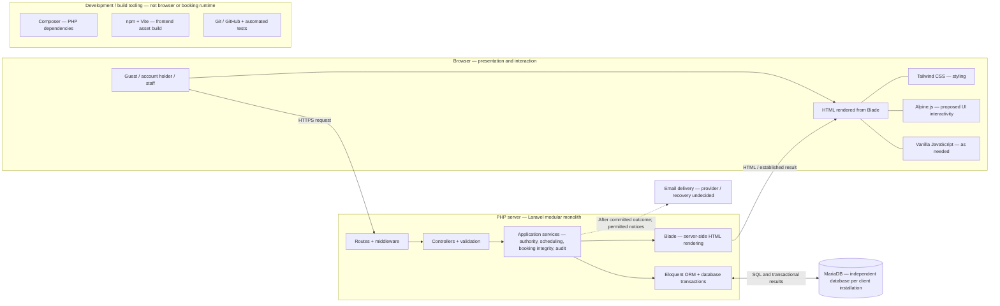
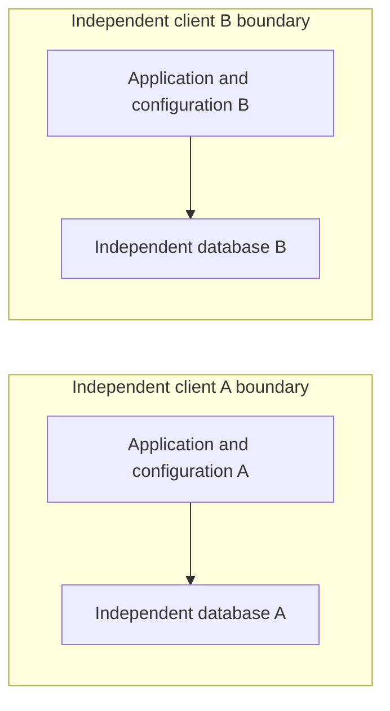
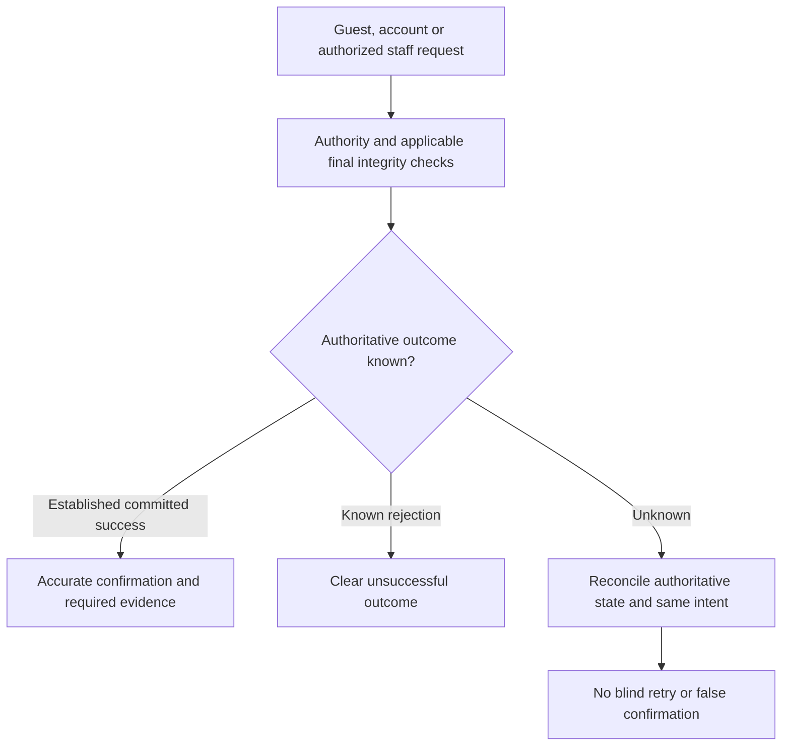

# iTakda Architecture Reference

> **Status: ACCEPTED PROVISIONAL ARCHITECTURE REFERENCE (Session 05).** The Product Owner accepted this overview with non-blocking deferrals. It summarizes approved boundaries and provisional responsibilities; it does not approve final architecture, a deployment design, implementation, or Checkpoint 11. D-085's existing provisional conceptual acceptance retains its separate recorded scope.

## 1. Purpose and authority

The approved baseline is [Engineering Governance](../ENGINEERING_GOVERNANCE.md), applicable [decisions](../decisions/DECISION_REGISTER.md), effective [requirements v0.9](../requirements/REQUIREMENTS-SPECIFICATION-v0.9.md) read with preserved v0.8 and unchanged [v0.7](../requirements/REQUIREMENTS_SPECIFICATION.md), and effective [traceability revision 1.3](../requirements/REQUIREMENTS-TRACEABILITY-v1.3.md) with preserved revisions 1.2 and 1.0. Exact-version approvals remain effective despite preparation-era proposed/draft labels; development-stage assumptions are not representative validation.

The accepted [PRD](../product/PRD.md), [TRD](../technical/TRD.md), [Design System](../design/DESIGN_SYSTEM.md), including its separately accepted provisional amendment, and [Application Flow](../design/APP_FLOW_UI_UX.md) support this overview without superseding that baseline. Routine work follows SDD under D-098; D-101 is a bounded fictional-prototype exception. Historical Gate 2 status remains unfinished and unaccepted under the [transition ledger](../SDD_TRANSITION.md).

## 2. Provisional architecture direction

D-085 provisionally accepts a **modular monolith per independent client installation** as the conceptual direction for further design. Responsibilities can be reasoned about together within one application, with clear authority and integrity boundaries; final packaging, module ownership and runtime interactions remain open. The direction is subject to integrity, security, privacy and operational review.

D-022 records Laravel, Blade, Tailwind CSS, MariaDB, Git/GitHub and automated testing as the preferred technology direction. A preferred stack is not a fully approved architecture, exact version selection, dependency authorization or installation instruction. See the [conceptual](../archive/legacy-sdlc/architecture-working-designs/CONCEPTUAL_ARCHITECTURE.md) and [component working designs](../archive/legacy-sdlc/architecture-working-designs/COMPONENT_MODULE_DESIGN.md).  
  
### Proposed technology stack and interaction flow (unapproved addition for review)

> **Status:** Visual design proposal for Product Owner review. This section illustrates the preferred PHP/Laravel/Blade/Tailwind/MariaDB direction. Alpine.js is a proposed enhancement, not an approved dependency. The diagram does not authorize implementation, select exact versions, or approve a physical database schema.

**Request flow:** A browser submits a booking intent over HTTPS. Laravel routes and validates it, checks the applicable authority and booking rules, and performs the final integrity checks with the client-local MariaDB database. A successful booking must have a committed, authoritative result before the user receives a success confirmation. Blade renders HTML, Tailwind styles the interface, and optional Alpine.js or focused JavaScript enhances browser interactions. Email is a separate post-commit concern; delivery failure must not repeat or undo the booking.

**Editable companion:** [`visual-proposal/06-technology-stack-flow.drawio`](visual-proposal/06-technology-stack-flow.drawio). The visual diagram is supplementary; existing approved architectural decisions remain authoritative.

## 3. Installation and database isolation

**Approved: each client has an independent application installation and independent database** (D-020/D-035/D-083; NFR-001/002/004). Separate schemas within a shared client database are not a substitute for this recorded boundary. Reusing one maintained product codebase does not merge live client state.

| Boundary | Conceptual implication |
|---|---|
| Application and configuration | Client-specific application state, business policy, technical configuration and credentials remain installation-scoped; no cross-client appointment or capacity store is introduced. |
| Database and personal data | Client appointments and personal data remain in that client's independent database and authorized installation context. |
| Access and operational artifacts | Access, diagnostics, generated artifacts, backups and restored copies require installation-scoped custody and privacy review; database separation alone does not prove these boundaries are safe. |
| Physical hosting | No separate physical server, VM, provider or network per client is prescribed here. Physical topology and isolation controls remain open under both hosting models. |
| Product independence | Unrelated installations remain separate; CEAP systems, databases and assets are outside this task and product boundary. |

**Illustrative logical isolation model:** boxes represent client boundaries, not servers, networks or an approved deployment topology.

## 4. Conceptual responsibilities and integrity

The following are reviewable responsibilities, not selected classes, packages, services, tables or APIs (D-085; [component working design](../archive/legacy-sdlc/architecture-working-designs/COMPONENT_MODULE_DESIGN.md)).

| Responsibility | Required boundary or provisional design direction |
|---|---|
| Presentation and identity | Present only permitted data/actions; state changes require approved authentication, server-side authorization and validation. Visibility of a control grants no authority (NFR-003/009). |
| Availability discovery | Present current candidate availability and actual installation-local alternatives; selection is informational and does not reserve or guarantee final capacity (FR-002/018; AC-013/018). |
| Final booking integrity | Recheck applicable authority, state, eligibility, capacity, resources and duplicate policy before accepting a booking-affecting operation; failed operations leave no partial or orphaned state (NFR-006; BR-010/013). |
| QR and attendance | QR/reference lookup does not establish identity, grant change authority or itself record attendance; authorized attendance decisions remain explicit and separate (D-045; FR-006/014). |
| Audit and continuity | Required attributable audit must agree with the business outcome; required evidence failure cannot be represented as established success. Controlled roster and reviewed reconciliation preserve newer authoritative state (FR-008/016/017; NFR-011; D-085/D-086). |

D-085's shared final integrity boundary covers public guest, optional-account, authorized staff-assisted and proxy booking, rescheduling, configured authorized exceptions, and applicable paper/walk-in reconciliation. Capacity-consuming or capacity-changing operations undergo applicable final checks; reviewing an existing paper observation is not automatically a new capacity reservation. Attendance-only reconciliation uses its applicable authority/state checks; a proposed walk-in or other booking-affecting change must also satisfy booking integrity. Paper is a controlled snapshot, not offline synchronization or permission to bypass validation.

Concurrent operations must preserve applicable capacity and duplicate rules; configured supervisor exceptions require authority, reason and audit and cannot bypass final validation. **D-070 / AC-005:** for 50 valid simultaneous booking requests competing for one remaining capacity unit, exactly one reservation succeeds; all others have safe outcomes, with no over-capacity, prohibited duplicate, partial or orphaned booking. Test design must establish valid requests and duplicate-policy preconditions. An unknown response is not evidence of a second success or known rejection. D-067/D-070's 20–100 appointments/day and busy 100-appointment-day profile are planning/verification inputs, not a capacity ceiling or concurrent-user count. No test result is claimed.

## 5. Booking outcomes and reconciliation

| Submitted-operation outcome | Architectural boundary |
|---|---|
| Established success | Establish the committed result before success confirmation; coordinate required audit with that outcome. |
| Known rejection | Present an established unsuccessful result accurately. A known rejected reschedule preserves the original appointment. |
| Unknown outcome | Do not assume success or rejection from a lost response. Reconcile authoritative state and preserve the same-intent relationship before retry; do not encourage blind duplicate submission or manufacture confirmation. |

These boundaries derive from D-090, BR-013 and AC-018/026 in [v0.8](../requirements/REQUIREMENTS-SPECIFICATION-v0.8.md); the precise reconciliation mechanism remains unresolved.

**Illustrative logical responsibility model:** arrows do not select component boundaries, routes, database operations, deployment or a retry protocol. Required audit is an outcome-consistency obligation, not a mandated runtime step.

## 6. Account, guest, hold and email boundaries

| Area | Approved boundary summary |
|---|---|
| Guest and optional account | Guest booking remains account-free. Registration is installation-configurable; disabling it blocks new signup, not existing verified-account access or scoped guest management. Account status grants no priority or unrelated appointment access (FR-019; AC-014/016/020). |
| Individual linking and privacy | Linking requires authenticated account control, independently verified original-booker proof and explicit confirmation for one appointment, with audit. Registration does not import prior guest appointments; account possession, matching details, reference, email token or QR alone is insufficient authority. Restricted attendee data remains protected (FR-020/021; AC-015/017/021). |
| Deactivation and profile | Deactivation ends account access without cancelling appointments; later management requires independently verified scoped guest access or authorized staff assistance. Booking/profile edits are separate (FR-019/022; AC-023/025). |
| Ordinary versus contested changes | Ordinary authorized eligible cancellation/rescheduling follows normal approved rules. When an approved dispute hold applies, only the affected contested link/change and its confirmation/email are paused for assigned review; the appointment and permitted staff attendance continue. The hold itself establishes neither success nor rejection (FR-007/021; AC-021/025; v0.8 §5). |

D-095's six email purposes are **account verification, password recovery, appointment-scoped guest access, established booking, established cancellation and established rescheduling**. Recipients and content are limited by [v0.8 §5](../requirements/REQUIREMENTS-SPECIFICATION-v0.8.md): email is not an unrestricted copy of the full confirmation and grants no unrelated appointment or attendee authority.

Delivery failure or delay does not reverse a committed change or trigger duplicate appointment commands. A missing browser response does not prove transaction failure: an independently established committed transaction may generate its approved notification. An authoritatively unknown, uncommitted, rejected or held transaction does not authorize a transaction email; notification follows authoritative committed state and approved email rules. Blind retries must not generate duplicate commands or notifications. The authorized viewer retains the required accessible on-screen/printable/screenshot-friendly confirmation independently of email delivery (FR-010/020; AC-002/024; accepted UX completeness amendment in [Application Flow](../design/APP_FLOW_UI_UX.md)). Proof, dispute procedures, mail provider and delivery mechanisms remain open.

## 7. Hosting, effective access and responsibility areas

D-083 requires accommodating **client-managed and provider-managed hosting**; D-084 approves one standardized supported-profile principle without selecting a profile. Technical custody can provide effective access through hosting credentials, database administration, backups/restored copies, diagnostic artifacts or support tooling. That capability does not authorize inspecting or using client records.

D-034/D-075, FR-012 and AC-007 preserve no default operator client-data access. Exceptional access requires explicit client authorization, least privilege, defined scope/duration, attribution, review and closure. Application permissions alone do not establish protection against host- or backup-level access. The [deployment working design](../archive/legacy-sdlc/architecture-working-designs/CONFIGURATION_DEPLOYMENT_DESIGN.md) and D-091 identify review areas, not final assignments.

| Responsibility area | Allocation to review in both hosting models |
|---|---|
| Hosting and credentials | **Open:** custody, scoped credentials, recovery and effective access; technical custody remains distinct from client business authority. |
| Backups and restored copies | **Open:** executor, storage custody, access, retention and restore authorization. |
| Restore verification | **Open:** evidence preparer/reviewer and approved privacy-safe real-backup verification approach. |
| Updates, monitoring and incidents | **Open:** deployment/maintenance executor, privacy-conscious signals, response and escalation allocation. |
| Technical support and privacy | **Open:** support duties, minimum diagnostic visibility, protection of artifacts and sensitive data. |
| Exceptional access | **Open:** procedure and role allocation within the binding client-authorization, scope, duration, audit and closure boundaries. |

No row grants access, chooses infrastructure, establishes a support contract or assigns final duties.

## 8. Backup and recovery evidence

A documented plan describes intended backup activity; producing a backup demonstrates an artifact exists. Neither proves recoverability. A tested restore procedure provides observed evidence within its test conditions; a synthetic rehearsal does not establish that a particular client's real backup is restorable.

[Governance §17](../ENGINEERING_GOVERNANCE.md#17-release-readiness-backups-recovery-and-operations) requires backups and a tested restore procedure before relying on installation data. D-091 separately requires a **separately approved privacy-safe real-backup verification approach before operational reliance**. Written procedures or backup files alone cannot establish readiness. No restore or real-backup verification is claimed here; custody, recovery completeness, restore authority, frequency, retention, recovery objectives and mechanisms remain open.

## 9. Source and status map

| Source | Recorded status and use |
|---|---|
| [Governance](../ENGINEERING_GOVERNANCE.md), [decisions](../decisions/DECISION_REGISTER.md), effective requirements/traceability linked in §1 | Authoritative within recorded approval scope; exact-version approvals and carried-forward records remain effective. |
| D-085 | Accepted **provisional conceptual direction**, including modular monolith and shared integrity boundary; not final architecture. |
| PRD, TRD, Design System and Application Flow linked in §1 | Accepted supporting references with their own limitations; not replacement requirements baselines. |
| [Conceptual](../archive/legacy-sdlc/architecture-working-designs/CONCEPTUAL_ARCHITECTURE.md), [component](../archive/legacy-sdlc/architecture-working-designs/COMPONENT_MODULE_DESIGN.md), [interface](../archive/legacy-sdlc/architecture-working-designs/INTERFACE_API_DESIGN.md), [deployment](../archive/legacy-sdlc/architecture-working-designs/CONFIGURATION_DEPLOYMENT_DESIGN.md) and other retained working designs | Historical/working sources with individually bounded dispositions; older account/email exclusions must be read through D-094/D-095. Present bytes are not asserted to match every historical accepted fingerprint. |
| [Checkpoint 11 design](../archive/legacy-sdlc/checkpoint-records/checkpoint-11/CHECKPOINT-11-DESIGN-SYSTEM-AND-ACCESSIBILITY.md), [screen inventory](../archive/legacy-sdlc/checkpoint-records/checkpoint-11/CHECKPOINT-11-SCREENS-AND-INTERACTIONS.md), [prototype](../../prototype/checkpoint-11/index.html), draft [security](../security/SECURITY.md) and [schema](BACKEND_SCHEMA.md) | CP11 was accepted under D-112 only within its documented design/prototype scope; Security and conceptual Schema remain provisional references. The fictional prototype is visual exploration, not evidence of real security, persistence or booking behavior. |
| Final architecture and deployment | Open; no final architecture, deployment profile or implementation approval follows from this overview. |

## 10. Open architectural decisions

**Subsequent Gate 2 dispositions (2026-11-15):** D-116 records Q-007's Gate 2 disposition as D-092's capability-based approach; D-117 records Q-008's minimum responsibility allocation; D-118 records D-109's measurable-target evaluation approach as satisfying the Q-016/Q-022 Gate 2 disposition milestone. These decisions do not select exact platform/dependency versions, detailed provider arrangements or runbooks, or numeric targets. The items below describe residual design, implementation, feasibility and operational details, not an absence of those Gate 2 dispositions.

- Final logical ownership, module boundaries, interfaces, schema/migrations, concurrency and audit-consistency mechanisms.
- Capacity/resource unit, duplicate policy, minimum safe configuration, accepted-booking configuration impact and paper reconciliation details.
- Guest proof/recovery, case-review role mapping/procedures, QR lifecycle, privacy/retention and exceptional-access controls.
- Reconciliation and same-intent handling, email delivery, notification presentation and technical contracts.
- Supported deployment profile, host/OS, exact technology/dependency versions, operational allocations, backup custody and recovery objectives.
- Error-response mapping, application/server fallback ownership and restoration-verification procedures and evidence.
- Numeric response-time/availability targets remain unapproved; D-118 records the evaluation approach, not target values. Review environments and future security, integrity, accessibility and recovery evidence remain open.

These items retain their source-recorded scope and required disposition under SDD and retained controls. Existing-booking preservation is an exploration direction, not universal grandfathering or automatic cancellation authority; see the accepted [TRD configuration discussion](../technical/TRD.md#configuration-and-appointment-impact). No locking technique, queue, service topology, credential architecture, storage provider or encryption mechanism is selected.

### Payment functionality — future product-scope review candidate

Integrated payment collection, deposits, refunds, payment-status tracking and payment-gateway integrations remain outside the approved MVP. This clarifies the existing payment exclusion in [requirements v0.8 §7](../requirements/REQUIREMENTS-SPECIFICATION-v0.8.md) and records payment functionality only as a candidate for a future Product Owner-authorized product-scope review.

This note approves no payment functionality, requirements or acceptance criteria, requires no payment architecture, tables, interfaces or integration, and makes no payment-readiness claim. Current booking-confirmation rules remain effective. Appointment-related customer payments are distinct from commercial licensing or sales of iTakda; this note establishes no subscription or licensing requirements for client businesses.

## 11. Session 05 review and acceptance

| Field | Record |
|---|---|
| Status and scope | **COMPLETE — ACCEPTED as provisional architecture reference.** The Product Owner explicitly accepted this Session 05 reference in the current conversation, with all P2 deferrals preserved. This is reference-document acceptance only. |
| Approver and dates | Product Owner. Approval date: not separately recorded. Recording date: 2026-11-11; this is not represented as the approval date. |
| Review outcome | **READY WITH NON-BLOCKING DEFERRALS.** ARCH-F01–ARCH-F07 resolved at the provisional-reference level; no P0/P1 blockers identified in the final documentation review. |
| Documentation decisions | ARCH-Q01 = B; ARCH-Q02 = B; ARCH-Q03 = A; ARCH-Q04 = A. The Product Owner also approved retaining P2 deferrals, the P3 email clarification, and the payment exclusion/future-review clarification above. |
| Reviewer and verification | Codex compared the artifact with the reviewed revision, checked the authorized status, scope and email changes against source records and the accepted UX clarification, and inspected the document diff, Markdown references and Git preservation as reported in the Session 05 recording chat. Mermaid rendering was not verified; no implementation, recovery, browser or accessibility tests are claimed. |
| Deferrals and limitations | Section 10 remains open for later authorized design, including proof, permission assignments, concurrency, reconciliation, hosting/operations, recovery objectives, restoration verification, error mapping and fallback ownership. Reference acceptance does not approve final architecture, deployment, implementation, payment integration, new product requirements, Gate 2 completion or Checkpoint 11. Review was documentation-based and assisted by Codex; no independent human technical review is claimed. |

This record follows [Engineering Governance §5](../ENGINEERING_GOVERNANCE.md#5-spec-driven-development-lifecycle) for the change, reviewer, verification, outcome and limitations, and §18 for explicit approval and an unsupplied approval date. No new Decision Register identifier or historical gate transition is implied.
