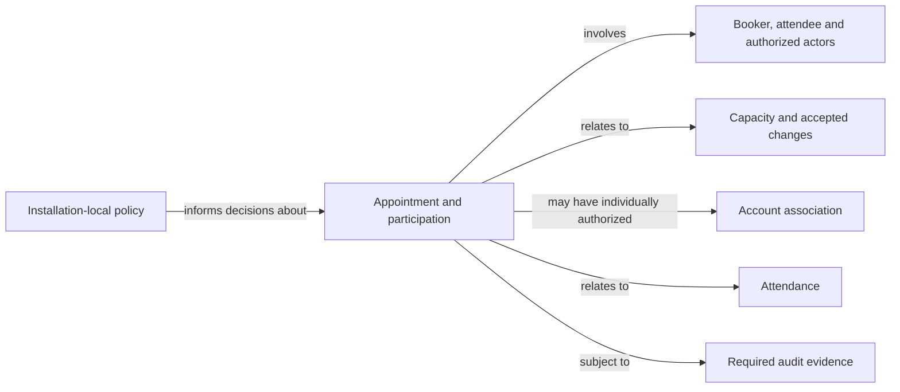

# iTakda Conceptual Backend Schema

> **Status: ACCEPTED PROVISIONAL CONCEPTUAL INFORMATION-MODEL REFERENCE (Session 06).** This is a conceptual information model, not an approved physical schema. The [logical data design](../archive/legacy-sdlc/architecture-working-designs/DATA_ARCHITECTURE_MODEL_DESIGN.md) has a fingerprinted provisional working-design disposition under D-088, not table, migration, database or API approval. Its original account-free statements predate the approved [v0.8 amendment](../requirements/REQUIREMENTS-SPECIFICATION-v0.8.md). Associations here express information needs, not mandated storage, cardinalities, keys or implementation.

## Purpose and authority

This reference summarizes conceptual information and selected approved boundaries; it does not replace [Engineering Governance](../ENGINEERING_GOVERNANCE.md), the [Decision Register](../decisions/DECISION_REGISTER.md), effective requirements ([v0.9](../requirements/REQUIREMENTS-SPECIFICATION-v0.9.md) read with preserved v0.8 and unchanged [v0.7](../requirements/REQUIREMENTS_SPECIFICATION.md)), or traceability ([revision 1.3](../requirements/REQUIREMENTS-TRACEABILITY-v1.3.md) with preserved revisions 1.2 and 1.0). Exact-version approvals remain effective despite preparation-era labels. The accepted provisional [Architecture](ARCHITECTURE.md), [PRD](../product/PRD.md), [TRD](../technical/TRD.md), [Design System](../design/DESIGN_SYSTEM.md) and [Application Flow](../design/APP_FLOW_UI_UX.md) are supporting references. The logical data design and draft [Security](../security/SECURITY.md) and [Testing](../engineering/TESTING.md) references have their own limited statuses; open policy and implementation choices remain open.

## Conceptual information groups

| Concept | Purpose and relationship to other concepts | Source |
|---|---|---|
| Installation configuration and service | Client-local effective service, scheduling, resource, capacity and policy context; one installation's business data is separate from every other installation. | NFR-001/002/004; FR-001 |
| Appointment and participation | Appointment has a unique reference and applicable service/time/status; record booker, attendee and acting staff distinctly where relevant. | FR-002/010/013/022 |
| Capacity and change | Track or derive applicable occupancy and accepted changes so final booking and atomic rescheduling respect effective policy. Physical representation is open. | NFR-006; BR-001/002/013 |
| Customer account and authorized appointment association | Optional verified customer account may book or be individually linked to an appointment only within approved authority and proof boundaries. No automatic personal-data match. | FR-019/021; BR-011/012 |
| Guest authority, staff identity and permission | Scoped proof, individually attributable staff and permitted roles/actions are distinct conceptual concerns; proof, provisioning and permission representation remain open. | NFR-003; FR-007/012/020 |
| QR/reference and attendance | Eligible presentation/lookup information is distinct from explicit staff attendance history; no QR-based proof of identity or automatic attendance. | FR-005/006/014; D-045 |
| Audit, exceptions and operational signals | Accountable action/outcome context, permitted exception evidence and minimized operational failures; access and retention require approved policy. | FR-008/015; NFR-009/011 |
| Roster and reconciliation | Controlled as-of roster, paper observations and reviewed per-item outcomes; paper is not authoritative live booking state. | FR-016/017; D-051/D-074 |
| Purpose-limited email | Verification/recovery/scoped-access and committed transaction communication needs, subject to the six-event recipient/content matrix; no delivery model is selected. | FR-010/020; D-095 |

## Illustrative conceptual relationships — not a physical schema

Associations describe information relationships, not access grants. An account association requires applicable authority; it is not automatic. The groups may be represented or derived differently in later authorized physical design. Arrows specify no table, key, cardinality, persistence, ownership or component.

## Approved integrity and outcome boundaries

Public guest and optional-account booking, authorized staff-assisted and proxy booking, rescheduling, configured authorized exceptions and applicable booking-affecting paper reconciliation share the applicable final authority, eligibility, current state, capacity, resource, duplicate-policy and integrity checks (D-085; NFR-006; BR-010/013). Attendance-only reconciliation uses its own applicable authority and state checks. Displayed availability is informational, not a reservation. Concurrent operations must preserve capacity and duplicate rules, including the recorded boundaries for authorized and audited exceptions.

Multi-record operations must be atomic, with rollback on failure; apply minimum necessary data and scoped access (Governance §11; NFR-009).

| Outcome | Boundary |
|---|---|
| Established success | Establish the authoritative committed result before confirmation; required audit evidence remains consistent with it. |
| Known rejection | Do not create partial or orphaned state; a known rejected reschedule preserves the original appointment. |
| Unknown | Neither success nor known rejection is established. A missing browser response does not prove failure; reconcile authoritative state and the same-intent relationship before unsafe retry or confirmation. |

Under D-070 / AC-005, future verification uses 50 valid simultaneous requests for one remaining capacity unit: exactly one succeeds and the others have safe outcomes without over-capacity, prohibited duplicates, partial or orphaned records. Establish valid-request and duplicate-policy preconditions. No result is claimed. See [Architecture §§4–5](ARCHITECTURE.md) and [v0.8 BR-013 and AC-018/026](../requirements/REQUIREMENTS-SPECIFICATION-v0.8.md).

## Account, authority and contested actions

| Area | Approved boundary |
|---|---|
| Guest and account | Guest booking remains account-free. Registration is installation-configurable; disabling new signup does not revoke existing verified-account sign-in and permitted access. Account status grants no unrelated appointment authority or booking priority (FR-019; BR-010/012; AC-020). |
| Individual association | Linking an existing guest appointment requires authenticated account control, independently verified original-booker proof, explicit confirmation for that appointment and attributable audit. Matching names, email, phone or other personal details, account possession, reference or QR alone do not grant unrelated access; registration does not automatically import guest appointments (FR-021; BR-011; AC-015/017/021). |
| Roles and deactivation | Booker, attendee, account holder, acting staff, administrator and system operator are distinct concepts where relevant, not necessarily separate stored entities. Deactivation ends account access without cancelling accepted appointments; later management follows independently verified scoped guest access or authorized staff assistance as applicable (FR-019/022; AC-025). |
| Routine and contested actions | Ordinary authorized eligible cancellation/rescheduling follows approved rules without automatic dispute review. An approved hold pauses only the affected contested link or change and its related confirmation/email pending assigned review. The appointment and permitted staff attendance remain intact; a hold itself is neither success nor rejection. Only assigned staff or a supervisor with approved case-review permission may place/release a hold or reverse a link after documented review. Assignment, proof, triggers and procedures remain open within those boundaries (FR-007/021; AC-021/025). |

QR/reference lookup does not establish identity, change authority or attendance; attendance is a separate authorized action (D-045; FR-006/014).

## Installation, paper, audit and email

**Each client has an independent application installation and an independent database** (D-020/D-035/D-083). One maintained product codebase may support separate installations. Separate schemas in a shared client database do not satisfy this boundary; no shared cross-client appointment store or SaaS tenant model is introduced. Physical hosting topology remains open. Backups, restored copies, diagnostics, exports, credentials and operational artifacts require installation-scoped custody, access and privacy controls. Technical custody alone does not authorize access to client records; exceptional operator access remains subject to the approved client authorization, scope, duration, attribution, review and closure boundaries (FR-012; AC-007; [Architecture §§3 and 7](ARCHITECTURE.md)).

| Concern | Boundary and source |
|---|---|
| Paper | An authorized roster is a controlled as-of snapshot; paper observations are not automatically authoritative live state or new bookings. Reconciliation requires applicable review and integrity checks, surfaces conflicts and must not silently overwrite newer authoritative state (FR-016/017; BR-009; AC-012). |
| Audit and operational signals | Required audit evidence records attributable actions and authoritative outcomes consistently. Operational signals help diagnose behavior; diagnostic records must not unnecessarily expose personal or sensitive information. Access and retention follow approved policy; no storage or logging mechanism is selected (FR-008; NFR-009/011). |
| Email | D-095 permits account verification, password recovery, appointment-scoped guest access, established booking, established cancellation and established rescheduling only within the approved recipient/content matrix. Delivery failure does not reverse a committed transaction or cause duplicate commands (FR-010/020; AC-024). |

A lost browser response does not suppress a legitimate notification for an independently established committed transaction. An authoritatively unknown, uncommitted, rejected or held transaction does not independently authorize a transaction email; notification follows the authoritative committed state and approved email rules. Blind retries must not generate duplicate commands or notifications. See the accepted [Application Flow](../design/APP_FLOW_UI_UX.md) UX completeness amendment and [Architecture §6](ARCHITECTURE.md).

## Unresolved technical and policy design

Physical tables, types, keys, indexes, relationships and cardinalities; capacity/resource units and duplicate-policy representation; concurrency and audit-consistency mechanisms; same-intent reconciliation and retry; guest proof and association representation; permission assignments, hold procedures, QR lifecycle and attendance correction; privacy, retention, deletion and operational custody; email delivery/persistence; and backup/restore mechanisms remain open for required review before affected work. No group implies separate persistence. A backup artifact alone does not establish recoverability; see [Architecture §8](ARCHITECTURE.md) for the tested-restore and D-091 real-backup verification boundaries.

Payment functionality remains outside the approved MVP and is only a future-scope review candidate; see [Architecture §10](ARCHITECTURE.md). No payment or commercial subscription data requirement is introduced.

## Session 06 review and acceptance

| Field | Record |
|---|---|
| Status and scope | **COMPLETE — ACCEPTED as provisional conceptual information-model reference.** Session 06 document review is complete within this scope; Gate 2 and physical-schema work are not complete by this acceptance. |
| Approver and dates | Product Owner, by explicit approval in the current conversation. Approval date: not separately recorded. Recording date: 2026-11-12; this is not represented as the approval date. |
| Review outcome | **READY FOR PROVISIONAL REFERENCE ACCEPTANCE — APPROVED BY PRODUCT OWNER.** No material contradiction or acceptance blocker was identified during the documentation review; this is not a claim of exhaustive independent audit. |
| Findings and documentation decisions | DATA-F01–DATA-F05 resolved at the conceptual documentation-reference level; underlying implementation and verification obligations remain. DATA-Q01 = B (compact boundary/outcome tables); DATA-Q02 = B (one illustrative conceptual relationship diagram). |
| Reviewer and verification | The 2026-11-12 revision was Codex-assisted and reviewed by the Product Owner. For acceptance recording, Codex compared the complete document with the reviewed 82-line draft, checked the authorized status/record changes and source-status boundaries, verified local links and Markdown structure, and compared Git state and unrelated modified/untracked-file hashes, as reported in the recording chat. No Mermaid rendering, independent technical audit, physical-schema validation, database/application tests or accessibility testing is claimed. |
| Deferrals | The unresolved-design section remains effective: physical tables/types/keys/indexes/cardinalities; capacity/resource units and duplicate-policy representation; concurrency, atomicity and audit-consistency mechanisms; same-intent reconciliation/retry; guest proof, account association/recovery; permissions, hold procedures, QR lifecycle and attendance correction; privacy/retention/deletion/custody; email delivery/persistence; backup, restore and recovery verification. Required atomic outcomes remain binding without selection of a Laravel/MariaDB transaction implementation. |
| Exclusions | No physical schema or migration, new product requirement, payment functionality, shared SaaS tenancy, implementation, deployment, Gate 2 completion, Checkpoint 11 acceptance or Session 07 work is approved. D-088 retains its separately recorded limited disposition. |

This record follows Engineering Governance §§5 and 18; approved requirements, decisions and governance remain authoritative. No other historical approval or document status is changed.
