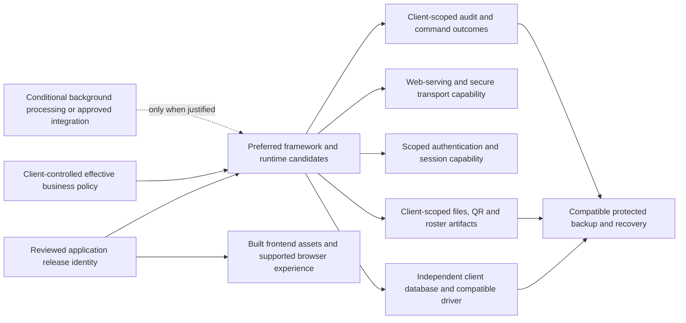
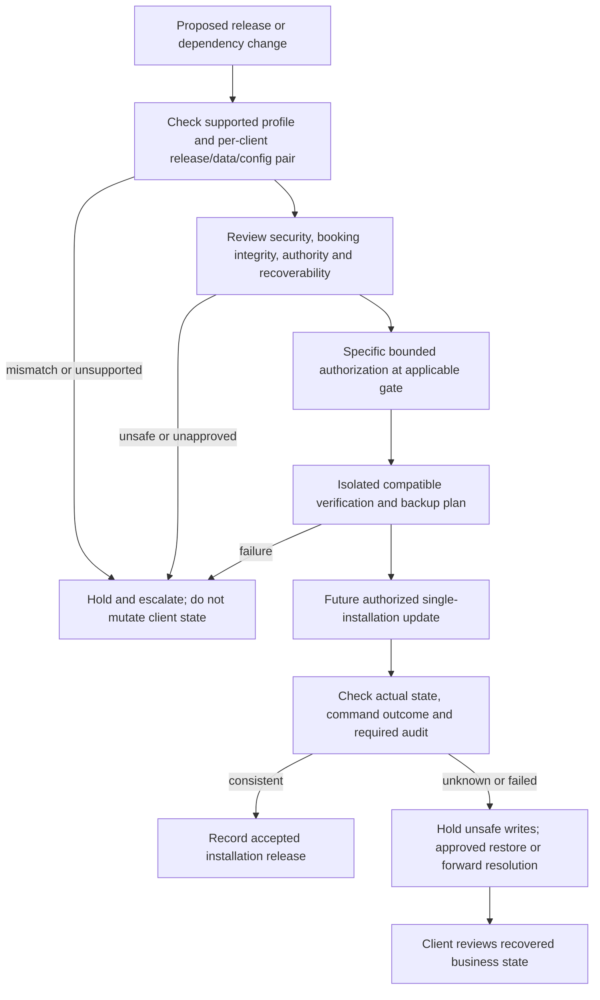

# Compatibility & Dependency Design — Appointment Management System

| Field | Value |
|---|---|
| Version | 0.1 |
| Status | **DRAFT — AWAITING PRODUCT OWNER REVIEW** |
| Gate | **2 — Architecture & Design (IN PROGRESS)** |
| Checkpoint | **10 — Compatibility & Dependency Design** |
| Approval | **NOT GRANTED** |
| Owner | Product Owner |
| Scope | Provisional compatibility boundaries, supported-profile principles, dependency governance and upgrade verification |

> Design for review only. No package, exact version, vendor, operating system, runtime, installation command, deployment service, migration, or security mechanism is selected. Gates 3–7 remain BLOCKED; nothing here authorizes implementation or a gate transition.

## 1. Purpose and scope

This design asks which product components must work together, which combinations the maintained product should later support, and how changes can be checked across **independent client installations**. *Compatibility* means a verified combination of application release, dependencies, runtime, data representation, configuration and client experience works without weakening approved integrity or access boundaries. A dependency is *direct* when selected for the product and *transitive* when introduced by another dependency. These definitions do not imply any package is installed. This document proposes a Gate 2 approach to Q-007; it does **not** itself close Q-007 or choose a final stack, supported version list, external service or operational commitment.

The objective is one **standardized supported deployment profile in principle** across client-managed and provider-managed hosting (D-084), with client-specific business policy rather than core-code forks (D-062). The profile identifies common compatibility obligations and evidence, not identical machines, vendors or shared tenancy. No production CEAP material was consulted; no connection to or effect on production CEAP is permitted (D-019/D-025/D-035).

## 2. Authoritative inputs and status

- `docs/PROJECT_CHARTER.md` §§1–4/9–12 establishes independent product goals and the preferred technology direction; its current revision 1.4 wording remains a draft, while P-002/P-003 and separately recorded decisions retain their own scopes.
- `docs/ENGINEERING_GOVERNANCE.md` §§2, 5–15/17–19 governs scope, dependency approval, data integrity, security, isolated testing, reviewed migrations, recovery and explicit gate authorization. `docs/GATE_REGISTER.md` §§2/5 records Gate 0/1 COMPLETE (APPROVED), Gate 2 IN PROGRESS for documentation only, Gates 3–7 BLOCKED and the Q-007/Q-008 Gate 2 dependencies. `docs/decisions/DECISION_REGISTER.md` records D-020/D-022/D-023/D-031/D-034–D-036/D-062/D-070/D-079/D-081–D-091 with bounded statuses.
- `docs/requirements/REQUIREMENTS_SPECIFICATION.md` **v0.7** and `docs/requirements/REQUIREMENTS_TRACEABILITY.md` **revision 1.0** are D-081 development-stage *assumption* baseline, not representative validation; the current traceability revision 1.1 is administrative. `docs/requirements/REQUIREMENTS_GOVERNANCE.md` §§5–8 requires versioned review for material baseline changes. FR-009 (eligibility/masterlist) and FR-011 (advanced reporting) remain DEFERRED.
- `docs/architecture/CONCEPTUAL_ARCHITECTURE.md` (Checkpoint 4); `COMPONENT_MODULE_DESIGN.md` (Checkpoint 5/D-086); `DETAILED_SYSTEM_WORKFLOW_DESIGN.md` (Checkpoint 6/D-087); `DATA_ARCHITECTURE_MODEL_DESIGN.md` (Checkpoint 7/D-088); `INTERFACE_API_DESIGN.md` (Checkpoint 8/D-090); and `CONFIGURATION_DEPLOYMENT_DESIGN.md` (Checkpoint 9/D-091) are inputs **within their provisional working-design scope**, not approvals of implementation or specific technology. WF/IF identifiers in those drafts are local design references, not adopted endpoints or packages.

## 3. Approved constraints, preferred candidates and assumptions

| Classification | What the records establish | What they do not establish |
|---|---|---|
| **Approved product constraints** | D-020/D-035 require separate installation, database/schema and configuration per client, never shared multi-tenant SaaS or CEAP data. D-034/D-075 deny default operator client-record access; D-083 requires both hosting-ownership models; D-084 approves one standardized supported-profile *principle*. D-029/Engineering Governance require integrity and security regardless of stack. | No physical topology, host administrator access grant, paid provider, central client-data management service or actual supported platform has been approved. |
| **Preferred technology direction (D-022)** | Laravel, Blade, Tailwind CSS, MariaDB, Git/GitHub and automated testing are planning preferences. These suggest categories whose compatibility should be evaluated together. | No exact versions, driver, web server, OS, framework API, frontend build tool or supporting package is selected or installed by this draft. |
| **Provisional architecture direction** | D-085(6) carries a modular monolith **per installation** for continued design; D-086–D-091 accept fingerprinted component/workflow/data/interface/configuration drafts only as working designs. | No final module topology, runtime call pattern, physical schema, event bus, queue or final architecture is approved. |
| **Conditional technology** | Docker can be considered only on documented benefit/complexity justification and Product Owner approval under D-023/D-036; D-032 remains provisional/P-006 proposed. Additional services/frameworks need D-036 justification and approval. | Docker, Kubernetes, container images or any cloud/CI/backup vendor are not part of the supported profile by default. |
| **Open and later decisions** | Q-007 requires Gate 2 provisional compatibility/dependency-management approach; Q-008 hosting responsibility/profile allocation is partly disposed but open. D-031 reserves exact runtime/dependency versions for Gate 4 and later release confirmation. | The 20–100 appointments/day planning profile (D-067) is not a simultaneous-user cap; Q-016/Q-022 numeric service targets remain open under D-079. D-091's backup/recovery/performance numbers are **evaluation candidates only**, not targets. |

**Assumption under review:** A-4/A-5/A-7 (stack suitability, test feasibility and anticipated internet-facing use) require Gate 2 consideration, not presumption of proof. If the preferred stack cannot satisfy the approved independent-installation, D-070 contention or security/hosting constraints, return to the Product Owner for a documented decision; do not silently swap technology.

## 4. Compatibility principles

1. **One reviewed release, many separately bounded installations:** an application release identity may be reused across clients, while data, credentials, policy, audit, files, backups and support access remain per-installation (D-020/D-035/D-084). A version mismatch must never redirect an installation to another client's resources.
2. **Support by verified combination, not loose labels:** the supported profile eventually names an approved combination/compatibility range across runtime, framework, database/driver, web-serving environment, frontend assets and relevant security updates. Q-007 and D-031 determine when exact choices become effective. Do not claim that any combination has been tested merely because components claim individual support.
3. **Correctness and privacy outrank version convenience:** upgrades may not bypass final capacity/duplicate integrity, authorizations, required audit or roster provenance (D-029/D-070/NFR-003/006). QR remains locator-only (D-045); guest changes stay account-free but require approved scoped proof (D-090).
4. **Reproducible, reviewable changes:** proposed dependency resolution, release identity and configuration compatibility evidence must allow one installation's behavior to be understood and reproduced without sharing secrets or production personal data. An unresolved command outcome remains unknown through upgrades/restores; never turn it into failure or replay blindly (D-090/D-091).
5. **Smallest justified footprint:** conditional queues, scheduled jobs, integrations and containerization do not enter MVP merely to support a hypothetical future feature. If a capability needs a new dependency/service, record purpose, alternatives, security/privacy/licensing/operational impact and explicit approval (D-036/D-054).

## 5. Conceptual compatibility architecture

The compatibility unit is **one independently configured client installation running a reviewed release**. A compatibility matrix (see §8) describes which adjacent capabilities must cooperate, who owns the check and what evidence would be required after authorization. An arrow below means *requires compatible behavior*, not a network call or prescribed stack.

**Mandatory relationships:** application/runtime and data representation; correct database target; protected access; frontend/browser behavior; files/audit/command outcomes where needed for approved MVP; and recoverability of the *same installation's* state. **Conditional:** background workers/scheduled jobs only if an approved operation actually requires them; external messaging/payment/eligibility services are deferred and have no MVP compatibility contract (D-042/D-056/D-057/FR-009). The diagram neither selects a technology nor authorizes a backup/restore procedure. Reusing one release across clients does not make their data or policies shared.

| Relationship | Required or conditional compatibility obligation | What remains to be selected |
|---|---|---|
| Application runtime ↔ preferred server framework | **Required:** supported language/runtime and framework behaviors for the chosen maintained release, including security maintenance and repeatable dependency resolution. | Runtime/framework versions, extensions, process model and actual choice at Gate 4 under D-031; Gate 2 provisional constraints Q-007. |
| Framework ↔ database engine/driver ↔ data revision | **Required:** correct client database/schema, compatible driver behavior and atomic final booking/change/audit outcomes; support for approved resource/duration/duplicate rules without assumed transaction technique. | MariaDB/driver versions, physical schema, isolation/locking mechanism and migration approvals; Gate 3 review before Gate 4. |
| Application ↔ web-serving/hosting/secure transport | **Required:** route public and internal actions within one client installation and protect session/personal data; verify host resources and access scopes. | Web server/OS/topology/TLS and custodians (Q-008/Gate 3); no platform selected. |
| Frontend source/build ↔ delivered assets ↔ browser | **Required:** release-consistent assets, accessible confirmation/QR/roster presentation; applicable desktop/mobile workflows target WCAG 2.2 AA on current/previous stable Chrome, Edge, Firefox and Safari (NFR-007/D-069). | Build tooling, version compatibility and exact environment matrix; no conformance asserted. Blade/Tailwind are preferred, not final. |
| Authentication/session ↔ scoped guest/staff authority | **Required:** supported state-changing authentication and server-side validation without mandatory public accounts; proof/role boundaries, QR possession never authority. | Guest claimant/proof/expiry, staff provisioning, session store and crypto mechanism (Q-009/Q-018; Gate 3). No SMS/OTP provider. |
| Application ↔ files/QR/roster/diagnostic storage | **Required:** per-client access, as-of roster provenance, minimal QR lookup and privacy-conscious audit/monitoring. | Storage format, lifecycle, retention, mechanism for generated artifacts; D-074/Q-015/Gate 3/6. |
| Application ↔ queue/scheduler | **Conditional:** only if approved core workflows need asynchronous work, with no loss of required consistent audit/booking outcomes. | Whether required at all, technology and operational owner; deferred notification/penalty jobs are not a reason. |
| Application ↔ external services | **Conditional future change only:** any later approved integration needs security, privacy, availability, compatibility and exit review. | No MVP external notifications, payment/deposit enforcement, masterlist or broad integration (D-042/D-056–D-058/D-089). |
| Application/data/audit/config ↔ backup/restore | **Required:** release and data/config/command/audit compatibility and installation identity; synthetic rehearsal is not proof a real client's backup restores (D-091). | Privacy-safe real-backup verification, custody, cadence, recovery objectives and restore authority (Q-008/Q-015); no recovery guarantee. |

## 6. One supported deployment profile across hosting models

**Proposed Gate 2 profile contract:** the supported combination must provide one client's independent application and data boundary; verified release-to-runtime/framework/database/driver compatibility; separated technical and business configuration and secrets; secure public/staff access; client-scoped file/audit/diagnostic and backup boundaries; safe updates and restore capability; maintenance and security-advisory response; supported-browser verification. A common **contract of capabilities** is the single D-084 profile, not a claim of identical hardware, provider or installation settings (Checkpoint 9 §3).

| Profile aspect | Readiness and drift check (proposal) | Ownership / open status |
|---|---|---|
| Required capabilities | Compare intended release, environment/runtime/framework/database-driver support, data/config revision, secret presence, installation identity and effective business-policy readiness before accepting booking. Hold on mismatch rather than silently switching databases or falling back to another client's secrets. | Q-007 supported compatibility evidence; Q-008 client/provider execution and access allocation; Q-019/Q-021 policy values. |
| Conditional capabilities | Enumerate an approved need before enabling worker/scheduler, extra storage or external integration; prove its failure does not produce falsely successful booking/audit. | D-036 and Product Owner approval; no queue/service adopted here. |
| Unsupported classes, independent of vendor | Shared tenant database or cross-client processing; pooled client credentials/records; production CEAP connection; unapproved operator-wide client-admin access; unreviewed version drift outside the supported profile; an unsafe app/data revision pairing; dependencies with no approved security/maintenance plan. | These conflict with D-020/D-025/D-034/D-035 or the integrity/security obligations. A named OS/version is **not** declared unsupported before selection. |
| Environment validation | Identify installation and environment, supported combination, authorized secret scope, clean test data and release artifact identity. Tests use their own isolated database and no production-copied personal data (Governance §14). | Gate 3 security and later Gate 4/5/6 evidence; no environment created here. |
| Drift detection and update readiness | Per installation compare actual release/dependency/data revision and approved business config to its reviewed intended record; distinguish intentional client policy differences from unsupported technical drift. Detect expired support or missing security updates; hold an unsafe change. | Mechanism, reviewer and update windows under Q-007/Q-008; no shared central client-data plane. |

A client-managed installation and a provider-managed installation can satisfy the same required checks through **different allocated custodians**, but neither hosting party acquires business-data authority just by running the infrastructure (D-075/D-091). The actual supported profile, host capabilities and exceptions need Product Owner review; current tables are proposal-only, not a support SLA or a deployment readiness result.

## 7. Dependency governance (proposed Q-007 approach)

**Candidate policy for Product Owner disposition, not an enacted dependency policy:**

| Lifecycle step | Reviewable obligation / failure response |
|---|---|
| Introduce | State the active FR/NFR/BR or decision need; compare using existing project/framework/platform features and a no-new-dependency option. Record why a direct package or external service is necessary, effect on security/privacy, maintenance, compatibility, licensing, backup/operations and both hosting models. D-036 requires documented purpose, justification and appropriate approval **before adoption**; optional Docker has separate D-023 constraints. |
| Resolve direct and transitive graph | Maintain a reviewed list of direct components and their owners plus enough provenance to identify transitive components, constraints, licensing and security advisories. A transitive dependency can be vulnerable even if no one selected it directly. Resolve to a reproducible set after technology approval; a lockfile or equivalent resolution record is a **proposed** reproducibility control, not a file created here or a commitment to a package manager. |
| Assign ownership | For each direct component record why it exists, interface/compatibility boundary, update owner, support/EOL source and security-contact responsibility. For transitives, track the direct introducer and which update/replacement resolves a finding; never assume they are exempt from review. Client/provider incident execution still needs Q-008 allocation. |
| Review security, license and health | Monitor published security advisories, maintenance activity and end-of-support for runtime, framework, database/driver, frontend tooling and transitive packages. Review license suitability with qualified advice where needed; no legal-compliance conclusion is claimed. Unsupported components trigger an assessed upgrade/replacement plan, not silent risk acceptance. |
| Classify changes | Proposed classes: routine compatible maintenance, behavior-changing/minor upgrade, major compatibility change, urgent security fix and removal. The class determines impact assessment, approval, isolated tests, rollback feasibility and rollout evidence; version-label conventions alone cannot prove behavior compatibility. |
| Update or remove | Review release/data/config/browser compatibility and security impact, run the approved isolated regression set and roll out per independent installation only after bounded authorization. Remove a dependency when its purpose ends, confirming no transitive requirement, user-visible behavior or data-migration dependency is lost. Preserve historical release identity for restores. |
| Urgent security response | Triage severity and client exposure under D-038/D-071; contain safely, obtain bounded Product Owner authorization and required security/change review, apply only approved update scope, test applicable integrity/authorization, plan recovery, then document each installation outcome. Urgency never self-authorizes a dependency install, migration, production access or skipped gate. |

No inventory of actual packages or lockfiles has been audited by this document; it defines *future records*. If a previously installed transitive package cannot be identified, readiness is unresolved until the future dependency graph is reviewed. Technology selection and final package versions remain later decisions (D-031/Q-007); merely citing a preferred framework does not approve all of its ecosystem packages.

## 8. Compatibility matrix structure

**Proposed matrix per reviewed release**, held with later authorized build/release evidence rather than created here:

| Matrix dimension | Record to resolve later | Evidence / review owner |
|---|---|---|
| Release identity and compatibility window | Reviewed product release and last supported predecessors; applicable installation configuration/data revision and support/end dates. No fixed support period selected. | Product Owner approves support/deprecation policy; engineering verifies compatibility. |
| Server runtime/framework/direct+transitive graph | Supported ranges and actual resolved package graph, security status, licensing and reproducibility evidence. | Q-007/ Gate 4 version decision; security/license review before release. |
| Database engine/driver/data revision | Compatible app↔driver↔data pair and any staged transition/rollback limits; isolate each client's schema/data. | Gate 3 integrity review, Gate 4 reviewed migration authorization (if needed), Gate 5 tests. |
| Web serving/OS/transport/auth | Host capabilities, protected transport, session/guest proof and internal role controls, without provider-specific shortcuts. | Q-008 allocation and Gate 3 assessment; no exact OS or server chosen. |
| Assets/browser/QR/roster | Build-output consistency with release, applicable supported browser families, QR lookup and print accessibility. | D-069/NFR-007/AC-006 later browser/accessibility evidence; QR-L lifecycle rules remain open. |
| Optional background/integrations | Explicitly approved dependency/service, host capability, failure semantics and exit path where such feature exists. | D-036 Product Owner approval; none selected for deferred MVP features. |
| Backup/restore and operational custody | Install-specific backup/data/config/audit format, compatible recovery release, privacy-safe real-backup verification and client acceptance procedure. | Q-008/D-091 plus Gate 3/6 reviews; a synthetic rehearsal does not verify a particular real backup. |

**Interpretation:** one matrix can describe the *same* supported capability profile for both hosting models while linking each installation to its verified release/data/config combination. One client may use a different approved service policy without thereby becoming an unsupported product fork. An unavailable or EOL component is an assessed risk and a required disposition, not proof that every live installation has already migrated. The matrix is a review template; no actual pairings or test results are recorded in this draft.

## 9. Upgrade, deprecation and rollback strategy

**Proposed sequence:** identify each installation's current release, approved business configuration, data revision, resolved dependencies and hosting custodian → check candidate release against the supported matrix, security advisories, Q-008 access and affected existing bookings → rehearse with isolated synthetic/nonproduction data → obtain specific bounded authorization, backup and privacy-safe recovery plan → update *one independent installation* under allocated authority → verify actual booking, guest, QR, attendance, audit, roster and operational behavior → accept or use an explicitly authorized recovery path, recording that installation's result (Checkpoint 9 §§8–10; Workflow WF-O02). No mass rollout or vendor tool is mandated.

Compatibility of application and database revisions may require a staged transition where both sides can work with the same data or a strictly controlled stop-the-world update; **neither is selected**. A destructive or irreversible database transformation cannot be undone by reinstalling old application files. Never invent a migration to make a package upgrade convenient: all database changes require independent design review and Gate 4 task authorization before execution (Engineering Governance §11). A configuration change that affects accepted bookings follows IF-A01/IF-I03; changing a dependency must not silently change duration/capacity/duplicate or client authority. An old confirmation/QR and unresolved in-flight command must have a safe current interpretation, or the update is held until reviewed. Rollback feasibility and recovery completeness are separate from a release's technical startup.

**Support lifecycle proposal:** record when a chosen component is supported, its security-update availability, an advance review point for end-of-support and a planned deprecation/communication path to every affected independently operated installation. Do not promise a fixed compatibility period or force a simultaneous upgrade. Restrict uncontrolled drift by reconciling installed versus approved release and resolved dependency record; version lag is assessed for severity, risk, operational ability and Product Owner approval, not automatically classified as safe. Client-managed custodians may execute upgrades differently from provider-managed custodians, but both must meet the same profile and evidence. No zero downtime, automated rollback or 24-hour incident remedy is promised.

### Conceptual upgrade eligibility and recovery

The drawing is conceptual and not an executable deployment workflow. In particular, a synthetic restore rehearsal is **not** evidence that any specific client's real backup is restorable (D-091). No package installation or production action occurs in this checkpoint.

## 10. Security and maintenance considerations

Compatibility choices are security decisions when an old runtime, framework, driver, build pipeline or transitive package is unsupported or vulnerable. Track exposure **per installation** without gathering client records into a central plane; privacy-minimized diagnostics and incident attribution remain required (D-073/NFR-011). A security update must preserve server-side guest and internal authorization, QR locator-only behavior, explicit attendance, supervisor-only exceptions and no default operator client-data access (D-034/D-045/D-075/D-090). Technical access to host, raw database, logs or backups is effective access to assess under **both** hosting models, not business authorization (D-083/D-091). Secrets must never be put into lockfiles, package manifests, docs or client-side assets; rotation and custody require Q-008/Gate 3 review.

Review advisory severity and whether mitigation requires replacement, safe configuration, temporary withdrawal of an affected feature or an explicitly approved update. Do not use generic risk acceptance to bypass mandatory security/legal/data-protection controls (D-038). Authentication/session design, retention/deletion, tamper resistance, QR proof/expiry, operator emergency access and backup-key handling need Gate 3/qualified review; no cryptography, plugin, secret manager or scanning vendor is chosen. License review is a review obligation, not a legal opinion. Emergency response does not change the D-031/D-036 approval boundaries.

## 11. Client-managed and provider-managed hosting implications

| Concern | Client-managed hosting: question to allocate | Provider-managed hosting: question to allocate | Same approved constraint |
|---|---|---|---|
| Runtime/database and dependency installation | Which authorized client custodian checks/releases compatible components; how can provider diagnose without client records? | Which provider technical custodian checks/releases them without default client-admin privilege? | One supported profile and separate per-client application/data/credentials; Q-007/Q-008 open. |
| Upgrade/security advisory response | Who receives actionable advisory, schedules permitted update and records results? | Which provider responder coordinates approval and individual client rollout? | D-036 justification and specific task authorization; no automatic client-wide deployment. |
| Backup/restore compatibility | Who holds protected copies, verifies real-backup restorability under an approved privacy-safe method, obtains client restore authorization? | Which provider custodian has possible backup/host visibility, and how are client authorization and access review enforced? | D-034/D-075/D-091; a synthetic test alone is insufficient and no approved RPO/RTO exists. |
| Browser/QR/support | Who verifies public/staff experience and handles incident escalation? | How does provider triage diagnostics while minimizing client data? | D-045/D-069, required audit, no operator-wide record access. |

**Q-008 remains OPEN.** Client organizations decide services, staff accounts, records and ordinary business configuration in either hosting model (D-075). Hosting procurement, credentials, backups, restore approvals, incidents and support must be allocated/reviewed before final Gate 2 approval **where feasibility depends on them** (D-091); later operational responsibilities and contracts belong to approved release/operations planning. Neither physical hosting ownership nor a common code release implies a shared tenant, a default operator role or automatic permission to use client records. An installation with unallocated custodian/backup duties cannot be declared release-ready merely because its packages resolve.

## 12. Verification strategy (future obligations, no executed tests)

All tests will require later authorization, an isolated test environment and its own database, **never production or production-copied personal data** (Engineering Governance §14). D-072 distinguishes evidence preparer/reviewer/approver and independent reviewer where needed. Each supported matrix combination and change class needs evidence appropriate to its risk; these are *planned test subjects*, not performed checks.

| Verification subject | Observable future result / sources |
|---|---|
| Supported runtime/framework/database/driver/web/asset combination | Confirm clean install/upgrade can start with matching client data/config, no cross-installation access, compatible dependency resolution and independently isolated credentials (NFR-001/002/004; S-1/S-2). |
| Dependency graph and security maintenance | Reproducible approved direct/transitive resolution, advisory and licensing review; urgent update does not silently adopt new infrastructure or change scope (D-031/D-036/D-038). |
| Booking under normal, peak and contention | Use D-067/D-070 profiles; **50 simultaneous valid requests for one remaining capacity unit → exactly one successful booking**, other authoritative outcomes safe, no prohibited duplicate/overcapacity/orphan/partial state. A lost response is *unknown*, not proof of a failed booking; safe outcome reconciliation precedes retry (FR-002; NFR-006/008; AC-005; D-090). No implementation result claimed. |
| Account-free guest/proxy/staff and authorization | Guest booking without public account; scoped change proof independent of QR/reference, separate staff/supervisor/admin/operator permissions, denied access leaves no mutation (FR-003/004/007/012/013/015; NFR-003/005; AC-007/010/011). |
| QR, attendance and paper | QR lookup stays locator-only and auditable; staff explicitly records valid attendance, invalid/cancelled presentations fail safely; roster preserves minimum fields/provenance and paper reconciliation cannot silently overwrite newer state (FR-005/006/014/016/017; BR-003/008/009; AC-002–004/012). |
| Configuration and data migration/rollback | Future approved changes do not invalidate accepted bookings; stale effective policy, incompatible app/data or irreversible change is rejected/held or resolved only through approved procedure (FR-001/007/008; NFR-006; WF-A01). No migration is designed or run here. |
| Backup and recovery | Synthetic/nonpersonal rehearsal proves procedure only; separately approved privacy-safe verification evaluates each real backup; recovery compares appointment/command/audit state with actual later actions and requires client business acceptance (D-091; Governance §17). No frequency/RPO/RTO chosen. |
| Browser and accessibility | Applicable D-068 public/admin core workflows target WCAG 2.2 AA across D-069 current/previous stable Chrome/Edge/Firefox/Safari and representative desktop/mobile; no conformance evidence claimed (NFR-007/010; AC-006/008; S-6/S-7). |

## 13. Failure scenarios and recovery considerations

| Scenario | Detection and safe disposition | Unresolved owner/decision |
|---|---|---|
| Framework/runtime or database-driver mismatch | Detect in pre-upgrade/readiness matrix before service; hold unsafe bookings/updates rather than relying on accidental behavior; preserve old accepted state. | Q-007 compatibility ranges, final Gate 4 versions and per-host execution Q-008. |
| Transitive vulnerability or end-of-support | Identify introducing direct dependency and affected releases/installations; assess severity and authorized replacement/mitigation, retain evidence without disclosing client data. | Security review/upgrade approval and affected-client operator under Q-008. |
| Frontend asset/browser incompatibility | Detect missing release-consistent assets or unsupported core behavior in approved browser families; do not claim accessible confirmation/QR just because a build succeeds. | Build tool, support policy, verification owner and D-069 environment evidence. |
| Unavailable optional worker/integration | Do not report required booking/audit as accepted if a conditional component is essential and unavailable; never silently replace approved capability with deferred service. | Whether such component is needed or approved (D-036); failure semantics Gate 3. |
| Application/data/config revision drift during update | Verify correct installation and versions; hold writes, evaluate existing-booking impact and approved rollback/forward path; do not silently drop commitments. | Q-007/Q-008 and physical migration review/authorization. |
| Lost response or interrupted update | Do not classify unknown command as rejected or blindly repeat; establish prior authoritative outcome and same intent before retry; audit agrees with actual state. | D-090 retry mechanism remains open; recovery custody Q-008. |
| Stale or unreadable real backup | Synthetic rehearsal is insufficient; verify real backup with approved privacy-safe method, hold unsafe writes after stale restore and reconcile later accepted activity with client authorization. | Q-008/D-091 real-backup method, recovery objectives and approval. |
| Wrong client version/credentials/database | Detect installation identity and scope mismatch before reads/writes; fail closed, preserve evidence without connecting to another installation or CEAP. | Q-008 custody/attestation design and Gate 3 review. |

Reproducibility does not guarantee recoverability: release/dependency records are needed to interpret a backup, but a successful rebuild cannot recreate later accepted appointments or prove the real backup is usable. Restoration into test uses only synthetic/nonpersonal data, while production backup verification requires a separately approved privacy-safe method (D-091; Governance §14/17). No actual failover, recovery point or service level is promised.

## 14. Requirements and architecture traceability

The matrix links **relevant** D-081 active requirements to this design. Other business workflows remain covered by the preceding architecture drafts; a citation is not validation or test evidence. All IDs are from Requirements Specification v0.7 and Requirements Traceability revision 1.0 (present revision 1.1 does not reapprove/change links). Checkpoint sources are [Conceptual Architecture](CONCEPTUAL_ARCHITECTURE.md) (4), [Component & Module Design](COMPONENT_MODULE_DESIGN.md) (5/D-086), [Detailed System Workflow Design](DETAILED_SYSTEM_WORKFLOW_DESIGN.md) (6/D-087), [Data Architecture & Model Design](DATA_ARCHITECTURE_MODEL_DESIGN.md) (7/D-088), [Interface & API Design](INTERFACE_API_DESIGN.md) (8/D-090), [Configuration & Deployment Design](CONFIGURATION_DEPLOYMENT_DESIGN.md) (9/D-091).

| Design area / section | FR/NFR; BR/UJ/AC in active baseline | Previous design and decision relationship |
|---|---|---|
| Independent profile and client separation (§§3–6/8/11) | FR-001/012; NFR-001/002/004/005; BR-004/005/007; UJ-004; AC-007 | Conceptual §§4/11, Component §11, Workflow WF-O01/O02, Data §2, Interface IF-O02, Configuration §§2–3/6; D-020/034/035/062/075/083/084/091; Q-007/008. |
| Runtime/database and booking integrity (§§5/8–9/12) | FR-001/002/004/007/013/015/018; NFR-003/006/008/010; BR-001/002/005/006/007; UJ-001/003/005; AC-001/005/008/009/010/011/013 | Conceptual §9, Component §§4/9, Workflow WF-P01/P02/P04/X01/X02/A01, Data §§5–7, Interface IF-I02/I03/I04, Configuration §§4–5; D-043/044/059/060/070/079/090. |
| Guest authority, QR and attendance compatibility (§§5/10/12) | FR-003/005/006/008/010/014; NFR-003/007/009/010/011; BR-003/006/008; UJ-001/002; AC-002/003/004/006/008 | Conceptual §§7–8, Component §§7/10, Workflow WF-P03/S01/S02, Data §§8–10, Interface IF-P06/IF-P08/IF-S03/IF-S04, Configuration §§3–4; D-045/046/069/075/085(1–2)/090. |
| Roster, audit, monitoring and recovery (§§5/6/10–13) | FR-008/016/017; NFR-005/009/010/011; BR-004/009; UJ-004/005; AC-007/008/012 | Conceptual §§10–12, Component §§8/10/11, Workflow WF-X03/X04/O01/O02, Data §§9–10, Interface IF-S08/S09/S10, Configuration §§8–11; D-051/063/073/074/079/083/091. |

The above addresses **relevant** records only and does not claim full Gate 1 baseline traceability for this compatibility checkpoint. FR-009 and FR-011 remain **DEFERRED** under D-042; external eligibility/advanced reporting dependencies are not MVP scope. D-089 excludes cancellation/no-show penalties (ordinary operational records remain), and D-091 does not approve numeric service/recovery targets. Existing Requirements Specification v0.7 references to fees require a **separately approved versioned reconciliation** under Requirements Governance §§6/8, not a silent compatibility option. Relevant AC-006 and NFR-007 concern future browser/accessibility verification, not an achieved result.

## 15. Open decisions and recommendations

| Question/decision and current status | Owner, consequence and deadline |
|---|---|
| **Q-007 / D-031 / P-005 — OPEN:** provisional supported compatibility/dependency approach and package/version-selection process | Product Owner must disposition Gate 2 profile/matrix and dependency governance; exact runtime/dependency versions remain Gate 4 under D-031 and need approval before implementation. This draft recommends the §7 graph/ownership/lock-resolution approach; it does not approve it. |
| **Q-008 / D-083/D-084/D-085(5)/D-091 — PARTIALLY DISPOSED, still OPEN:** both hosting models and single-profile *principle* approved; allocation and profile specifics not | Product Owner with client/provider review must sufficiently allocate credentials, updates, backups, real-backup verification, restores, incidents and exceptional support **before final Gate 2 architecture approval where feasibility depends on them**. Technical host/backup access is not business permission. |
| **Q-020 / D-079 — OPEN:** cancellation/rescheduling cutoff and eligibility | Product Owner must dispose of the cutoff **before final Gate 2 architecture approval**; one-hour/24-hour suggestions not approved. D-089 excludes MVP penalties, not ordinary cancellation/no-show records or unrelated service fees. |
| **Q-016 / D-079 — OPEN:** measurable response-time target | Product Owner must dispose **before final Gate 2 architecture approval**. D-091's response-time evaluation candidate is not a target or tested result. |
| **Q-022 / D-079 — OPEN:** measurable availability target | Product Owner must dispose **before final Gate 2 architecture approval**. D-091's availability/recovery evaluation candidates are not commitments; D-067/070 supply profile/integrity obligations only. |
| **Q-015 / D-079 — OPEN:** retention/deletion, exceptional operator duration and emergency/break-glass policy | Product Owner with qualified security/privacy review must decide **before Gate 3 security/privacy design-review approval**; no period, candidate support-session length or break-glass grant approved. |
| **D-079 / D-074 — OPEN:** printed-roster handling/disposal | Product Owner must decide **before Gate 6 release approval**. Any retained/generated artifacts and backups follow the later approved policy. |
| **D-091/Q-008 — OPEN:** backup cadence, RPO/RTO, real-backup verification, restore approval/completeness and client acceptance | Product Owner/operational reviewers: no synthetic rehearsal proves a client's backup. A separately approved privacy-safe real-backup verification approach is required before operational reliance; no numeric values adopted. |
| **Q-009/Q-018 and QR-L01–L12 — OPEN:** staff/guest authority, QR lifecycle, attendance corrections and paper conflict handling | Product Owner and qualified reviewers before affected design/implementation; no public account, OTP provider, QR identity proof, final transition graph or offline booking sync assumed (D-045/D-090). |

**Recommendations for review, not decisions:** adopt one compatibility-matrix template (§8) and a justified dependency record (§7); verify each installation's release/data/configuration pairing before updates; require scoped, privacy-safe real-backup verification under D-091; and retire unsupported combinations through an explicit per-installation plan rather than uncontrolled drift. Alternatives are ad-hoc per-client version selection (less centralized maintenance, more divergence/untested pairs) or a tightly fixed platform everywhere (simpler matrix, potentially incompatible with both hosting arrangements). The supported-profile *capabilities* direction balances those costs without choosing an OS or vendor. D-091's proposed backup cadence, RPO/RTO, operator-session duration, response-time and availability figures remain **evaluation candidates only**; none is a default or approved threshold. Q-010 commercial/support-package pricing stays deferred to Gate 6 by D-055.

## 16. Gate boundaries

Gate 2 remains **IN PROGRESS for documentation/design only** under D-082; Gate 3–7 remain **BLOCKED**. D-031 reserves exact dependency/runtime versions and implementation details for Gate 4 after prerequisite Gate 3 review and explicit task authorization; Gate 2 must still resolve provisional compatibility/profile and Q-008 architecture feasibility as applicable. Gate 3 performs security/privacy and data-integrity design review; Gate 4 cannot start merely because a proposed matrix exists. Gate 5 supplies real isolated test evidence; Gate 6 separately approves release, secrets/configuration, rollback, backup/restore readiness and operational responsibilities; Gate 7 maintains them. No release, dependency install, migration, environment change or production access is performed by writing this document.

**Change control:** if a dependency proposal materially changes the approved Requirements Specification v0.7 or a recorded architecture decision, report it for Product Owner disposition and follow Requirements Governance §§6/8 rather than editing baseline text. Only one new artifact is authorized for this checkpoint. D-036 technology approval, D-079 milestones, D-089 scope, D-090 unknown-result/guest boundaries and D-091 real-backup limitation stay in force. No CEAP files, credentials, database, infrastructure or external service may be consulted or touched.

## 17. Self-audit and review limitations

**One author self-audit, not independent review:** checked D-020/D-022/D-023/D-031/D-034–D-036/D-062/D-070/D-079/D-081–D-091 against the Gate 1 active/deferred baseline; both hosting arrangements and one-profile principle; preferred versus final technology; direct/transitive dependency governance; upgrade and rollback constraints; Q-007/Q-008 and D-079 milestones; future isolated verification; privacy/access; real-backup and unknown-result limitations; diagram-to-prose alignment; and the requirement IDs in §14.

| Severity | Finding and disposition |
|---|---|
| **BLOCKER** | None within the bounded draft scope; final stack/profile, implementation, testing and gate approval remain separate decisions. |
| **MAJOR** | Q-007's proposed compatibility/dependency approach and Q-008's host/credential/backup/support allocations lack Product Owner disposition. Retained as open in §§6–8/11/15, not silently approved. D-091's real-backup verification also remains unresolved; the matrix does not claim a synthetic restore proves a real backup is usable. |
| **MINOR** | Mermaid source is illustrative and was source-compared with the prose, but no parser or visual renderer was run; visual correctness cannot be claimed. No actual package inventory, resolved version pairing, license opinion or measured verification evidence exists in this documentation task. |

**Drafting corrections retained:** kept preferred Laravel/Blade/Tailwind/MariaDB distinct from an approved selected stack; made conditional integrations and queue capability explicitly dependent on approved need; separated recovery procedure rehearsal from real-backup verification; kept D-070 accepted outcomes distinct from lost responses; and described lockfile expectations as a proposed control rather than an already-created file. No application, dependency resolution, migration, database, deployment, backup, security or accessibility test has been run by this draft. Product Owner review is required before any provisional working-design acceptance, final architecture disposition or gate transition.
