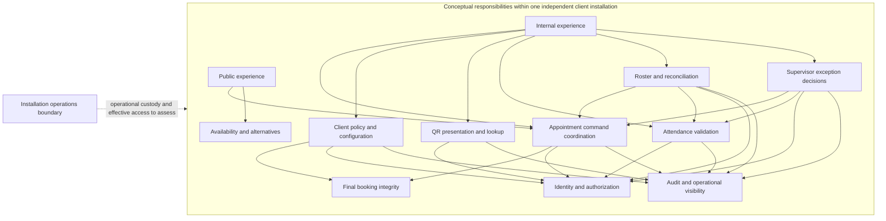
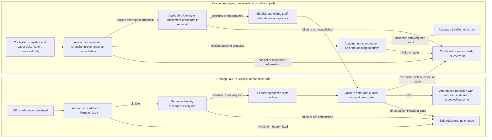
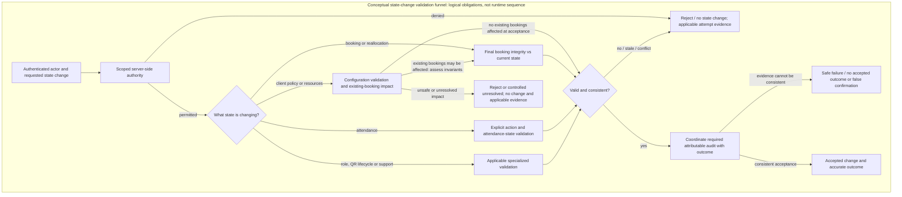

# Detailed Component & Module Design — Appointment Management System

| Field | Value |
|---|---|
| Version | 0.1 |
| Status | DRAFT — NOT APPROVED AS FINAL ARCHITECTURE |
| Gate | 2 — Architecture & Technical Design (IN PROGRESS) |
| Artifact | Detailed Component & Module Design |
| Owner / approval authority | Product Owner |

## 1. Status, authority, source baseline and limitations

This is a review draft advancing the Gate 2 **architecture description**, not a final architecture, gate approval or implementation authorization. Gate 1 is COMPLETE (APPROVED) under D-082; Gates 3–7 remain BLOCKED. The Product Owner confirmed in the Pass 2 instruction that the corrected `CONCEPTUAL_ARCHITECTURE.md` v0.1 was accepted in conversation as a **provisional working draft** for continued Gate 2 design. That confirmation is not a repository-recorded final architecture approval; no acceptance date or new decision ID is asserted here. Its corrected attendance diagram requires an explicit authorized action and applicable-state validation before attendance changes.

The governing requirement baseline is `REQUIREMENTS_SPECIFICATION.md` v0.7 with `REQUIREMENTS_TRACEABILITY.md` rev 1.0, approved under D-081 as **development-stage assumptions**, not representative stakeholder validation. The present traceability rev 1.1 only reconciles gate-status commentary and does not expand D-081 approval or alter requirement links. D-083/D-084 constrain hosting/profile design; D-085(1–6) authorizes **provisional conceptual directions only**. Client-policy values, security mechanisms and deployment choices remain open. References to a module below mean a **logical responsibility**: neither an interface nor a separately deployed service, package, class, table, runtime call sequence or implementation technology is selected.

## 2. Scope, architectural drivers and non-goals

The working hypothesis is a **modular monolith per independent client installation** (D-085(6)), subject to later integrity, security, privacy and operational review. Drivers are concurrent booking correctness (FR-002, NFR-006/NFR-008, BR-001–BR-002, AC-005; D-029/D-043/D-044/D-070), account-free but authorized journeys (FR-003/FR-007/FR-013; NFR-003), separated QR and attendance actions (FR-005–FR-006/FR-014; D-045), controlled exceptions and paper continuity (FR-015–FR-017), and isolation, usability and essential monitoring (NFR-001–NFR-005/NFR-007/NFR-009–NFR-011).

The 20–100 appointments/day per-installation profile is for planning and later verification, **not** a hard booking cap or concurrency figure (D-067). D-070's 50 simultaneous valid requests competing for one remaining capacity unit must eventually yield exactly one success and safe outcomes for the others; no measured result is claimed here. Separate Gate 2 data-model/schema, interface/API, configuration/deployment and compatibility/dependency designs and the final Gate 2 review are **not** completed by this document. FR-009 and FR-011, payments/deposits, SMS/OTP and automated outbound delivery, public accounts, waitlists, multiple branches and offline booking synchronization are not MVP modules (D-042/D-056–D-058). No CEAP material is used.

## 3. Actor, installation, paper-roster and infrastructure trust boundaries

- **Public guest/proxy booker:** may request account-free booking; a booker is not automatically the attendee. Booking changes and eligible QR presentation require approved scoped authority. A reference or QR alone identifies a candidate appointment but never proves identity, attendance or permission to change it (D-045/D-046/D-085(1–2)). Public responses disclose only what the authorized task needs.
- **Client front-desk staff:** individually accountable for permitted appointment, lookup, attendance, roster and reconciliation work; staff assistance does not grant supervisor powers. **Supervisor:** separately authorizes only configured, reasoned exceptions. **Client administrator:** owns client services/policies and internal accounts; cannot silently waive booking integrity. Exact permissions and provisioning are still open (D-047/D-048).
- **Product operator:** handles authorized technical duties without default client appointment-record/personal-data or client-administrator access. Exceptional client-data access requires explicit client authorization, least privilege, defined scope/duration, attribution, review and closure (D-034/D-075; FR-012/AC-007).
- **Each installation:** independently deployed and operated with its own application environment, data/database and schema boundary, configuration and credentials; no cross-client record flow or shared-tenant service. Production CEAP application, database, credentials and deployments remain entirely outside this product (D-019/D-020/D-025/D-035; NFR-001/NFR-002).
- **Paper and infrastructure:** a printed roster crosses physical custody and distribution boundaries and is a dated snapshot, not a second writable database. Hosting administrators, credentials, backups, diagnostics and restores can confer **effective access** outside application role checks; both hosting models require separate responsibility and access controls (§11). Neither a diagram nor a role label grants that access.

## 4. Logical module responsibilities and ownership contracts

In the table, **input → output** describes a conceptual obligation; **depends on** identifies another responsibility needed for a decision, not a prescribed runtime call. All state-changing obligations use approved authentication (including scoped guest authentication), server-side authorization and validation. Applicable required audit is coordinated with the outcome (§9). “Reject” means no unauthorized or partial accepted state and no falsely successful confirmation.

| Logical responsibility and owner of decision | Authorized actor / conceptual input → output; permitted logical dependencies | Authority, invariant and safe failure | Requirement / decision links |
|---|---|---|---|
| **Public experience:** public-facing presentation and request intake | Guest/proxy; availability, minimum input or scoped change request → clear outcome and, on successful booking/change, FR-010 confirmation with reference/status, service/date/time, location/arrival, booking-management and applicable QR/reference guidance; relies on authority, availability, appointment coordination and eligible QR presentation | Never grants authority from a reference/QR or accepts a displayed slot as reserved; invalid/unauthorized requests reveal no unnecessary record and receive a safe outcome | FR-003/005/007/010/018; UJ-001/003; AC-002/013; D-046/065/066/085(1) |
| **Internal staff experience:** role-specific work intake and presentation | Staff/supervisor/administrator; lookup, action, configuration or roster request → permitted view/outcome; relies on authority and the corresponding command/validation owners | Screen controls are not authorization; deny an unauthorized actor without changing or disclosing records; do not conflate lookup with attendance | FR-004/006/013–017; NFR-007; UJ-002/005; BR-007; D-047/068/069 |
| **Identity, authorization and scoped guest recovery:** actor, operation and appointment-scope decision | Guest, internal actor or exceptional support claimant; asserted identity/proof, requested scope and applicable evaluated policy → authorized/denied decision; used by every protected responsibility; policy is supplied as an input, not looked up through configuration ownership | Individual internal accountability and least privilege; booker ≠ attendee, reference ≠ proof. Missing/invalid proof or recovery authorization fails closed; credential/provisioning method open | FR-007/012; NFR-003/005; BR-004/007; AC-003/007; D-034/047/061/075/085(1) |
| **Client policy and configuration:** effective policy, configuration change and existing-booking impact | Client administrator; proposed service/availability/resource/role policy plus current impact → valid or rejected proposal; relies on authority and final booking-invariant assessment when existing bookings may be affected | Minimum safe policy must make service, duration/buffers, resources, capacity, duplicate and eligibility decisions possible before live booking. No implicit defaults or silent invalidation; impact resolution open | FR-001/004; NFR-004/006; BR-005/007; AC-001/009; D-043/060/062/079/085(3) |
| **Availability and alternatives:** candidate selection | Guest/staff presentation; effective policy and current local availability → candidates within this installation; relies on evaluated policy and current booking context | A candidate is not an acceptance guarantee; stale candidates require final check on selection. If none qualify, show clear unavailable outcome, not cross-client results | FR-001/018; BR-001/005; AC-001/013; D-066 |
| **Appointment command coordination:** booking-affecting operation and resulting confirmation | Scoped guest or authorized staff/supervisor, also eligible reconciliation; requested create/update/cancel/reschedule → accepted, rejected or uncertain outcome; relies on authority, policy, final booking integrity and required audit | Distinguish actor, booker and attendee; coordinate capacity release/reallocation and required records with final decision. No confirmation of unaccepted or uncertain mutation | FR-002–004/007/010/013; NFR-003/006; UJ-001/003/005; AC-001/009/010; D-044/046/064 |
| **Final booking integrity:** final acceptance of booking-affecting state | Appointment coordination, exceptional booking and eligible reconciliation; proposed change plus effective policy and authoritative current state → permitted/rejected booking outcome | Owns unique reference on creation, applicable capacity/staff/resource/duration/buffer checks, prohibited duplicates, booking eligibility and consistent reallocation under contention. No exception or import bypass; failure leaves no accepted partial/orphaned booking | FR-001/002/007/015/017; NFR-006/008; BR-001/002; AC-001/005/009/011; D-043/044/059/060/070/085(3) |
| **QR presentation and authorized lookup:** eligibility and minimum verification result | Intended user/authorized staff for eligible presentation; authorized staff for lookup; appointment state and QR/reference → minimized presentation or verification result; relies on authority and current state | QR is not identity, change permission or attendance; cancelled/invalid cannot silently look active. Issuance/reissue/revocation, where approved, require separate scoped state-change validation and audit; lifecycle open | FR-005/006/008; NFR-003/009; BR-003/008; AC-002–004; D-045/050/085(2) |
| **Attendance/service-state validation:** explicit staff transition decision | Authorized staff acting directly or on an eligible reviewed paper proposal; appointment/current status and explicit action → valid transition or rejection; relies on authority, applicable policy and required audit | Owns status legality, including minimum expected/arrived/completed/no-show states; any required identity procedure is separate. Invalid/stale state or unauthorized actor causes no status change | FR-004/014/017; NFR-003; BR-008/009; UJ-002/005; AC-004/012; D-045/047/085(2) |
| **Supervisor exception decisions:** configured exceptional authority and justification | Individually authorized supervisor; rule, affected appointment, reason and proposed outcome → approved-for-check or denied exception context; relies on authority, policy, applicable final validation and audit | Required actor/time/rule/reason/before-after evidence; ordinary staff/public cannot bypass. An exception does not approve an otherwise invalid unrelated state or make a direct write | FR-015; NFR-006/011; BR-001/007; AC-011; D-048/085(3) |
| **Roster and reconciliation:** controlled snapshot and reviewed paper outcomes | Authorized staff; scoped daily print or snapshot-provenance batch observations → controlled roster and per-record accepted/conflicted/unresolved decisions; relies on authority, current-state comparison, appointment coordination, attendance validation and audit | Minimum fields only; no automatic paper acceptance, silent overwrite or offline new-booking synchronization. Conflicts remain visible; safe failure retains unresolved work without false acceptance | FR-016/017; NFR-009/011; BR-009; UJ-005; AC-012; D-051/063/074/085(4) |
| **Audit and essential operational visibility:** outcome evidence, restricted review and failure signals | Material operation owners and authorized reviewers; accountable decision/attempt context → appropriate protected evidence or operational signal; coordinated by command owner, not an alternative mutation path | Accepted operations requiring audit cannot be reported accepted without consistent required evidence; failure to record it fails safely. QR lookups require an audit record; rejected attempts follow applicable policy. Minimize personal data | FR-008; NFR-009/011; BR-004/009; AC-007/011/012; D-050/073 |
| **Installation operations boundary:** client-specific custody and exceptional support control | Client/provider custodians; installation, backup, restore, diagnostic or support request → authorized operational disposition; relies on client authorization, attributable operational controls and approved responsibility allocation | Separate installations/credentials/data; infrastructure access assessed independently from application permissions. No default operator record access; if authority or audit control absent, no exceptional data access | FR-012; NFR-001/002/005; BR-004; UJ-004; AC-007; D-020/034/035/075/083–085(5) |

## 5. Dependency direction, permitted interactions and prohibited bypasses

The **arrow means “consumer of a logical decision/obligation → owner of that decision”**; it is not a runtime call, data transfer contract, API, package import, class reference or deployment connection. An operation coordinator supplies evaluated policy to final booking integrity; the final check does not own policy editing. Configuration owns proposed-policy impact assessment and consults the booking-invariant owner where bookings would be affected. This avoids policy ↔ integrity *ownership* cycles while leaving physical implementation undecided. The audit arrow denotes an outcome-evidence obligation, **not a post-success write**.

**Conceptual, provisional dependency map:** arrows omit several input relationships for legibility; every protected path, including public change proof and internal role administration, still requires authority and applicable audit. Evaluated policy and current state are **inputs** to authority and invariant owners, not reverse ownership of configuration or a fixed runtime call direction. The dotted installation-operations link denotes effective-access risk to assess, **not** a dependency or permission. In particular: public/staff screens may not write appointments; availability is advisory; supervisors cannot write around final validation; reconciliation cannot overwrite via paper; QR lookup cannot trigger attendance; configuration changes cannot silently invalidate existing bookings; and an operator cannot acquire application permission by controlling a host.

## 6. Booking and administrative state-change paths

The rows define **logical decision coverage**, not an ordered runtime protocol. “Required audit” means evidence consistent with the final outcome under §§9–10; a failed attempt is not automatically the same record as a successful action.

| Path / actor and authority | Policy, current-state and responsible validation | Consistent outcome / required evidence and safe failure |
|---|---|---|
| **Guest booking / proxy booker:** approved scoped guest authentication; no public account required | Appointment coordination checks minimum inputs and client policy; final booking integrity checks authoritative current capacity/resources/buffers, duplicate rule and unique reference. Proxy booker and attendee remain distinct | Accepted booking and reference or clear rejection, with applicable booking/attempt evidence; no partial record. A displayed candidate or selected alternative is rechecked, never reserved by display (FR-002/003/018; AC-001/005/013) |
| **Staff-assisted or walk-in booking:** individually authorized staff, including proxy on behalf of attendee | Same appointment and final booking owners; required service/identity fields remain policy-specific, even for a streamlined walk-in | Same final checks and attributable booking outcome; no staff-only shortcut or offline creation (FR-013; BR-006; AC-010; D-064) |
| **Guest cancellation/rescheduling:** separately established scoped change authority; **staff cancellation/rescheduling:** individually permitted internal role | Appointment coordination checks current eligibility/cutoff; final booking integrity handles capacity release or destination reallocation and duplicate/capacity recheck against current state | Accepted change produces FR-010's accessible, printable, screenshot-friendly confirmation with outcome-appropriate content and consistent audit; otherwise reject without partial release/reallocation. Reference/QR possession alone is insufficient (FR-007/010; BR-005; AC-009; D-079/085(1)) |
| **Routine staff appointment update:** individually permitted staff role | Appointment coordination checks allowed fields and current state; any booking-affecting change uses final booking integrity. Attendance-only actions instead use attendance validation (§7) | Attributable accepted/rejected outcome; stale or conflict-producing edits cannot silently damage existing bookings (FR-004; NFR-006; D-085(3)) |
| **Administrator configuration, service, availability or resource change:** authorized client administrator | Configuration owns minimum-safe-policy and existing-booking impact review; consults final booking-invariant assessment where bookings could be affected. Any resulting appointment mutations still use appointment coordination and final booking integrity | Accept a consistent change only with required configuration audit; otherwise reject/hold without silently invalidating appointments. Whether to retain, reject or exceptionally resolve affected bookings is open (FR-001/004/008; BR-005/007; D-085(3)) |
| **Supervisor exception:** individually authorized supervisor, configured scope and reason | Exception decision identifies rule, appointment, actor and proposed before/after outcome; appointment coordination/final booking integrity evaluates booking effect; attendance validation governs attendance effect | Only a permitted, reasoned exception with required attributable evidence can be accepted; missing reason, authority or applicable validation rejects without change (FR-015; AC-011; D-048) |
| **QR presentation issuance/reissue/revocation, if a lifecycle change is later approved:** authorized intended user or staff within scoped eligibility | QR responsibility checks authorization, current appointment state and applicable lifecycle policy; lookup is a separately authorized read | Approved lifecycle change and required audit or no-change rejection; no expiry, revocation, format or consumption rule is presumed (FR-005/006/008; QR-L01–QR-L09) |
| **Attendance/service update:** individually authorized staff following any required separate identity/entitlement procedure | Attendance owner validates current appointment and requested status transition; QR lookup is not this action | Accepted explicit transition and attendance audit or no-change rejection; never infer arrival/completion from presentation or lookup (FR-014; BR-008; AC-004) |
| **Paper reconciliation:** authorized, attributable staff reviewer | Roster owner compares snapshot and observation to current state; booking-affecting walk-in proposals use appointment coordination/final booking integrity; reviewed attendance proposals require an explicit authorized staff action and attendance validation | Per-record accepted, conflicted or unresolved outcome and required reconciliation evidence; unresolved/conflicted proposals do not overwrite newer state (FR-017; BR-009; AC-012) |
| **Internal role administration:** authorized client administrator; **ordinary support administration:** authorized client/operator custodian within approved scope | Identity/authority owner validates provisioning or role change; installation boundary governs technical work and any exceptional client-data access | Attributable role/support change only with required audit; otherwise deny without access change. No operator default client-administrator privilege (FR-008/012; BR-004/007; AC-007; D-047/075) |

For each booking-affecting route, the final booking boundary owns the invariant, while the coordinator owns the combined authorized outcome. An unavailable preferred slot can produce actual local alternatives (FR-018); selection is a **new candidate**, not an integrity bypass. Registration of a walk-in after an outage is a reviewed online booking proposal, not an offline-created booking silently imported (D-051/D-063).

Every successful booking, cancellation or rescheduling produces the screen-readable, printable, screenshot-friendly FR-010 confirmation: appointment reference and status, service, date/time, location and arrival instructions, QR/reference presentation guidance and booking-management instructions. Guidance must reflect the **actual outcome** and QR eligibility; a cancelled appointment must not be portrayed as presenting a valid active QR. No automated external delivery is implied (FR-010; D-049/D-065).

For booking, cancellation and rescheduling, a repeated submission after an uncertain completion is **not automatically a new authorized operation**. Before allowing a repeat to create another effect, appointment coordination must safely establish the earlier attempt's authoritative outcome **and** whether the repeat expresses the same intended operation or a genuinely new one. An established prior outcome is communicated consistently without duplicating its effect; if the relationship or outcome cannot be established safely, return an unresolved/no-new-effect result pending safe reconciliation. A genuinely new authorized operation still passes current policy and final booking integrity. A configured duplicate warning does not authorize blind replay. Required audit must agree with the authoritative outcome (§9), and an unresolved outcome cannot produce a falsely successful FR-010 confirmation; no retry-identification mechanism is selected.

## 7. QR lookup and explicit attendance transition

An eligible user obtains a privacy-minimized QR presentation through an approved access path; eligibility, reissue and recovery remain open (QR-L01–QR-L05). An authorized staff member can scan or enter it for the **minimum verification result**, including a safe invalid/cancelled outcome. **FR-008 requires recording QR lookup events**; lookup is distinct from presentation, issuance/reissue and attendance, whose applicable state-change/audit obligations are assessed separately. Exact event fields, failed or repeated interaction handling, authorized visibility and retention remain open (QR-L06–QR-L09). Expired/revoked handling applies only if later approved; races with cancellation/rescheduling also need later design (QR-L07). Neither possession nor lookup establishes attendee identity, change authority or arrival (D-045). If client policy requires identity/entitlement checking, that is a **separate staff procedure**; it does not itself update status. Only an explicit authorized staff action, validated against the applicable current appointment state, can change expected, arrived, completed or no-show status (FR-014; BR-008). Correction permissions remain open (QR-L10–QR-L12).

## 8. Supervisor exceptions and paper-roster reconciliation

An exception supplies **authorized, configured context** for the applicable booking or attendance decision; it is not a second mutation route. Supervisor authority, reason, affected appointment, rule, time, actor and before/after outcome must be reviewable, and an attempted override with insufficient authority or missing evidence fails safely (FR-015; AC-011). Exception types and limits are client policy, not universal defaults.

An authorized daily print contains at least reference, date/time, attendee name, service, assigned staff/resource where applicable and attendance status; extra contact details require justified need and control (D-074). Physical custody/distribution and later disposal require separate policy. Reconciliation retains **which snapshot** an observation came from, the authorized reviewing actor, and comparison with authoritative current state for each paper-recorded attendance/walk-in **proposal**. An eligible walk-in must still pass current booking checks. A reviewed attendance proposal must satisfy any applicable identity/entitlement procedure, receive an explicit authorized staff acceptance/action and pass attendance-state validation; paper alone never changes attendance. Invalid, conflicting or insufficiently supported items remain **conflicted** or **unresolved** without overwriting newer state. Each accepted, conflicted or unresolved outcome has consistent required attributable reconciliation evidence (§9). Batch atomicity, conflict override and final paper handling remain undecided (D-051/D-063/D-085(4)).

**Conceptual, provisional workflow:** arrows depict distinct decisions, not a prescribed call sequence or persistence mechanism. The lookup has no edge directly to a status change. Reconciliation adds provenance/current-state review and an explicit authorized staff acceptance before the same attendance-state validation (`V`) used for direct actions. A failed required identity check cannot lead to acceptance. Reconciled attendance and booking outcomes require consistent, attributable reconciliation and action evidence (§9); if required evidence cannot be recorded, no accepted outcome may be reported.

## 9. Atomicity, concurrency, outcome consistency and safe failure

Final booking integrity checks **authoritative current state at acceptance**, not only availability shown earlier. Every successfully created appointment has a unique reference; ordinary bookings satisfy configured effective capacity, staff/physical-resource availability, service duration/buffers and prohibited-duplicate rules. A configured duplicate *warning* is not permission to complete a booking prohibited by the effective policy; legitimate proxy/multiple-attendee scenarios remain possible (BR-001–BR-002; D-059/D-060). A cancellation or rescheduling must consistently release/reallocate capacity and leave neither partial nor orphaned state. Concurrent or stale requests must be re-evaluated or rejected safely. The approved 50-request/one-remaining-unit result is a **later design/test obligation**, not evidence that this design already achieves it (D-070/AC-005). Multi-record operations must be atomic with rollback on failure (Engineering Governance §11); no locking, persistence, idempotency or batch mechanism is chosen here.

An operation's **accepted, rejected or unresolved outcome and applicable required audit evidence must agree**. Booking/change, attendance, configuration, role, supervisor-exception, support-access and reconciliation actions require attributable records under FR-008; QR lookups and appropriate security-relevant attempts also need policy-governed evidence. The command or coordinating owner cannot declare success and then hope a later audit write works. If required evidence cannot be recorded consistently, the action must not be reported as accepted; the design must prevent a partially accepted operation and handle uncertainty safely. A lost response does not establish failure: before retrying a booking, cancellation or rescheduling, determine the earlier attempt's authoritative result and its relationship to the repeat, **not merely whether a similar current booking exists**. Communicate an established result without duplicating its effect; otherwise leave it unresolved with no new effect until safe resolution. This preserves configured duplicate warning/blocking behavior and D-070's contention obligation without choosing an idempotency mechanism. Rejected attempts may warrant a distinct security/operational record; which rejected reads or failures are logged, and how they are attributed where no actor can be identified, remain policy/design questions. A monitoring failure is not automatically identical to loss of a **required audit** record. No transaction, event bus, outbox or other audit/persistence technology is selected.

**Conceptual, provisional funnel:** a validated configuration change with no affected existing bookings can proceed to its applicable outcome/audit check. Where existing bookings may be affected, configuration impact assessment must include applicable final booking-invariant evaluation before acceptance; unsafe or unresolved effects leave no accepted change or silently invalidated appointment. That assessment does **not** imply every configuration change writes a booking or itself authorizes acceptance. A supervisor exception enters only through applicable authority and final validation; reviewed paper proposals follow the relevant booking or attendance branch. Audit is an outcome consistency condition, not a mandated post-validation runtime step. The exact treatment of an uncertain completion and batch-wide versus per-item atomicity belongs to later design.

## 10. Audit, monitoring, privacy, accessibility and testability

Audit ownership is shared as an **obligation**, not duplicated write authority: each command/coordinator supplies actor, action, affected record, decision and outcome context; audit/visibility owns protected, appropriately attributable evidence and authorized review. Material events include booking/change, QR lookup, attendance, client configuration, internal roles, exceptions, exceptional operator access and reconciliation (FR-008). Supervisor evidence additionally includes mandatory reason/rule/time/before-after outcome (AC-011). Preserve privacy minimization in public views, QR, rosters, audit and diagnostics; retention, tamper resistance and review procedures need later privacy/security design (NFR-009/NFR-011; Q-015).

Essential operational visibility covers booking failures, unexpected errors, security-relevant activity, capacity/integrity violations, reconciliation failures and other important operational failures (D-073). Authorized reviewers and client/provider response duties remain to be allocated; this is not FR-011 advanced analytics. Core public/administrative workflows target WCAG 2.2 AA for applicable desktop/mobile experiences across current and previous stable major Chrome, Edge, Firefox and Safari versions (NFR-007; D-069); no conformance result is claimed. NFR-010/AC-008 require later isolated automated success, rejection, authorization and failure-path tests for the D-068 core workflow inventory. Necessary design scenarios include two competing final bookings, duplicate-warning versus blocking, stale availability, failed required audit, attendance after cancellation, denied lookup, configuration impact, exception attribution and stale paper reconciliation. Tests, accessibility review, performance measurements and independent security/privacy assessment have not occurred in this drafting pass.

## 11. Hosting models, effective access and operational interfaces

D-083 requires **both** client-managed and provider-managed hosting; D-084 approves **one standardized supported deployment profile as a principle**, not a product, topology or technology. In either model, clients control ordinary records, staff accounts, services and business administration, while installations and credentials remain separate. The table identifies review interfaces, **not approved allocations or grants of access** (D-034/D-075/D-085(5); FR-012/NFR-005).

| Responsibility to define | Client-managed hosting: effective-access question | Provider-managed hosting: effective-access question |
|---|---|---|
| Installation, client policy and credentials | Who verifies installation isolation and holds host secrets, distinct from client account/policy authority? | How are deployment credentials separated from client policy and record administration? |
| Updates and incidents | Who authorizes maintenance, sees diagnostics and escalates failures? | What provider diagnostic/maintenance visibility exists and how is client authorization evidenced? |
| Monitoring, backups and restores | Which client/technical custodians can read logs or backup data; who authorizes and verifies restores? | Which provider custodians could effectively read logs/backups or restored data, and how is access constrained and reviewed? |
| Exceptional support | How does the client authorize time/scope-bound record access, attribution, review and closure? | The same client authorization is required even when a provider controls infrastructure; how is effective access bounded and audited? |

Application permissions cannot by themselves prevent host- or backup-level access. If client authorization, scope or accountability is absent, exceptional client-data access remains denied; technical custody is not blanket application authority. Final allocations, backup/restore controls, supported deployment profile and Q-008 operational procedures belong to separate Gate 2/later design. Backup and tested restore are required before relying on installation data (Engineering Governance §17); none is claimed here.

## 12. Active requirements and decision traceability

Rows give **design coverage**, not validation, tested behavior or final architecture approval. Together they cover the D-081 active set: FR-001–FR-008, FR-010, FR-012–FR-018; NFR-001–NFR-011; BR-001–BR-009; UJ-001–UJ-005; AC-001–AC-013. Detailed provenance and validation links remain in Requirements Traceability rev 1.0 (present rev 1.1 retains those links).

| Logical ownership / design sections | Active requirement and journey/rule/criterion links | Principal decisions |
|---|---|---|
| Installation, client authority and operational access (§§3–5, 11) | FR-012; NFR-001–NFR-005; BR-004/007; UJ-004; AC-007 | D-019/020/025/034/035/047/062/075/081/083–085(5–6) |
| Client policy, availability, configuration impact and alternatives (§§4–6, 9) | FR-001/018; NFR-004/006; BR-001/005; UJ-001; AC-001/013 | D-043/060/062/066/079/085(3) |
| Guest, proxy, staff, walk-in, booking and change integrity (§§4–6, 9) | FR-002–FR-004/FR-007/FR-013; NFR-003/006/008; BR-001/002/005/006/007; UJ-001/003/005; AC-001/005/009/010/013 | D-044/046/047/059/061/064/067/070/085(1,3) |
| Confirmation, QR lookup and explicit attendance (§§4, 6–9) | FR-005/006/010/014; NFR-003/007/009; BR-003/008; UJ-001–UJ-003; AC-002–AC-004/006/009 | D-045/049/050/065/069/085(1–2) |
| Supervisor exceptions, roster and reconciliation (§§4, 6, 8–10) | FR-015–FR-017; NFR-006/009/011; BR-001/007/009; UJ-005; AC-011/012 | D-048/051/063/074/079/085(3–4) |
| Audit, monitoring, accessibility and verification (§§4, 9–10) | FR-008; NFR-003/007–NFR-011; BR-004/008/009; UJ-002/004/005; AC-003–AC-008/011/012 | D-029/038/050/052/068–073/081 |

**Deferred:** FR-009 (generic eligibility/masterlist and document validation) and FR-011 (advanced reporting/analytics) have no MVP responsibility. FR-008/NFR-011's essential monitoring under D-073 and FR-016's controlled daily roster do **not** revive FR-011. D-076's queue numbers, optional staff notes and typing corrections likewise remain deferred.

## 13. Open decisions, deadlines, tradeoffs and revisit triggers

| Timing / disposition | Open question and effect on this design |
|---|---|
| **Before final Gate 2 architecture approval** | D-079 requires the client-policy cancellation/rescheduling cutoff and remaining measurable quality targets; the proposed one-hour value is not approved. Gate 2 also needs a reviewable disposition of minimum safe configuration, capacity/resource unit, duplicate identity/window and warning/blocking behavior, guest proof/recovery, staff provisioning and permission detail (Q-009/Q-018), QR lifecycle and attendance rules (QR-L01–QR-L12), exception types, configuration-impact outcomes, concurrency/atomicity and reconciliation conflict/batch policy, Q-007 provisional compatibility/dependency approach and Q-008 responsibility/profile boundaries. Idempotency mechanics remain open under D-079 without an invented deadline. These matters may remain **explicitly open in this v0.1 draft**, but cannot be silently assumed in final architecture. |
| **Before Gate 3 security/privacy design-review approval** | D-079 requires retention/deletion, exceptional operator access duration and emergency break-glass policy; no period, four-hour duration or break-glass procedure is approved. Q-015 and qualified security/privacy and data-integrity review remain mandatory. |
| **Before Gate 6 release approval** | D-079 requires printed-roster handling/disposal. Genuine product-fit review, qualified independent privacy/security assessment, tests and release evidence remain outstanding; Q-010 detailed pricing/licensing/support-package pricing is deferred to Gate 6 (D-055). |

The modular monolith offers one reviewable per-installation booking boundary but risks tightly coupled policy/command/audit ownership if the logical distinctions are lost. An undifferentiated application obscures those boundaries; separately deployed responsibilities could isolate later scaling but complicate consistent outcomes and operations. Neither alternative is selected. Revisit the hypothesis if the D-070 contention obligation cannot be designed safely, later workload evidence invalidates the profile, Gate 3 cannot uphold privacy/authority boundaries, paper reconciliation cannot share final checks, or either hosting arrangement cannot meet isolation and no-default-access under a reviewable standardized profile. Shared multi-tenancy requires D-020's formal change review, not an architectural shortcut.

## 14. Review criteria and approval limitations

For review, trace **each** public/staff/supervisor/admin/operator/paper path to its accountable actor, authorized scope, current-state and specialized validator, final booking integrity where applicable, required audit and safe accepted/rejected/conflicted/unresolved outcome. Check that all three diagrams' arrows are only logical relationships; that QR lookup cannot itself mutate attendance; that exceptions and reconciliation cannot bypass booking checks; and that host/backup effective access is not misreported as application permission. Check the §12 identifiers against the approved v0.7/rev 1.0 development-stage baseline and retain all §13 open questions with their actual deadlines.

This draft selects no schema, API, credential, QR format or lifecycle, locking/transaction/persistence technique, audit transport, vendor, operating system, container platform, version, legal retention period or hosting allocation. It establishes no representative validation, approved final architecture, test or accessibility result, production readiness, implementation authorization or Gate 2 exit. Only a later explicit Product Owner disposition can approve an architecture or gate transition.
