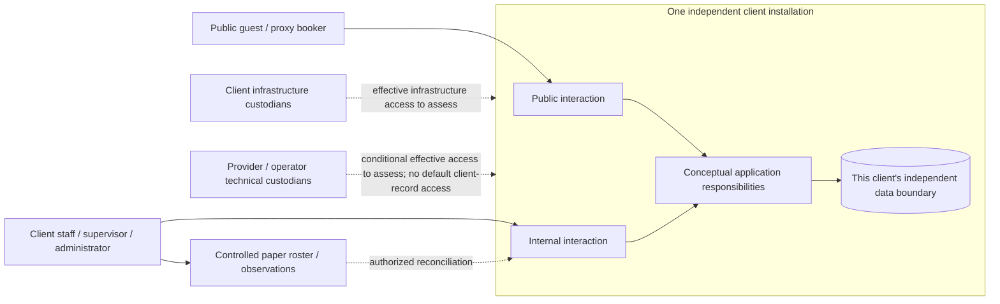
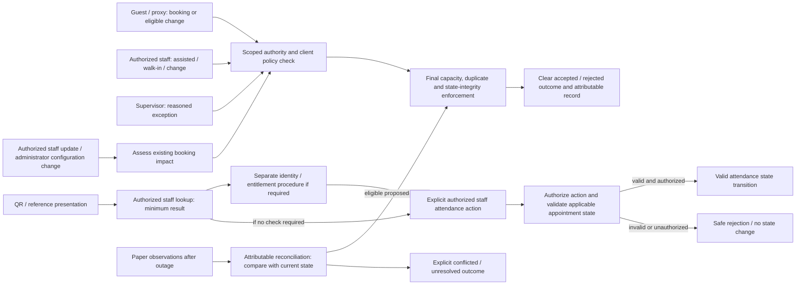

# Conceptual Architecture — Appointment Management System

| Field | Value |
|---|---|
| Version | 0.1 |
| Status | DRAFT — Gate 2 conceptual design for Product Owner review |
| Authority | D-081 development-stage baseline; D-083/D-084 design constraints; D-085 provisional conceptual directions |
| Owner | Product Owner |

## 1. Status, authority, source baseline and non-approval boundaries

Gate 1 is **COMPLETE (APPROVED)** under D-082. Gate 2 is **IN PROGRESS**, authorized for architecture/design documentation only; Gates 3–7 are **BLOCKED**. This draft grants **no additional approval**: it does not approve final architecture, a security mechanism, a deployment profile, implementation, a gate transition, or release.

D-081 approved Requirements Specification **v0.7** and Requirements Traceability **revision 1.0** as a development-stage *assumption* baseline, not representative stakeholder validation. The currently present traceability revision 1.1 is an administrative Gate 1/2 status correction under D-082, not a new approval or a change to the requirement links. The Gate 1 closure evidence retains the limitations of EVD-001–EVD-013 and incomplete VAL-001–VAL-006; simulated material is design input, not real validation. The Charter's current revised wording remains a draft; separately recorded decisions govern their own scopes.

**Reading convention:** “Approved constraint” means a recorded product/requirements direction within its stated scope; “provisional direction” means D-085's design hypothesis, not final selection; “open” means no mechanism or policy value has been approved. The two diagrams below illustrate concepts only, **not** an approved process, schema, API, security mechanism, or deployment topology.

## 2. Architecture drivers and applicable requirements

The first design driver is correctness under competing requests: effective capacity, configured duplicate rules, safe failure and attributable exceptions (FR-001–FR-002, FR-015, NFR-006, BR-001–BR-002, AC-001/AC-005/AC-011; D-029/D-043/D-044/D-048/D-059/D-060). The second is independent client operation with configurable policies and no shared tenancy or CEAP coupling (NFR-001–NFR-002/NFR-004; D-019/D-020/D-035/D-062). The third is an account-free but authorized public journey, distinct staff roles, privacy-minimized QR lookup and explicit attendance (FR-003–FR-007/FR-012–FR-014; NFR-003/NFR-005/NFR-009; D-034/D-045–D-047/D-075). The fourth is front-desk continuity, accessibility, testability and essential monitoring (FR-008/FR-010/FR-016–FR-018; NFR-007–NFR-008/NFR-010–NFR-011; D-051/D-063–D-074).

The initial planning profile is 20–100 appointments/day **per installation**, not a hard capacity limit or simultaneous-user count (D-067). D-070's later contention check is 50 simultaneous valid requests for one remaining capacity unit: exactly one succeeds, all others receive safe outcomes, with no duplicate-rule, over-capacity, partial or orphaned state. No response-time or availability measurement is claimed.

## 3. System context, actors and trust boundaries

Public guests and proxy bookers interact with the public side; authorized front-desk staff, supervisors and client administrators use internal responsibilities. A proxy booker is not automatically the attendee. The client organization controls ordinary appointment/business administration. A product operator may perform authorized technical work, but is **not** a default installation administrator and has **no default client-record or personal-data access** (D-034/D-075). Infrastructure ownership can create *effective* access even without an application role; that risk needs explicit treatment in both hosting arrangements. Paper rosters cross a physical custody boundary and are not a second live database.

The dashed custodial links depict **risk and responsibility to assess**, not permission to read records or a chosen topology. No link connects installations or CEAP.

## 4. Independent per-client installation and data boundary

Each client has its own independently deployed and operated installation, application environment, configuration, credentials and database/schema boundary (D-020/D-035; NFR-001/NFR-002). A maintained product may support many such installations without a shared-tenant data flow. Client policies can vary without routine changes to core scheduling logic (D-062). The standardized supported deployment *profile* is a common support/verification principle across installations, **not** shared data, identical business rules, or an approved product or technology (D-084). The commercial product remains separate from CEAP; it never connects to, imports from, modifies, or depends on production CEAP systems or data (D-019/D-025/D-035). No CEAP artifact informs this draft.

## 5. Provisional modular-monolith direction, rationale and tradeoffs

**D-085(6), provisional:** explore a modular monolith **per independent client installation**. “Modular” means distinct conceptual responsibilities and reviewable boundaries; “monolith” means they can be designed as one application unit, not that they share client data or that implementation packaging is decided. This direction makes it easier to reason about a single final booking-integrity boundary and a modest first operating profile, without requiring distributed coordination. Its tradeoff is that poorly separated responsibilities could become tightly coupled, and an installation's operational scaling limits still need evidence. Security, integrity, privacy and operational reviews may change this direction; no final architecture is selected here. D-022 remains a preferred stack direction only, with no runtime/version or dependency chosen by this draft.

## 6. Conceptual component responsibilities and interactions

| Responsibility (conceptual, not a code module/API) | Interactions and boundary |
|---|---|
| Public and internal experience | Presents availability, eligible changes, status and confirmation; keeps public requests separate from staff/supervisor/admin authority (FR-003–FR-004/FR-010/FR-018). |
| Identity/authority and policy decisions | Checks approved scoped guest authority or internal role before state change; treats booker, attendee and acting staff distinctly; resolves configured policy, not a universal default (FR-007/FR-012–FR-015; NFR-003). |
| Availability and final booking integrity | Computes actual local alternatives, then enforces unique appointment references and rechecks effective schedule/resource capacity and duplicate constraints at the final mutation boundary for every booking path; assesses effects of staff updates and configuration changes on existing bookings (FR-001–FR-002/FR-004/FR-017–FR-018; NFR-006). |
| Appointment and attendance lifecycle | Keeps booking changes, QR lookup, any staff identity procedure and explicit attendance/service changes separate (FR-005–FR-007/FR-014). |
| Audit and operational visibility | Records attributable material actions and privacy-conscious failures/alerts for authorized review; no advanced analytics implied (FR-008; NFR-011). |
| Roster and reconciliation | Produces an authorized, controlled snapshot; compares later paper observations against current state and submits eligible changes through the same final integrity boundary (FR-016–FR-017). |

These are responsibility boundaries, not prescribed tables, services, endpoints or transaction technology. Every state-changing path requires approved authentication (including a future scoped guest mechanism), server-side authorization and validation; internal users need individual accountability (NFR-003; D-047). The exact mechanisms remain open.

## 7. Guest, proxy, assisted and walk-in booking, cancellation and rescheduling

**D-085(1), provisional:** an appointment reference or QR presentation identifies an appointment for appropriate presentation/lookup; possession alone does **not** grant cancellation/rescheduling authority. Explore scoped guest proof and staff-mediated recovery without selecting a credential, verification channel, expiry or recovery procedure. The guest can request booking without a public account; an authorized staff member can assist, create a proxy booking (booker distinct from attendee) or register a streamlined walk-in with only required client/service fields (FR-003/FR-013; BR-006). Staff assistance does not bypass required identity information, authorization, validation, audit, duplicate or capacity checks (D-064). No public self-registration/login or mandatory SMS/OTP is introduced.

Cancellation and rescheduling need authorization and eligibility under client policy; rescheduling releases/reallocates capacity atomically and rechecks the destination as a booking candidate (FR-007; BR-005; AC-009). Unavailable preferred slots may yield actually available alternatives **within this installation**; selecting one still reaches final enforcement (FR-018; AC-013). Every successful booking/change returns an accessible screen-readable, printable, screenshot-friendly confirmation with reference, status, service, date/time, location/arrival instructions, QR/reference guidance and booking-management instructions (FR-010; D-049/D-065). No external delivery is assumed.

The QR line does **not** establish identity or attendance automatically: after any required identity procedure, authorized staff must explicitly act before attendance changes. Paper observations are reviewed, never implicitly synchronized. This diagram is illustrative, not an approved process or mechanism.

## 8. QR presentation, staff lookup, identity procedure and explicit attendance transitions

**D-085(2), provisional, reinforcing approved D-045:** QR possession alone proves neither identity nor authority to change an appointment, and never records attendance. An eligible appointment may have a privacy-minimized presentation; only authorized staff obtain the minimum lookup outcome (FR-005–FR-006; BR-003; AC-002–AC-004). A separate staff identity/entitlement procedure applies **where client policy requires it**. An authorized person then explicitly records an applicable attendance/service transition; expected, arrived, completed and no-show are minimum statuses, not an automatic QR-driven sequence (FR-014; BR-008). Invalid/cancelled presentations must not silently appear valid; expiry/revocation rules apply only if later approved. Issuance, content, activation, expiry, revocation, recovery, repeat-scan behavior, verification races, exceptions, audit visibility and correction permissions remain open (QR-L01–QR-L12). No QR lifecycle or credential rule is selected here.

## 9. Booking integrity, minimum safe configuration contract, concurrency and atomicity

**D-085(3), provisional:** before an installation accepts live bookings, its effective client policy must be sufficiently defined to evaluate the applicable service availability, duration/buffers, staff/physical resources, ordinary capacity, duplicate warning/blocking and permitted exceptions, booking/change eligibility and required inputs. This is a *minimum safe configuration contract* to design and review, not an approved field list, capacity unit, policy value or implementation of configuration validation. Missing or ambiguous policy must not be guessed into a universal default; how the installation prevents unsafe use remains open. D-079 retains configurable buffers and does not approve a universal one-hour cutoff.

At a **shared final integrity boundary**, guest, staff, rescheduling, supervisor-exception and reconciliation paths must enforce the same applicable invariants. Every successfully created appointment must receive a unique reference, with uniqueness enforced by the application's final integrity boundary (FR-002; Engineering Governance §11). Ordinary completed bookings cannot exceed effective configured capacity or violate the configured prohibited-duplicate rule, including under concurrency; a configured warning may be allowed without silently turning a prohibited duplicate into a booking (BR-001–BR-002). Legitimate proxy/multiple-attendee cases must remain possible under approved client policy (D-059). Routine staff appointment updates and policy, resource, availability or other configuration changes need integrity-impact analysis: if a proposed change affects existing bookings, it must receive an authorized, consistent outcome and must not silently invalidate appointments or bypass established constraints (FR-001/FR-004; NFR-006; D-085(3)). Whether such a change is rejected, retains prior bookings, requires an approved exception or needs another resolution remains open. An exception requires supervisor authority and recorded reason, actor, time, affected appointment, rule and before/after outcome (FR-015; AC-011). A failed or rejected operation leaves no partial/orphaned booking; multi-record mutations and change/reallocation are atomic with rollback on failure (Engineering Governance §11). Locking, schema, capacity unit, duplicate key/window, idempotency mechanics, exception limits and batch atomicity remain undecided. Later design and isolated tests must demonstrate D-070/AC-005, not presume they pass.

## 10. Paper roster, outage fallback and attributable reconciliation

An authorized daily print is a controlled **snapshot**, not an offline writable database. Its approved minimum fields are reference, appointment date/time, attendee name, service, assigned staff/resource where applicable and attendance status; additional contact data requires justified operational need and controls (FR-016; D-074). Authorized printing, limited distribution, secure physical custody and later approved handling/disposal rules matter because paper crosses the application access boundary. An outage does not authorize offline creation or synchronization of new bookings (D-051/D-063).

**D-085(4), provisional:** retain snapshot provenance (which roster snapshot an observation came from), an attributable review by authorized staff, comparison with newer installation state, and explicit **accepted**, **conflicted** or **unresolved** outcomes for each paper-recorded attendance/walk-in update in a batch (FR-017; BR-009; AC-012). Proposed changes that can be accepted still pass current authorization and final integrity enforcement; conflicts and non-reconcilable records remain visible for controlled handling, never silently overwrite newer state. Exact paper procedure, conflict override, batch atomicity and final walk-in treatment remain open; paper observations are not automatically valid bookings.

## 11. Client-managed and provider-managed hosting responsibility/effective-access matrices

**D-083/D-084 approved constraints; D-085(5) provisional design direction:** both ownership arrangements must be evaluated before the one standardized supported deployment profile can be finalized. These are **questions for allocation and review**, not approved hosting assignments. In both cases client organizations control appointment records, staff accounts, services and ordinary administration; the operator has no default client-record/personal-data access (D-034/D-075). “Effective access” includes what infrastructure control, credentials, diagnostics or backups might expose independently of application roles. No access is granted by the tables.

| Concern | Client-managed hosting: responsibility to define / effective-access risk | Provider-managed hosting: responsibility to define / effective-access risk |
|---|---|---|
| Installation and configuration | Define client-hosting custodian, installation verification and client policy ownership; assess host administrator visibility. | Define provider deployment custodian and client policy handoff; assess provider infrastructure visibility. |
| Credentials and internal accounts | Client controls staff accounts; define custody of infrastructure credentials and separation from client records. | Client still controls staff accounts; define provider infrastructure credential custody and separation from application/data access. |
| Updates and maintenance | Define who applies/approves changes and how installation-specific authorization is evidenced; inspect maintenance access. | Define provider change execution and client coordination; inspect privileged maintenance paths. |
| Monitoring and incidents | Define who can see privacy-minimized diagnostics, respond and escalate; inspect log/host visibility. | Define provider diagnostic/incident scope and client notification/review; inspect log/host visibility. |
| Backups and restoration | Define custody, authorization and restore verification; examine whether backup custodians can read client data. | Define provider custody, client authorization and restore verification; examine whether provider backup custodians can read client data. |
| Exceptional support | Client authorization, least privilege, defined scope/duration, attributable audit, review and closure required before any client-data access. | The same boundary applies even if the provider controls infrastructure; privileged technical access is not blanket client-record permission. |

Q-008 remains partly open: no operating system, hosting vendor, paid arrangement, topology, final division of duties, credential design, backup mechanism, support package or deployment profile is approved. Q-007 compatibility/dependency approach also remains open; exact runtime/dependency versions belong to Gate 4 (D-031). Docker/container adoption still requires D-023/D-036 justification and Product Owner approval; D-032/P-006 remain provisional/proposed.

## 12. Security, privacy, accessibility, audit, monitoring, backup and recovery concerns

Server-side state-change authentication, authorization and validation include scoped guest operations; least privilege and distinct internal roles apply to staff, supervisors and administrators (NFR-003; D-047). Guest proof and staff provisioning are open design questions, not license to treat a reference or QR as authority. Minimize public displays, QR contents, rosters, audit and diagnostic data; restrict authorized review. Exceptional operator data access requires explicit client authorization, least privilege, defined scope/duration, attribution, review and closure (FR-012; AC-007). Exact legal basis, notice, retention/deletion periods and privacy/security mechanisms remain for qualified review (Q-015; Gate 3).

Record booking/change, QR lookup, attendance, configuration, role, supervisor exception, support access and reconciliation events (FR-008). Essential monitoring includes booking failures, unexpected errors, security-relevant events, integrity/capacity violations, reconciliation failures and operational failures requiring attention (NFR-011; D-073). Diagnostic records should avoid unnecessary personal data; tamper resistance, alerting and review/retention mechanisms are not chosen. Advanced reporting remains deferred. Design must support backups and *tested* restoration before relying on data (Engineering Governance §17), with responsibility, effective access, incident and recovery procedures to be decided under Q-008; no recovery target is invented.

Core public and administrative workflows target WCAG 2.2 AA across applicable desktop/mobile experiences in current and previous stable major releases of Chrome, Edge, Firefox and Safari (NFR-007; D-069). This is a future verification target, not achieved conformance. Every approved core workflow needs success, rejection, authorization and failure-path automated checks as applicable (NFR-010; AC-008); isolated testing and accountable preparer/reviewer/approver roles are later evidence (D-072). Unresolved Critical/High security findings and Critical data-integrity defects are release blockers as recorded in D-038/D-071; this draft reports no findings or test results.

## 13. Alternatives and explicit architecture-revisit triggers

The provisional modular monolith is compared with (a) separately deployed responsibilities, which could isolate some scaling needs but complicate cross-responsibility integrity and operations, and (b) one undifferentiated application, which is initially simpler but obscures authority and integrity boundaries. Neither alternative is approved. Revisit the provisional direction if the 50-request contention design cannot preserve atomic invariants, real workload/operating evidence exposes an unacceptable bottleneck, qualified security/privacy review cannot uphold role and effective-access boundaries, outage reconciliation cannot safely share final integrity enforcement, or both hosting-ownership models cannot fit a reviewable standardized profile. Shared multi-tenancy is **not** an alternative silently available for selection: D-020 requires formal change review of architecture, security, isolation, operations and commercial scope. New infrastructure, services or frameworks require D-036 justification and approval.

## 14. Compact traceability to conceptual responsibilities

The IDs below are the **active** D-081 assumption-baseline records in Specification v0.7 and Traceability rev 1.0 (rev 1.1 keeps their links). Rows group related responsibilities; the ranges collectively cover every active FR, all NFR, BR-001–BR-009, UJ-001–UJ-005 and AC-001–AC-013. Citation means design coverage, **not** validation, final architecture or test evidence.

| Conceptual responsibility / section | Active requirement links | Constraint / direction links |
|---|---|---|
| Independent installation, configuration, supported profile (§§4, 9, 11) | FR-001; NFR-001–NFR-002/NFR-004; BR-005; UJ-001; AC-001 | D-019/D-020/D-025/D-035/D-043/D-060/D-062/D-083–D-085(5) |
| Booking, availability, safe final enforcement and alternatives (§§6–7, 9) | FR-002–FR-003/FR-018; NFR-003/NFR-006/NFR-008; BR-001–BR-002/BR-006; UJ-001; AC-001/AC-005/AC-013 | D-042/D-044/D-046/D-059/D-066/D-067/D-070/D-085(1,3) |
| Staff, proxy, walk-in, change and exceptions (§§6–7, 9) | FR-004/FR-007/FR-013/FR-015; NFR-003/NFR-006/NFR-009; BR-005–BR-007; UJ-003/UJ-005; AC-009–AC-011 | D-046–D-048/D-061/D-064/D-079/D-085(1,3) |
| Confirmation, QR lookup and explicit attendance (§§7–8) | FR-005–FR-006/FR-010/FR-014; NFR-003/NFR-009; BR-003/BR-008; UJ-001–UJ-003; AC-002–AC-004/AC-009 | D-045/D-049/D-065/D-085(1–2); QR-L01–QR-L12 open |
| Audit, least privilege, operator and hosting access (§§3, 11–12) | FR-008/FR-012; NFR-003/NFR-005/NFR-009/NFR-011; BR-004/BR-007; UJ-004; AC-007/AC-011 | D-034/D-047–D-050/D-073/D-075/D-083/D-085(5) |
| Paper continuity and batch reconciliation (§§10–12) | FR-016–FR-017; NFR-006/NFR-009/NFR-011; BR-009; UJ-005; AC-012 | D-051/D-063/D-074/D-079/D-085(3–4) |
| Accessibility, core verification and operational quality (§§2, 12, 16) | NFR-007–NFR-008/NFR-010–NFR-011; AC-005–AC-006/AC-008 | D-052/D-067–D-073/D-081/D-082 |

**Deferred, outside active rows:** FR-009 (generic eligibility/masterlist) and FR-011 (advanced reporting/analytics) remain `DEFERRED` under D-042. D-073's essential monitoring is carried by NFR-011/FR-008, not a revival of FR-011.

## 15. Open decisions, assumptions, risks and D-079 milestones

| Timing / owner boundary | Unresolved matter or risk |
|---|---|
| **Before Gate 2 architecture approval — Product Owner (D-079)** | Decide the cancellation/rescheduling cutoff (a one-hour proposal is **not approved**) and remaining measurable quality targets; design still needs the minimum safe configuration contract, capacity unit/resource model, duplicate identity/window and warning/blocking policy, guest proof/recovery, QR lifecycle, idempotency, staff provisioning/permission detail, concurrency and reconciliation mechanics, provisional compatibility and Q-008 responsibility/profile boundaries. |
| **Before Gate 3 security/privacy design review approval — Product Owner (D-079)** | Decide retention/deletion policy, exceptional operator access duration and emergency break-glass policy; **no fixed period, four-hour duration or break-glass procedure is approved**. Gate 3 still requires security/privacy and data-integrity reviews and a threat model. |
| **Before Gate 6 release approval — Product Owner (D-079)** | Decide printed-roster handling/disposal. Genuine product-fit review, qualified independent privacy/security assessment, testing and release evidence remain required; Q-010 detailed pricing/licensing/support-package pricing is deferred to Gate 6 by D-055. |

Other active risks: R-2 (guest/internal authentication), R-4 (unconfirmed versions), R-5 (concurrent integrity), R-6 (privacy and effective infrastructure access), R-7 (outage/hosting/recovery), R-9 (assumptions mistaken for validation), R-10 (product isolation) and R-11 (client-specific policies mistaken for defaults). A-4/A-5/A-7 (stack suitability, test feasibility, internet-facing assumption) require Gate 2 review; A-1 is the approved D-020 model whose *market fit* still needs genuine validation; A-2/A-3/A-6 remain development-stage assumptions with follow-up. Q-007/Q-008/Q-009/Q-011/Q-015/Q-016/Q-018/Q-019–Q-022 and QR-L questions remain open to their recorded extents; Q-014 is resolved for essential monitoring. D-076 defers walk-in queue numbers, optional staff notes and typing corrections. No proposal in an unqualified submitted validation response supplies policy or evidence here.

## 16. Review criteria, limitations and approval boundaries

For Product Owner review: can each public, staff, supervisor, operator and paper path be traced to its authority and final integrity check; can both hosting models meet no-default-access despite infrastructure/backup visibility; and are QR lookup, identity procedure, explicit attendance and reconciliation outcomes visibly separate? Check the §14 ID mapping against the existing matrix, and resolve or retain the §15 questions under their deadlines. Later Gate 2 deliverables still need data-model, interface and configuration/deployment strategy designs, with Gate 3 review before any Gate 4 implementation.

This draft does not establish representative validation, legal conclusions, a security assessment, accessibility conformance, performance results, a backup/restore test, an approved mechanism or a final deployment arrangement. It selects no schema, endpoint, credential, QR lifecycle, retention period, lock, idempotency method, vendor, operating system, container platform or version. Only a separately recorded Product Owner disposition may finalize architecture or advance a gate; creating or reviewing this document cannot do so.
