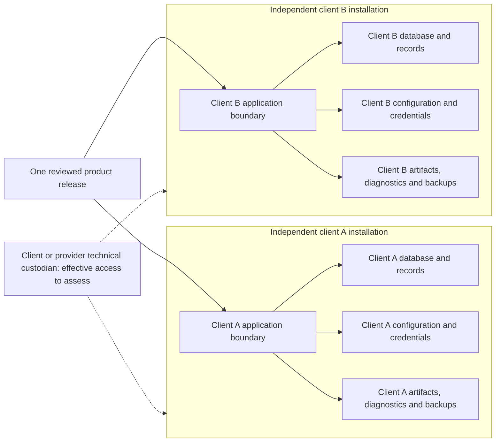
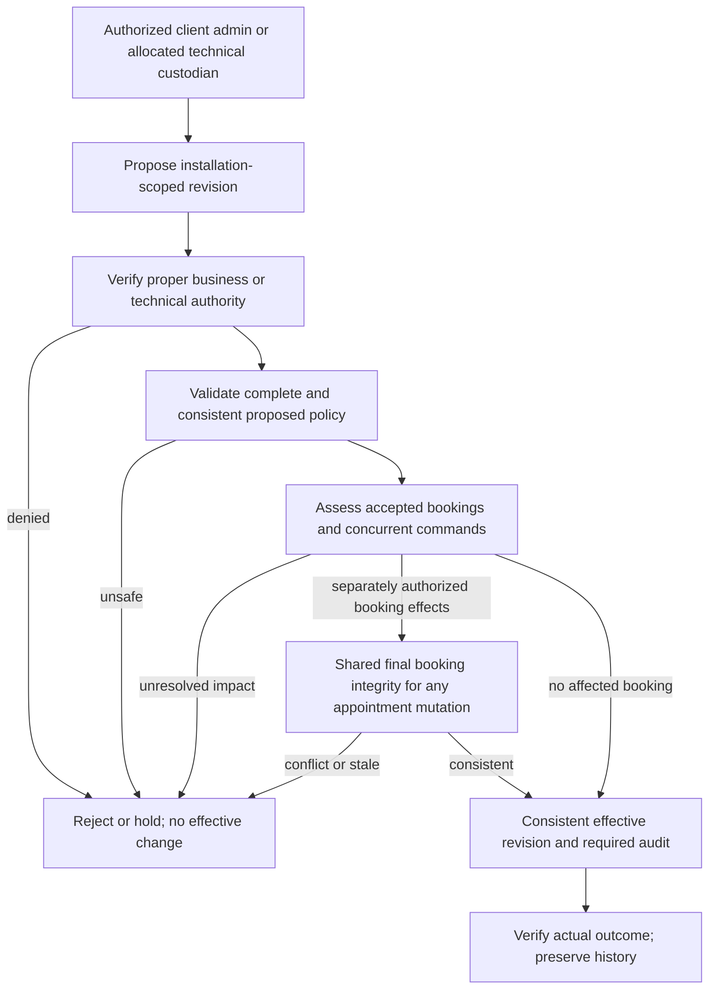
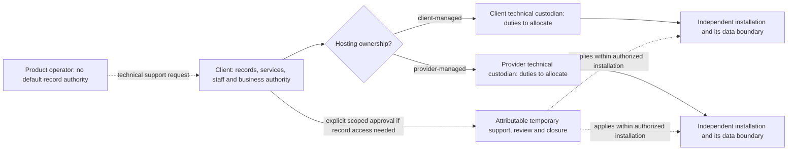
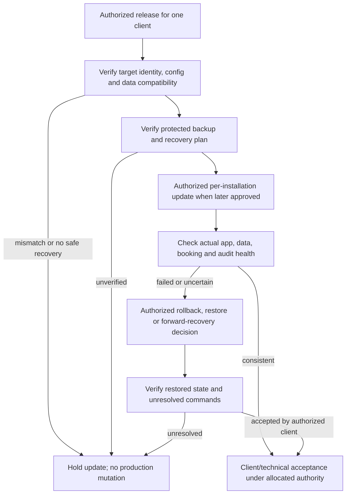
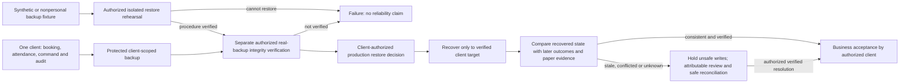

# Configuration & Deployment Design — Appointment Management System

| Field | Value |
|---|---|
| Version | 0.1 |
| Status | **DRAFT — AWAITING PRODUCT OWNER REVIEW** |
| Gate | **Gate 2 — Architecture & Design (IN PROGRESS)** |
| Checkpoint | **9 — Configuration & Deployment Design** |
| Owner | Product Owner |
| Scope | Provisional configuration, installation, deployment, operational ownership, backup, restoration and support design |

> Logical design for Product Owner review, not a selected hosting platform, approved deployment procedure, security assessment, physical schema, release plan, or implementation authorization. Gate 2 remains IN PROGRESS; Gates 3–7 remain BLOCKED.

## 1. Purpose, authority and scope

This document proposes how one maintained commercial Appointment Management System (AMS) could be configured, installed and operated **separately for each client organization** while keeping the same booking integrity and security obligations in both approved hosting-ownership models. It describes *capability and responsibility boundaries*, not actual environments or settings. Configuration decides client business behavior; deployment places and updates an independent installation; operations handle custody, incidents and recoverability; Gate 3 separately reviews security/privacy and data integrity; Gate 4 requires separately authorized implementation; Gate 6 approves a real release. None is completed by this draft.

**Authority:** D-020/D-035 fix separate installations and data; D-034/D-075 fix client authority and no default operator record access; D-083 requires client-managed **and** provider-managed hosting; D-084 approves **one standardized supported deployment profile in principle**, not a specific profile or technology. D-085's modular monolith per installation remains a provisional conceptual direction. Component & Module Design, Detailed System Workflow Design, Data Architecture & Model Design and Interface & API Design v0.1 are accepted *only as Gate 2 working designs* under D-086/D-087/D-088/D-090. The exact D-081 baseline is Requirements Specification **v0.7** and Requirements Traceability **revision 1.0**, approved as development-stage assumptions, **not representative validation**; present traceability revision 1.1 is an administrative correction. Charter revision 1.4 is a working draft; recorded decisions govern within their stated scopes. Engineering Governance §§7–8, 11–12, 17–19 require bounded authorization, integrity, security, verified recovery and recorded gate approval. No CEAP source or environment informs this design.

**Labels:** **Approved constraint** = a decision/requirement in its recorded scope; **Proposed** = a reviewable design choice, not approval; **Open** = requires Product Owner disposition or named later review. “Client authority” over business records is distinct from **effective access** (a host/database/backup custodian's technical ability to view or copy records). A shared physical provider is possible only if installations, applications, data and credentials remain independently bounded; it does **not** create shared SaaS tenancy or a central client-data management plane. No cloud vendor, operating system, runtime version, paid product, CI/CD tool, Docker/container platform, backup vendor or database implementation is selected. Laravel/Blade/Tailwind/MariaDB are the D-022 preferred technology direction, not approval to install or pin versions; D-031 leaves exact versions to Gate 4, with provisional Q-007 compatibility/dependency direction still needed at Gate 2.

## 2. Independent deployment model and trust boundaries

One client installation owns an independently operated application boundary, its own database/schema and client business records, its own applicable business/technical configuration and credentials, separately scoped generated artifacts and logs, and identifiable backups/restoration history. There is **no shared tenant database**, cross-client booking/capacity decision, shared guest/staff identity store, or production CEAP connection. Reusing a maintained product release across installations does not merge their live state (D-019/D-020/D-025/D-035; NFR-001/002).

| Logical boundary | Required invariant; proposed verification question / failure response |
|---|---|
| Application and database | Exactly the authorized installation's application reads/writes its corresponding independently isolated client database/schema. Before any service starts or update proceeds, establish that database identity and intended installation agree; mismatch means **no reads/writes** and escalation. No client-supplied installation label overrides this boundary. |
| Business and technical configuration | Business rules belong to that client's authorized administrator and effective policy revision. Technical values remain scoped to one installation and environment; missing or contradictory rules cannot silently default into live booking. A shared code release may be reused without copying another client's configuration. |
| Credentials and secrets | Installation and environment credentials are separate, access limited to allocated custodians, never copied across clients or committed. A missing/invalid credential fails closed, not by connecting to another database or using an operator-wide superuser. Rotation/recovery procedures and custody are open for Gate 3/Q-008. |
| Files and generated artifacts | QR/reference presentations, controlled roster copies/snapshot manifests and other justified files remain within the client/installation access boundary. Public QR is a minimal **lookup locator**, not identity proof; a printed roster crosses a physical custody boundary (D-045/D-074). No shared public directory exposes client records. Storage form remains undecided. |
| Logs, diagnostics and operational visibility | Identify the installation and authorized event context without unnecessary personal data or proof secrets. Access, aggregation and support workflows must not let one client's diagnostics reveal another's records; essential monitoring does not become advanced analytics (D-073; FR-008/NFR-011). Cross-client aggregation of **client data** is not authorized. |
| Backups, restores and historical evidence | Backups and any restored copy preserve installation identity, data/command/audit consistency and custody; a restore target must be verified for the correct client/environment before use. Restore is not automatically an accepted current business state (§10). Backup access can bypass application authorization. |
| Client administration and exceptional operator access | Client administrators control services, staff accounts and ordinary business administration. An operator may have allocated technical custody but **no default record/admin role**; each necessary record access needs explicit client authorization, least scope, defined duration, attribution, review and closure (D-034/D-075). |

**Cross-client mix-up risks:** reused credentials, wrong database target, copied environment settings, storage/backup path collisions, log aggregation that leaks fields, restore to the wrong installation, or support tools that assume an operator-wide admin. The *proposed* boundary check at each install/update/restore is to reconcile the intended installation, configured database, artifact/log/backup scope and custodian authorization before state-changing work; if uncertain, hold the operation. This is a logical obligation, not a chosen discovery mechanism, path convention or tested control. Files, logs and backups are subject to their own isolation and privacy review even if the application database is isolated.

### Conceptual independent-installation boundaries

The dotted links are **possible infrastructure-access risks to constrain**, not permission or a chosen shared physical topology. There is no A↔B data edge and no CEAP dependency. Even where one custodian supports multiple installations, D-034/D-075 prohibit assuming a cross-client application role.

## 3. Provisional standardized supported deployment profile

**D-084 principle:** propose one reviewable *capability contract* that can be satisfied in either hosting-ownership model, with client-specific business settings but without per-client core scheduling forks. It standardizes what must be verifiable, not where or with which vendor it runs. **M** below is an approved-source obligation expressed as a provisional profile capability; **C** is needed only when approved scope/policy uses it; **P** is a candidate implementation-facing design check; **O** remains for decision. None is evidence of a working installation.

| Capability | Profile expectation and status | Deferred selection / verification |
|---|---|---|
| Compatible application runtime and dependencies | **M/P:** support the maintained product release and reproducible compatibility/dependency review without per-client code forks (D-022/D-062; NFR-004). | Q-007 provisional compatibility/dependency approach at Gate 2; exact versions at Gate 4 under D-031/P-005, support policy before release. No runtime/OS pinned. |
| Application execution and web serving | **M/P:** independently address one installation; handle public and authorized staff interactions and isolate application processes/state so one client's requests cannot use another's database or identity context. | Server type, process model, topology and hosting product open (Q-008). No assumed SPA/mobile API. |
| Independent database compatibility | **M:** each client uses its own database/schema; installation must have a compatible data model for the matching product release, enforce approved integrity and refuse unsafe mismatches (D-035; NFR-002/006). | Preferred MariaDB direction is not a selected version/schema/migration; physical design and reviewed changes only in later authorized gates. |
| Secure public and internal transport | **M/P:** protect authenticated operations and personal data in transit and separate public/staff/operator authority. | TLS/key custody and specific controls need Gate 3/Q-008 review; no certificate vendor or topology selected. |
| Configuration and secrets | **M/P:** install-specific, environment-separated secrets and business policy; missing/unsafe policy blocks booking; do not store secrets in source or public output (Engineering Governance §12). | Secret storage/rotation, effective policy format and access mechanism open. |
| Files, QR and roster artifacts | **M:** privacy-minimized QR/reference presentation, authorized printable roster and protected provenance; **C:** durable digital artifact only if later approved for operations. | Format, retention, custody/disposal and whether roster manifest is persisted open (D-045/D-074/D-079). |
| Background processing | **C:** only if a justified approved operation later requires it; correctness/audit cannot rely on an unapproved asynchronous effect. | No queue, worker, broker, scheduled penalty/notification or external messaging service selected. |
| Audit and operational visibility | **M:** attributable accepted-action/QR lookup/config/role/operator/reconciliation evidence and privacy-conscious signals for failures (FR-008; NFR-011; D-073). | Diagnostic/alert transport, reviewer roles, tamper-resistance and retention await Gate 3/Q-008/Q-015. Advanced FR-011 analytics deferred. |
| Backup and verified restoration | **M:** protect separately scoped records, audit/command outcomes, business configuration and required artifacts; backups plus tested restore before relying on data (Engineering Governance §17). | Cadence, storage, encryption/access mechanism, RPO/RTO, restore approval and retention open. A successful backup is not proof of restorability. |
| Updates, rollback and maintenance | **M/P:** identify release per installation, check data/config compatibility and authorized migration need; preserve booking integrity and recovery path. | Downtime/rollback approach and technology are later deployment/release decisions. No zero-downtime or automatic rollback promise. |
| Security/dependency maintenance | **M/P:** identify supported compatibility/security-update obligation and review changes without bypassing Gate 3/4/6 (D-021/D-029/D-036). | Exact dependency versions, update cadence, tooling and security mechanisms unresolved. Docker requires D-023/D-036 justification and approval; D-032/P-006 do not adopt it. |
| Supported client experiences | **M:** applicable desktop/mobile core workflows target WCAG 2.2 AA with current/previous stable Chrome, Edge, Firefox and Safari (NFR-007; D-069). | No conformance result or OS/device matrix is selected here; later evidence required. |

**Provisional choice versus alternatives:** a common profile reduces divergent support/update behavior; client-specific business values live in reviewed configuration rather than core-code forks. An identical deployment platform for both hosting models is **not** required by the profile principle; selecting one would need compatibility and effective-access evidence. Mandatory secure transport or backup *capability* is not a mandate to buy a specific service.

## 4. Logical configuration catalog and ownership

The **client** owns business decisions for services, staff and records (D-075). “Admin” means an authorized **client administrator**, not a provider host administrator. For technical rows, **OPEN** means the authorized client/provider technical custodian and approval path must be allocated under Q-008, even when the operator performs installation/maintenance work. Restart/deployment/migration columns are *impact questions*, never approval to perform them. B = business, T = technical, M = mixed. No row supplies a policy value, default or unapproved penalty feature.

| Category / class | Logical owner; proposer → authorizer | Existing-booking effect; possible technical action | Open policy / review dependency |
|---|---|---|---|
| Installation identity, data boundaries / T | Installation operations; allocated custodian → **OPEN** technical change authority, never self-granted cross-client access | High: wrong target risks cross-client data; changing bound identity may require separate install/recovery, not a silent edit | Matching app/database/credentials/artifact scope; Q-008/Gate 3. |
| Service offerings and public context / B | Client business administration; permitted admin → authorized client admin | Possible: retirement/location/instructions affect accepted bookings; may need re-presentation, not routine code fork | Service-specific field set and existing-booking disposition; FR-001/010, WF-A01. |
| Availability/operating periods and exceptions / B | Client policy; permitted admin → authorized client admin | Yes: changed availability may conflict with accepted bookings; no automatic cancellation | Recurrence, closures, effective times; Q-019, D-085(3). |
| Duration and preparation/cleanup buffers / B | Client policy; permitted admin → authorized client admin | Yes: overlaps/resource use; may need recomputation of candidates and impact decision | No fixed duration/buffer; D-043/D-060/D-079. |
| Capacity, staff and physical resources / B | Client policy; permitted admin → authorized client admin | Yes: reductions, unavailable resources and assignments can affect existing commitments; hold unsafe change | Capacity unit/pooling, resource ownership and allowed exception; Q-019/021. |
| Prohibited duplicate and warning policy / B | Client policy; permitted admin → authorized client admin | Possible for future and existing comparison; cannot retroactively erase accepted bookings | Identity key, comparison window, warning/blocking and legitimate proxy cases; D-044/D-059. Non-punitive warning only. |
| Guest/assisted booking and required fields / B | Client policy within privacy constraints; permitted admin → authorized client admin, qualified review as required | Possible: in-flight forms/stored participation; protect existing accepted records | Proxy proof, attendee-presence, streamlined walk-in fields, scoped guest authority; D-046/D-064/D-090. |
| Cancellation/rescheduling and eligibility / B | Client policy; permitted admin → authorized client admin after Product Owner cutoff disposition | Yes: may change existing booking eligibility; no silent cutoff default or fee enforcement | Q-020/D-079 cutoff **before final Gate 2 approval**; D-089 excludes cancellation/no-show penalties, unrelated service fees undecided. |
| Attendance and QR policy / B/M | Client business rule + security boundary; permitted admin proposes → authorized client decision after Product Owner/qualified review | Possible: status interpretation and existing QR validity; no automatic attendance from QR | Transition/correction authority, QR issuance/revocation/expiry (QR-L01–L12); D-045. |
| Staff roles, grants and supervisor exceptions / B | Client access administration; authorized admin proposes → permitted client approver | Yes: future permission and existing exception work; revoke safely, preserve attribution | Q-009/Q-018 granularity and exception types; no default operator role. |
| Public presentation, accessibility and instructions / B/M | Client business content; permitted admin → authorized client admin within UX/accessibility requirements | Possible: old confirmations and QR guidance must remain truthful | NFR-007/D-065/D-069; no unapproved external messaging channel. |
| Roster fields, snapshot and reconciliation / B/M | Client front-desk/admin policy; permitted admin → authorized client decision + privacy review where required | Yes: printed copies and pending paper batches use prior snapshot as-of; never rewrite paper history | D-074 minimum fields, optional justified contacts, batch/conflict rules; D-079 disposal due Gate 6. |
| Privacy, retention, deletion and audit visibility / B/M | Client business/legal authority with qualified review; client proposal → Product Owner policy disposition where required | Yes: old records, command/audit evidence, backups and paper; cannot silently delete needed integrity history | Q-015, D-079 before Gate 3; no legal basis/period invented. |
| Diagnostic scope and operational alerts / T/M | Installation operations and client privacy authority; allocated custodian proposes → **OPEN** client/provider approval allocation | Possible disclosure/support effect; no booking-state bypass | D-073 categories, reviewer roles and log retention; NFR-011/Gate 3. |
| Backup cadence, restore and recovery objectives / T/M | Installation operations + client record authority; allocated custodian proposes → **OPEN** technical/client approval allocation | Very high: stale restore can lose accepted appointments; verified recovery before business acceptance | Q-008, RPO/RTO/cadence and custody/retention open; Gate 6 runbook. |
| Exceptional operator access / M | Client authorization for client data; operator may request → explicitly authorized client decision-maker | High: access to personal records, audit and revoke; never blanket technical grant | Scope, duration and break-glass (D-034/D-075/D-079); Gate 3 review. |
| Environment/runtime/transport/secrets / T | Allocated installation custodian → **OPEN** technical approval under change control | Compatibility/startup or migration possible; never silently copy production data or secrets | Q-007/Q-008, D-031, Gate 3/4/6; no host, TLS provider or version selected. |

**Change classification:** business changes use authorization and effective policy revisions, not routine core-code forks (D-062/NFR-004). A technical restart, deploy or reviewed migration might someday be needed when an approved capability actually changes; the catalog does not mandate or authorize one. D-089 rules out penalty balances, punitive points/suspensions and automated penalty enforcement even as optional MVP configuration toggles. Ordinary cancellation/no-show *operational* records remain. Requirements Specification v0.7 fee-open references still require separate exact-wording versioned reconciliation and traceability review under Requirements Governance §§6/8; this draft does not amend them or decide unrelated service fees.

## 5. Safe configuration lifecycle and booking impact

**Proposed logical lifecycle:** a client-admin or separately authorized technical custodian **proposes** a scoped revision → the correct client/technical authority **authorizes** it → validate presence, type and internal consistency of effective policy/environment → assess current and future accepted appointments, resources, staff and in-flight commands → **accept atomically with required audit** only if impact is resolved, otherwise **reject/hold with no effective change** → verify resulting behavior/custody and record actual outcome. A proposal is not a live policy; effective time and recorded time are distinct (Checkpoint 7 #01–05). Stale administrator proposals must be re-evaluated against the current revision and current accepted bookings. No UI permission, proposed configuration or host role bypasses server-side authorization (FR-001/008; NFR-003/006; WF-A01; IF-A01/IF-I02/IF-I03).

**Minimum-safe-policy direction (D-085(3), provisional):** before any live booking, an installation needs enough applicable service, schedule, duration/buffer, resource, ordinary capacity, duplicate, required-input, change-eligibility and exception policy to evaluate the requested action. The exact contract and values are **open**, not a fixed list of fields or universal defaults. Reject/hold invalid periods, contradictory staff/resource availability or capacity reduction that leaves accepted commitments inconsistent. An administrator may not silently cancel, reschedule or reclassify old bookings. Product Owner must decide among rejecting a change, retaining prior accepted commitments under documented policy, or an expressly authorized resolution; there is no approved automatic grandfathering/override. Changes requiring appointment mutation still pass Appointment command coordination and the **shared Final booking integrity** boundary, including duplicate/capacity checks and required audit (Checkpoint 5 §§4/9; Checkpoint 8 IF-I03/I04).

**Concurrent policy and booking:** displayed availability is advisory. An in-flight booking must be decided against a coherent effective policy and authoritative occupancy at final acceptance; an admin change and booking cannot both commit incompatible interpretations. An uncertain command response remains unknown, **not a failed booking**, until its prior authoritative outcome and same-intent relationship are established (D-070/D-090). Failed validation or required audit leaves no accepted partial effect. How revisions are stored, concurrency is serialized and rollback is executed is deliberately not selected. Rolling back an unsafe *unaccepted* proposal restores no booking; compensating for an already effective change needs a new authorized impact review, never overwriting history.

### Conceptual configuration-change boundary

The “booking effects” branch is **conditional on a future-approved disposition**; a configuration edit itself is not permission to change appointments or a prescription for transaction technology.

## 6. Client-managed versus provider-managed responsibilities

The client retains **business decision authority** for records, services and staff in both hosting models (D-075). The table asks who *may execute* technical duties after allocation: “client custodian?” and “provider custodian?” are **OPEN candidates, not assignments, access grants or signed support commitments**. In provider-managed hosting, infrastructure possession may create effective access despite no client application role; in client-managed hosting a provider support credential could do the same. Every row needs a reviewed responsibility/effective-access record under Q-008/D-085(5) before choosing the single supported profile.

| Duty / business authority | Client-managed hosting: execution/access question | Provider-managed hosting: execution/access question |
|---|---|---|
| Hosting procurement / Product Owner commercial scope open | Which client custodian procures and authorizes infrastructure? Cost/support terms open. | Which provider custodian procures; who authorizes terms? No paid hosting assumed (Q-010/D-055). |
| Infrastructure administration / client record authority unchanged | Which client host administrator can read data indirectly; how is provider support constrained? | Which provider host administrator can access filesystem, database or snapshots; how is access bounded and reviewed? |
| Application deployment and updates / client change approval plus technical allocation | Which custodian verifies per-client target, compatible release and maintenance approval? | Which provider custodian executes per-installation release under client coordination? No shared tenant deploy. |
| Database custody / client controls records | Which client database custodian has raw access? | Which provider database custodian has raw access despite no default app/admin grant? |
| Secrets, credentials, TLS / authorization and custody open | Who provisions/rotates environment credentials and secure transport without revealing client data to support staff? | Who holds keys/certificates and can effectively decrypt records/traffic; who reviews rotation and incident access? |
| Backups and restore authorization / client record decisions + Q-008 procedure | Who creates/stores/verifies backups; who can inspect them; who approves restore into client production? | Which provider custodian can read snapshots; what separate client authorization precedes production restore? |
| Monitoring/diagnostics and incident response / client privacy authority + open responder allocation | Who sees minimized logs, detects failures and escalates; when may provider diagnose without records? | Which provider responder sees operational data and alerts; how are client notification and scope reviewed? |
| Security maintenance / release scope and technical change control | Who applies supported patches and verifies a client's independent installation? | Who applies patches without default access to appointment data; who approves per-client rollout? |
| Business configuration and staff administration / **client** | Client admin decides service, capacity, scheduling, roles; technical custodian is not business admin. | Same client decision; provider infrastructure role cannot approve business policies or grant itself staff access. |
| Privacy, retention and printed roster / client policy with qualified review and Product Owner milestone | Who applies approved record/paper custody and disposal policy? | Who handles backups/logs under client-controlled policy; where does physical paper remain? |
| Exceptional support / **explicit client authorization** | Who requests, grants, logs, reviews and closes scoped provider/client-data access? | Same explicit client approval despite provider host access; how is technical visibility restricted? |
| Decommissioning/data handover / client authority + contract open | Who verifies custody and revokes client/provider credentials after authorized transfer? | Who returns client records/evidence, removes provider copies under approved retention, and proves closure? |

**Responsibility-flow illustration (conceptual):**

This diagram branches between two **alternative** ownership models for a single installation, not two simultaneous installations sharing state. Dotted arrows signify conditional support, not standing host/database grants. Business authority never transfers merely because a provider executes technical work. Detailed service levels, commercial terms and legal responsibilities are not approved by this matrix.

## 7. Application permission versus effective infrastructure access

The following is a **trust-assessment matrix**, not a permission grant. `Scoped` means only within separately approved application authority; `Possible` indicates effective technical visibility to be constrained, not legitimate business authorization; `Open` needs an allocated custodial procedure. A role may have no app permission yet still have effective host/backup access, so a “no default operator access” design must address both (D-034/D-075/NFR-005; Checkpoint 8 IF-O01/IF-O02).

| Actor | Application | Raw DB / host | Backup / logs | Exceptional support |
|---|---|---|---|---|
| Public guest/proxy | Scoped availability/booking and separately proven appointment management; no account required | None | None | None |
| Client staff | Scoped appointment/QR/attendance/roster/reconciliation within assigned permissions | No inherent raw access | No inherent backup; scoped audit visibility only as authorized | Not operator support by being staff |
| Client supervisor | Scoped staff work plus configured reasoned exception authority | No inherent raw access | Scoped review only | Cannot waive unrelated controls |
| Client administrator | Client services/policies/internal grants; not a host or vendor superuser | No inherent raw access | Authorized business review, not backup custody by default | Can request/approve only within client approval policy; exact approver open |
| Client technical custodian | No inherent appointment-admin role | **Possible** host/DB access if allocated in client-managed model | **Possible** backup/log access; scope and accountability open | Technical custody is not client-record business authority |
| Provider technical custodian | No inherent appointment-admin role in either model | **Possible** host/DB access in provider-managed model or authorized support | **Possible** backup/log access; restrict and audit | Client authorization needed before exceptional record access |
| Product/system operator | **Denied by default** for client records/admin | May have **possible** technical visibility depending on Q-008 hosting allocation | Possible diagnostics/backups require effective-access safeguards | Explicit client authorization, least scope, defined duration, attribution, review and closure; no implicit break-glass |
| Backup/restore custodian (client or provider) | No inherent appointment-admin role | May require **possible** backup/restore host access | **Possible** full client-record copy, requiring independent controls | Separate restore authorization and any exceptional data access under approved procedure |

**Boundary to approve later:** credential custody, least-privilege infrastructure roles, how copies and logs are protected, who authorizes an operator support request, how actual access is attributed, and how temporary scope is revoked/closed. An emergency/break-glass rule and access duration are **not approved** and require D-079 Product Owner disposition before Gate 3 security/privacy design-review approval. A host/backup custodian may be technically capable of reading records; this risk cannot be wished away by app-role labels. No silent sharing of credentials, raw data or backup copies across client installations is permitted.

## 8. Development, test, production and restore-validation environments

| Boundary | Proposed treatment / authorization |
|---|---|
| Local development | Independent nonproduction configuration, credentials and data; no production CEAP or client-production access, no real secrets in repository/docs. Local choice of infrastructure remains unselected. |
| Automated/integration test | **Isolated test environment with its own database** (Engineering Governance §14), synthetic or otherwise appropriately authorized data, never copied production personal data. Later security/integrity tests include D-070 contention, authentication, denied access, backup/restore and failure paths; none run here. |
| Staging or preproduction | **Conditional/proposed** only if needed for deployment rehearsal. Independently scoped environment, own secrets and database; use synthetic or nonproduction data, not personal data copied from production. It does not become a shared client-data service. Whether one exists is open under Q-008. |
| Production per client | Only a separately authorized release to the correct installation with reviewed settings and data boundary. No tests/migrations/restore performed as a consequence of this design. No development credential or diagnostic bypass should cross into production. |
| Restore validation | A separately authorized, controlled nonproduction target uses synthetic or nonpersonal backup data to verify the recovery procedure without client-production mutation or cross-client exposure. Engineering Governance §14 forbids production-copied personal test data. Verification of a real client backup's integrity and any production recovery need a separately approved, privacy-reviewed procedure; this draft authorizes no production-data rehearsal. |

Promotion means a reviewed *release identity and compatible configuration* can move through approved environments; it is **not** permission to copy client production records or secrets along with it. A migration/update rehearsal and production preflight are later required plans/evidence, not work performed now. Operations must identify actual installation/environment before any update, backup or restore, and deny a wrong-client target. Qualified Gate 3 review and Gate 6 release authorization remain prerequisites; later tests must not act on client production or CEAP (D-025; Engineering Governance §§11–14).

## 9. Proposed deployment, update and rollback lifecycle

**Prepare → validate → back up → deploy/update → verify → accept or recover → record evidence** is a logical review sequence, not an executable runbook. Per-installation release identity, prior version, effective business configuration revision, database/schema compatibility, required artifacts, secret custody, authorized change window, accountable actor and restore/rollback constraints must be known before any future authorized execution. The client controls business configuration/records; which client/provider custodian runs the release and who approves technical rollback are still open under Q-008. An update affecting a booked service may require an explicit client impact decision rather than a technical rollback alone.

Before live change, validate intended client/database/environment, release-to-data compatibility, minimum safe business policy, migration need and rollback/forward-recovery feasibility. Make or verify a protected backup per the approved future procedure; **a backup job's success does not prove restore will work**. During update, prevent partially applied application/data changes from accepting bookings with incompatible policy. Afterward, check installation identity, permitted public/staff paths, booking-integrity/audit health, retained appointments and operational signals within authorized scope. Accept only on actual verified state and role-appropriate sign-off; otherwise hold service/safe writes and choose approved rollback, restore or forward correction. A database change that cannot safely be reversed is not made reversible merely by rolling back application files. Log actual result, affected installation and responsible actor; make unknown in-flight booking outcomes subject to safe command reconciliation before replay (WF-X02; D-090). No zero-downtime or automatic rollback claim, deployment tool, update cadence or approved migration is introduced.

### Conceptual update/rollback decision

The “update” node describes a **future** authorized action, not one performed or approved here. Returning an old application release cannot by itself restore newer bookings; §10 distinguishes recovery completeness from business acceptance.

## 10. Backup, restoration and disaster recovery

**Recovery set, proposed:** installation-specific application release identity/compatibility information; client database and booking/capacity state; effective business/technical configuration (with secrets protected separately); the required audit, command/outcome and exceptional-access evidence; protected QR/roster artifacts and snapshot provenance **only where the approved representation requires them**; and enough custody/restore evidence to identify what was recovered. A partial restore that discards accepted command outcomes, attendance or audit while keeping appointments is unsafe. Exact file representation, backup mechanism, encryption/access controls, cadence, retention, RPO and RTO are **open**. RPO (recovery-point objective) is the tolerated data-loss window; RTO (recovery-time objective) is the tolerated recovery time—neither has an approved number.

Four different claims must be kept separate:

| Claim | Required future evidence; what it does **not** prove |
|---|---|
| Backup job succeeded | A dated, client-scoped protected copy is reported; does **not** establish it can be read or restored. |
| Backup is restorable | An authorized isolated rehearsal with synthetic/nonpersonal backup data verifies the procedure, readable data, compatible app and access boundaries. It does **not** alone prove that a particular client backup is readable, nor that nothing happened after its creation; real-backup verification needs a separately approved procedure. |
| Recovery is complete | Compare recovered bookings, capacity, attendance, command outcomes, audit, roster/reconciliation and later real-world activity; identify gaps and in-flight/unknown operations. A successful restore alone does **not** establish completeness. |
| Business accepts restored state | An authorized client decision-maker reviews discrepancies and approves a controlled resolution before relying on records. Technical custody cannot approve silently lost appointments. |

Before production restore, verify the correct installation/environment, explicit client authorization for record-state restoration, technical actor/custody scope and protected backup provenance. Secure transfer/storage and encryption/access mechanisms require Gate 3 review; no decryption key is stored in the document or shared across installations by assumption. Rehearse only with synthetic/nonpersonal data in an isolated validation target; protect and dispose of copies under later-approved privacy policy. A real client's backup requires separately authorized verification without copying production personal data into the test environment. Recovered state may be **stale**: new bookings, cancellations, attendance and QR lookups since the backup may exist in confirmations, paper or authorized operational evidence. Do not open booking as if stale capacity is free, blindly replay unknown commands, auto-import paper observations, or silently overwrite newer truth. Hold unsafe writes, compare available authoritative evidence and paper snapshot provenance, surface conflicts for authorized review, then run any permitted booking-affecting change through the Final booking integrity boundary and explicit attendance change through its separate boundary (Checkpoint 8 IF-I03/I04/I06/I07). Whether the recovery strategy can establish an authoritative outcome when evidence is missing remains open and requires escalation, not fabricated success. Record incident, technical restore evidence, differences, custodian, client acceptance and closure; backup/restore access itself is auditable.

### Conceptual backup/restore and reconciliation

These are *logical obligations*, not a storage layout, guaranteed ability to reconstruct lost events, RPO/RTO value or automatic production restore. A synthetic rehearsal is not proof that the real backup is restorable; its verification procedure remains open under Q-008 and Gate 3/6 review. Paper remains evidence, never an offline writable booking store.

## 11. Essential monitoring, incidents and ownership

Privacy-conscious signals must cover availability/important operational failures, booking rejection/unknown outcome and unexpected application errors, capacity/duplicate or referential violations, QR lookup/attendance failures, invalid/unsafe configuration, paper reconciliation failures/conflicts, backup/restore failures and security-relevant events (FR-008; NFR-011; D-073). No advanced FR-011 reporting/analytics is revived. Distinguish expected business rejection from integrity failure; distinguish temporary lost response from confirmed rejection (D-070/D-090). Protected audit evidence of an actual accepted booking/configuration/role/QR lookup/exception/reconciliation action is not replaceable by an alert. Minimize names, proof material and diagnostic contents; logs and backups are privacy-sensitive and separately scoped.

**Proposed incident chain:** detect and attribute to the correct installation → allocate responder under the chosen hosting model → contain unsafe state changes without inventing a success/failure → assess client-record exposure and current booking/audit consistency → obtain client authorization for data-bearing support or restore → reconcile affected commands/paper → record actual resolution and responsible roles. Client-managed versus provider-managed monitoring, on-call coverage, escalation, notice obligations and contractual support levels are **OPEN under Q-008**, not presumed. Severe security/data-integrity defects block release as governed by D-038/D-071; no incident response technology or alert delivery channel is selected. Availability and response-time numeric targets Q-022/Q-016 remain for D-079 disposition before final Gate 2 approval.

## 12. Portability, handover and decommissioning

An independent installation may later be handed to another **authorized custodian** or retired, but this draft approves no export format, automatic transfer or deletion period. Plan an inventory of client records, effective policy, staff grants, audit/command outcome evidence, controlled roster/QR artifacts where retained, infrastructure credentials, backups, logs and diagnostic exports; establish who has legal/business authority and who can technically execute handover. Verify destination remains independently isolated from other clients and CEAP, compatible with release/data and restricted to authorized custodians before any restoration or service cutover. Do not copy shared credentials or expose personal data through support tooling.

**Proposed closure sequence:** client approves scope and recipient → authorized technical custodian produces protected handover evidence and verifies completeness with the client → authorized team revokes/rotates old access and stops writes → tracks physical roster copies, historical backups, logs, stale test/restore copies and prior environments to the later-approved retention/deletion policy → records actual disposal or lawful retention and closure review. A decommissioning request does not itself erase required audit or backup dependencies, and a host's ability to delete a backup does not substitute for client data authority. Q-008/Q-015, D-079 and Gate 3/Gate 6 review must resolve custody, format, retention and verification before an actual handover.

## 13. Failure scenarios and bounded tradeoffs

These scenarios identify required *future* detection/safe outcomes, not implemented checks or tested recovery. “Owner” means logical responsibility; actual client/provider responder allocation remains Q-008.

| Scenario | Detection obligation → safe response | Evidence / owner; unresolved choice |
|---|---|---|
| Wrong client database or artifact/storage target | Verify installation identity/binding before action → hold all reads/writes, never fall back to another client | Technical custodian, isolation/attempt evidence; target attestation approach Q-008/Gate 3. |
| Missing/invalid secret | Validate scoped credential without disclosure → deny service-dependent operation; never use shared fallback | Custodian and minimized failure signal; secret custody/rotation open. |
| Unsafe schedule/capacity/resource configuration | Check minimum safe policy and affected bookings → reject/hold change; no silent cancellation/overbooking | Client admin/config audit + Final booking integrity; policy disposition Q-019/021. |
| Interrupted deployment / failed database update | Verify release-to-data compatibility and actual state → hold unsafe writes, choose separately authorized rollback/restore/forward recovery | Technical/client decision and release/incident evidence; migration reversal feasibility open. |
| Incompatible application/database revision | Preflight compatibility and post-update verification → do not accept bookings on incompatible state | Release custodian; supported profile and Q-007/versions open. |
| Lost response after accepted booking | Compare command intent with authoritative outcome → mark unknown until established; no blind retry or false failure | Appointment command/audit owner (#12–13/#22); retry mechanics open (D-090). |
| Stale restored appointments or attendance | Compare backup point with later authoritative/paper evidence → hold unsafe writes and review conflicts, do not silently overwrite newer state | Client accepts business resolution; custodian reports gaps; RPO/RTO/reconciliation open. |
| Sensitive backup or restore copy exposed | Identify copy/reader and restrict further exposure; follow future-approved incident/privacy procedure | Custodian and client authority; encryption, notices, retention and incident rules Gate 3/Q-015. |
| Provider technical access without client-data authorization | Detect/log actual effective access and block unjustified application record use; escalate for client review | Client approval record and access audit; host-level technical constraints/roles open (D-075). |
| Client production data in test/staging by mistake | Detect source/target mismatch → stop tests and contain copies, no further use | Test/custody incident evidence; data sanitization and deletion policy Gate 3. |
| Hosting or storage unavailable | Detect service/backup failure → mark new command outcomes accurately, use controlled paper roster only where approved | Allocated responder/operational evidence; availability/RTO/incident allocation Q-008/Q-022. |
| Cross-client log/backup or diagnostic mix-up | Verify scoped source/destination and access → stop distribution/restore; assess exposure, preserve evidence | Client/provider custodian plus privacy reviewer; aggregation, notice and remediation open. |

**Tradeoff:** stricter failure-closed checks may delay availability or update completion, but accepting a booking against unknown client identity, inconsistent capacity or a stale restore risks data exposure and orphaned records (D-029/NFR-006). The later Q-016/Q-022 dispositions will inform measurable operations; they cannot waive integrity/privacy obligations. No universal downtime, retry timer, backup interval, storage class or support service level is inferred.

## 14. Source and architecture traceability

This is **design traceability, not validation or test evidence**. Source names are: [Requirements Specification](../requirements/REQUIREMENTS_SPECIFICATION.md) v0.7 and [Requirements Traceability](../requirements/REQUIREMENTS_TRACEABILITY.md) revision 1.0 under D-081 (present traceability revision 1.1 is administrative); [Conceptual Architecture](CONCEPTUAL_ARCHITECTURE.md) (Checkpoint 4), [Component & Module Design](COMPONENT_MODULE_DESIGN.md) (Checkpoint 5/D-086), [Detailed System Workflow Design](DETAILED_SYSTEM_WORKFLOW_DESIGN.md) (Checkpoint 6/D-087), [Data Architecture & Model Design](DATA_ARCHITECTURE_MODEL_DESIGN.md) (Checkpoint 7/D-088), [Interface & API Design](INTERFACE_API_DESIGN.md) (Checkpoint 8/D-090). `#` identifiers below are *logical candidates* in Data §3; `IF-*` and `WF-*` are draft-local interface/workflow references, not physical classes/endpoints.

| Design area / sections | Actual active requirement, rule, journey and criterion links | Prior architecture, decisions and design dependencies |
|---|---|---|
| Independent installation/profile, environments (§§2–3/8) | NFR-001/002/004/007/010; FR-001/012; BR-005/007; UJ-004; AC-006/008 | Conceptual §§4/11–12; Component §§3/11; Workflow WF-O02; Data #01/#22–24; Interface IF-O02/IF-I02; D-020/025/031/035/062/069/081/083/084/090 |
| Service and safe policy revision (§§4–5) | FR-001/004/007/015/018; NFR-003/004/006; BR-001/002/005/007; UJ-001/003/005; AC-001/009/011/013 | Conceptual §9; Component §§4/6/9; Workflow WF-P01/P04/A01/X01; Data #01–06/#12–15; Interface IF-A01/IF-I02/IF-I03; D-043/044/048/059/060/070/079/085(3)/090 |
| Guest, QR, attendance and authorized roles (§§4/7/11) | FR-003/005/006/008/013/014; NFR-003/005/009/011; BR-003/006/007/008; UJ-001/002/005; AC-002/003/004/010 | Conceptual §§7–8; Component §§7/10; Workflow WF-P02/P03/S01/S02/S03; Data #07–11/#16–17/#22; Interface IF-P06–IF-P08/IF-S01–IF-S05/IF-I01/IF-I05/IF-I06; D-034/045/046/075/085(1–2)/090 |
| Booking/concurrency, unknown commands and releases (§§5/9–10/13) | FR-002/007/008/010/013/015; NFR-006/008/011; BR-001/002/005/006; UJ-001/003/005; AC-001/005/009/010/011 | Conceptual §9; Component §§6/9; Workflow WF-P02/P04/P05/X01/X02/X04; Data #05–08/#12–14/#22; Interface IF-P04/IF-P09/IF-P10/IF-I03/IF-I04; D-044/070/079/090 |
| Roster, paper continuity and reconciliation (§§2/4/10–11) | FR-008/016/017; NFR-006/009/011; BR-009; UJ-005; AC-012 | Conceptual §10; Component §8; Workflow WF-X03/X04; Data #18–22/#25; Interface IF-S08/IF-S09/IF-I07; D-051/063/073/074/079/085(4) |
| Operator, hosting, backup/restore and incident (§§6–13) | FR-008/012; NFR-001/002/003/005/009/010/011; BR-004/007; UJ-004; AC-007/008 | Conceptual §§3/11–12; Component §§3/10–11; Workflow WF-O01/O02/X04; Data #01/#22–24; Interface IF-O01/IF-O02/IF-S10; D-034/035/038/073/075/079/083/084/085(5)/090 |

The table links **only relevant** active records to configuration/deployment obligations; other workflow details remain in Checkpoints 4–8 and the Gate 1 matrix. FR-009 generic eligibility/masterlist and FR-011 advanced reporting/analytics remain **DEFERRED** (D-042); the daily roster and essential D-073 monitoring do not revive FR-011. Public accounts, paid processing/deposits, automated outbound messaging, waitlists, multiple branches, offline new-booking synchronization and D-076 queue/notes/typing corrections are not added. D-089 excludes MVP cancellation/no-show penalties without removing normal cancellation/no-show evidence or deciding unrelated service fees. No penalty configuration switch is proposed.

## 15. Open decisions and governance milestones

**No row below is approval of an option.** The Product Owner owns policy and gate dispositions; client administrators own permitted installation-specific business values *after* policy is approved; qualified reviewers and allocated custodians provide evidence, not Product Owner approvals. Identifiers refer to existing Decision Register questions/decisions, not new D-IDs.

| Decision or question / present state | Owner; consequence for this design | Required milestone |
|---|---|---|
| Q-020/D-079 cancellation/rescheduling cutoff and eligibility — **OPEN**; one-hour and 24-hour suggestions not approved | Product Owner; determines live policy, revisions and treatment of accepted bookings; D-089 forbids MVP penalties | **Before final Gate 2 architecture approval.** |
| Q-016/D-079 numeric response-time target — **OPEN** | Product Owner; informs profile verification but no number/test result invented | **Before final Gate 2 architecture approval:** approve value or formally dispose. |
| Q-022/D-079 numeric availability target — **OPEN** | Product Owner; informs recovery/monitoring and support planning, not an assumed SLA | **Before final Gate 2 architecture approval:** approve value or formally dispose. |
| D-079/Q-015 retention/deletion policy — **OPEN** | Product Owner with qualified privacy/security review; governs audit, logs, backups, restore copies and client handover | **Before Gate 3 security/privacy design-review approval.** |
| D-079 exceptional operator-access duration — **OPEN** | Product Owner; scope/revocation evidence needed; no four-hour default | **Before Gate 3 security/privacy design-review approval.** |
| D-079 emergency/break-glass policy — **OPEN**, none granted | Product Owner; decide whether any procedure exists and controls; no default bypass | **Before Gate 3 security/privacy design-review approval.** |
| D-079/D-074 printed-roster handling/disposal — **OPEN** | Product Owner with client/qualified review; governs copy custody, distribution and deletion | **Before Gate 6 release approval.** |
| Q-007/D-031/P-005 profile runtime/dependency compatibility — **OPEN** | Product Owner; provisional compatibility/dependency approach needed in Gate 2, exact versions Gate 4 | Gate 2 design decision; versions before Gate 4 implementation, release evidence Gate 6. |
| Q-008/D-083/D-084/D-085(5) supported profile, dual-hosting duty and effective-access matrices — **OPEN** | Product Owner with client/provider custodians; assign procurement, credentials, backups, restore, incident and support accountability without shared client data | Gate 2 architecture review before selecting supported profile; operational/release detail Gate 6. |
| Backup cadence, RPO/RTO, restore approval/test and recovery completeness — **OPEN** | Product Owner with client record authority and operational reviewers; defines loss/time tolerance, safe restore and evidence; no numeric value implied | Gate 2/Q-008 design as needed; actual tested restore before reliance on data (Governance §17) and Gate 6 release approval. |
| Configuration-change impact, capacity/duplicate units/key/window, staff/resource and service policies — **OPEN** (D-043/D-044/D-059/D-060/D-085) | Product Owner/client policy review; cannot finalize minimum safe config or revise accepted bookings by inference | Gate 2 final architecture where relied upon; Gate 3 integrity review before implementation. |
| Guest proof, QR lifecycle, attendance correction, command/retry identity and paper conflict/batch rules — **OPEN** | Product Owner/qualified reviewers; D-090 keeps account-free scope and unknown outcome distinct from rejection; no auth or idempotency technology selected | Gate 2/Gate 3 design before implementation, with D-079 explicitly deferring idempotency mechanics without an invented Gate 2 deadline. |
| Environment ownership, secret custody, incident escalation, support/decommissioning and portable handover — **OPEN** | Product Owner with client/provider custodians; align technical access with client business authorization and deletion policy | Gate 2 Q-008 design and later Gate 3 security/Gate 6 operational approvals as applicable. |
| D-089 / v0.7 fee-open references — **penalties excluded, text reconciliation OPEN** | Product Owner; no MVP penalty config; unrelated service fees undecided; Requirements Governance §§6/8 require versioned Specification amendment and affected Traceability review | Separate exact-wording approval before replacing D-081 v0.7 effective baseline; this document makes no amendment. |

**Governance boundary:** D-020/D-035 isolation, D-070 50-valid-requests/one-capacity-unit integrity and D-090's lost-response limitation apply under either hosting model. A proposed monitoring profile cannot waive unknown-outcome reconciliation. No D-079 deadline is replaced by a calendar date, and the deferred idempotency mechanism is not given a false new deadline. Genuine product-fit validation, Gate 3 security/data-integrity review, qualified independent privacy/security assessment, later tests and separate Gate 6 release sign-off remain outstanding. This document cannot approve a host, runtime, operator access, schema, gate transition or actual deployment.

## 16. Checkpoint 8 consistency and Product Owner review

Configuration cannot write an appointment around Checkpoint 8 IF-I03; a technical host/database/backup role is **not** appointment-data authorization (IF-O01/IF-O02); guest booking needs **no public account** but guest state changes require separately approved scoped proof; QR/reference is a lookup locator, never identity proof or attendance; attendance needs explicit authorized IF-I06 action; paper observations are proposals, not a second live database; a lost booking response remains **unknown**, not rejected, until IF-I04 establishes the prior outcome; blind retry cannot create another accepted booking; D-089 penalty features are neither configuration switches nor operational defaults. Independent installations never become shared tenancy. These are review criteria, not claims that any control has been implemented or tested.

For Product Owner review: are the §§2–3 capability boundaries sufficient across both hosting ownership models without selecting a technology; does §6 make **business authority versus technical execution/effective access** explicit; do §§9–10 adequately protect accepted appointments and unknown commands during update/restore; and are §15's open allocations/dispositions correctly timed? A provisional working-design disposition, if later given, would still not approve a deployment, security control, gate exit or implementation.

## 17. Single internal self-audit and validation limits

**Author self-audit only; not an independent review.** Checked sections 1–16 against the requested scope, the current D-081 baseline, D-082 Gate 2 authorization, D-083/D-084 both-hosting and one-profile constraints, D-085–D-090 provisional boundaries, the Checkpoint 7/8 data/interface owners, and D-079 milestones. Checked both ownership models and effective access, per-client isolation, no vendor/version/targets, safe config changes, backup/restore/incident authority, deferred features, source ID links, conceptual diagrams and no implementation claims.

| Severity | Finding and disposition |
|---|---|
| **BLOCKER** | None found within this bounded *draft* scope; no final Gate 2 approval or real deployment is claimed. |
| **MAJOR** | Q-008 allocation of credential, host, backup, restore and support custody is unresolved. An operator without an application role can still have effective access to client data in either hosting model. Preserved the distinction and OPEN allocations in §§6–7/15 rather than granting authority. RPO/RTO, backup cadence and real-backup verification/restore acceptance also remain open; no guarantee of recoverability is asserted. During this audit the staging/restore-rehearsal wording was corrected to enforce Engineering Governance §14's prohibition on production-copied personal test data (§§8/10). |
| **MINOR** | Mermaid source and table references can be inspected here, but **no Mermaid parser or visual renderer was run**; no diagram-rendering result is claimed. Later physical runbooks, exact-version compatibility evidence and controlled restore results are outside this documentation pass. |

**Corrections incorporated in this single drafting execution:** separated backup success, restorability, completeness and business acceptance without claiming synthetic rehearsal proves a real client's backup; excluded production-copied personal data from staging/test/restore validation; kept per-installation identity separate from a shared physical provider; distinguished technical custody from client authorization; required post-restore review of unknown command outcomes before booking resumes; preserved D-089's fee-versus-penalty distinction and D-090's rejected-versus-unknown result boundary. Unresolved authority is visible in §15 instead of becoming an invented policy. No application, database, deployment, security, performance, accessibility, restore or diagram-rendering test was performed; this draft does not claim any such result.
