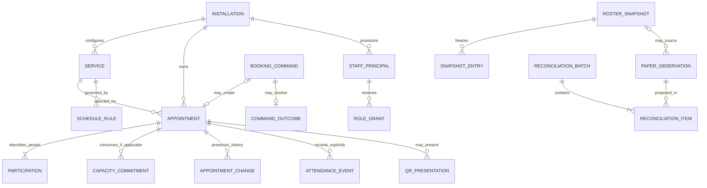
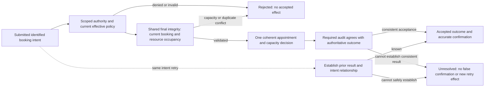
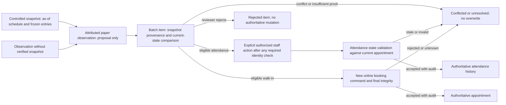

# Data Architecture & Model Design — Appointment Management System

| Field | Value |
|---|---|
| Version | v0.1 |
| Status | **DRAFT — AWAITING PRODUCT OWNER REVIEW** |
| Gate | **Gate 2 — IN PROGRESS** |
| Checkpoint | **7 — Data Architecture & Model Design** |
| Approval | **Not approved** |
| Owner / approval authority | Product Owner |

> Logical design for review only. Every named entity below is a **logical candidate**, not an approved table, class, database schema, interface, enum, or implementation mechanism. This document does not accept Checkpoint 7 or approve Gate 2.

## 1. Authority, scope, and reading convention

The source baseline is Requirements Specification **v0.7** and Requirements Traceability **revision 1.0**, approved by D-081 for *development-stage design assumptions*, not representative stakeholder validation. The present traceability revision 1.1 is an administrative status reconciliation, not a second baseline. Gate 1 is complete under D-082; Gate 2 authorizes architecture/design documentation only. D-083/D-084 constrain both hosting-ownership models and one standardized supported deployment profile *in principle*; D-085's modular-monolith and other conceptual directions remain provisional. Component & Module Design v0.1 and Detailed System Workflow Design v0.1 are provisionally accepted for continued Gate 2 work under D-086 and D-087, respectively, not approved final architecture. References to their logical responsibilities and `WF-*` identifiers below inherit those limitations.

**Product Owner direction received for this checkpoint, pending formal recording:** cancellation and no-show **penalties are excluded from MVP**. No fees, violation points, punitive automated warnings, suspensions, penalty balances, or enforcement entities are proposed. Operational cancellation and no-show evidence remains necessary. The existing Specification §6 and Decision Register Q-020 still list *fees* among open client-policy questions; that wording is **not** authority to design an MVP fee. Product Owner should record the exclusion and reconcile those open references through change control; this draft does not amend them. A configurable cutoff remains open under D-079 and must be disposed of before final Gate 2 architecture approval. A duplicate-*booking* warning under D-059/BR-002 is a non-punitive booking-integrity response, not a penalty warning.

Sources read: `docs/PROJECT_CHARTER.md`; `docs/ENGINEERING_GOVERNANCE.md`; `docs/GATE_REGISTER.md`; `docs/decisions/DECISION_REGISTER.md`; `docs/requirements/REQUIREMENTS_SPECIFICATION.md`; `docs/requirements/REQUIREMENTS_TRACEABILITY.md`; `docs/architecture/CONCEPTUAL_ARCHITECTURE.md`; `docs/architecture/COMPONENT_MODULE_DESIGN.md`; `docs/architecture/DETAILED_SYSTEM_WORKFLOW_DESIGN.md`; and `AGENTS.md`. No CEAP source is used.

**Key:** In attribute groups, **R** = information required by the current source obligation (not necessarily a separate stored field); **P** = proposed representation for design review; **O** = open policy/representation. A reference to an event is not a commitment to event sourcing. Cardinalities describe conceptual associations, not physical foreign keys. A logical candidate may be folded into another representation later; audit and integrity obligations must survive that choice.

## 2. Data architecture principles and ownership

1. **One installation, one authoritative client boundary.** Each client organization has a separate installation with its own application, data/database/schema, configuration, and credentials (D-020/D-035; NFR-001/002). An installation label is an operational provenance aid, **not** a shared tenant key in a pooled client database. No cross-installation record or CEAP dependency is permitted.
2. **Client controls business records.** Client administrators control services, policy and staff administration; authorized staff create and manage appointments and attendance under role policy. The provider/operator has technical custody duties but no default client-record or client-admin access (D-034/D-075). Hosting ownership does not confer application authority; backup, diagnostic and host access can still expose data and must be separately controlled (§11).
3. **One final booking integrity decision.** Availability is advisory; every accepted guest, staff, change, supervisor-exception or reconciled booking uses current effective policy and authoritative state at the shared final integrity boundary (D-085(3); Component §4; Workflow §3.3). Attendance has a separate validated mutation boundary. Required outcome and audit evidence agree; failure must not produce a success confirmation.
4. **Minimal, attributable and recoverable.** Collect only fields necessary for permitted booking, service, roster, recovery or review. Preserve provenance and before/after evidence for material changes, restrict audit/diagnostic disclosure, and design backups/restores and deletion together. A snapshot or paper observation is evidence, never the live appointment source of truth (D-050/D-051/D-074; NFR-009/011).
5. **Logical, not physical.** This design names information, relationships, optionality and invariants. It does not choose SQL types, indexes, locks, transaction isolation, table boundaries, QR encoding, cryptography, credential storage, API paths, retention periods, deployment topology or a fixed status enum. Those choices require later Interface/API, deployment/configuration, Gate 3 review and authorized implementation. No assumption of shared SaaS tenancy, universal durations, universal capacity units, masterlists or mandatory public accounts is made.

## 3. Logical candidate inventory and attribute contract

The **25 numbered rows** are logical candidates. “Owner” means the responsibility that decides the business meaning; it does not grant direct database access. Lifecycle descriptions are conceptual. `R/P/O` classify the candidate attributes in each row. Stable identifiers below mean locally stable identity for linkage, **not** a globally exposed identifier or selected storage format. Actor and timestamps are carried on relevant decisions/evidence even when not repeated in every row.

| # / candidate and responsibility | Authoritative owner; relationships and lifecycle | Candidate attribute groups and source |
|---|---|---|
| 01 **Installation context / effective configuration**: boundary and applicable policy revision | Client policy and configuration; one installation has many services, actors and records. Proposal → validated effective revision or rejected/held; per-installation boundary remains distinct from deployment metadata. | **R:** client-scoped service/scheduling/duplicate/change policies, applicable effective state; **P:** local installation provenance, policy revision, effective-from and recorded-at, approving actor/impact disposition; **O:** minimum safe configuration contract and historical policy interpretation. FR-001; BR-005; D-020/062/085(3); WF-A01. |
| 02 **Service offering**: bookable service and presentation context | Client policy and configuration; installation has many offerings, appointment selects one effective offering. Active/changed/retired with existing-booking impact review. | **R:** service identity/context, configurable duration/buffers and applicable policy; **P:** local service ID, display label, applicable revision, location/arrival instructions and effective period; **O:** service variants and retention of retired descriptions. FR-001/010; D-043/060/065; WF-A01. |
| 03 **Scheduling rule / availability exception**: permitted periods and changes | Client policy and configuration; service and optionally resource have many rules/exceptions. Effective/expired/superseded; changes cannot silently invalidate bookings. | **R:** availability periods, staff availability and exceptions to applicable schedule; **P:** rule ID, scope, effective interval, recorded-at and actor; **O:** recurrence/closure representation and time-zone interpretation. FR-001/018; BR-005; WF-P01/A01. |
| 04 **Capacity resource**: constrained staff or physical resource | Client policy and configuration; can serve multiple offerings where policy permits; one appointment can require zero/multiple resources (model open). Available/unavailable/retired subject to impact review. | **R:** applicable staff/physical-resource constraints, ordinary capacity; **P:** resource ID, kind, availability and effective revision; **O:** capacity unit, pooling, assignment cardinality and shared-resource semantics. D-043/060; FR-001; WF-X01. |
| 05 **Capacity commitment / allocation**: logical consumption or release | Final booking integrity; each accepted capacity-consuming appointment has the necessary commitments; allocation links applicable service/time/resource. Created/adjusted/released only with accepted booking/change; not a mandated stored ledger. | **R:** effective occupied capacity for relevant unit/period/resources; **P:** commitment identity, appointment link, interval including buffers, applied policy revision and change provenance; **O:** whether computed from bookings or materialized and how overlap is modeled. BR-001; NFR-006; AC-005/009; WF-X01. |
| 06 **Appointment**: authoritative booking identity and current booking outcome | Appointment command coordination + Final booking integrity; links offering, participant context, optional allocations and history. Accepted → eligible for authorized changes/attendance → cancellation or other approved disposition; preserve historical identity. | **R:** unique appointment reference, service/date/time/status and applicable instructions for confirmation; **P:** internal local ID distinct from public reference, original and current schedule context, policy revision, created/updated recorded times and version for stale-write detection; **O:** exact booking state graph and whether reschedule retains identity or links replacement appointments. FR-002/007/010; AC-009; WF-P02/P04. |
| 07 **Booking participation**: distinct booker/contact and attendee relationships | Appointment command coordination; an appointment has intended attendee participation and booker/contact context; can record staff-assisted/proxy/walk-in mode. Participation remains historically interpretable after change. | **R:** actor versus booker/contact versus intended attendee, proxy/walk-in context and required relationship; **P:** participation ID, role, appointment/person links or scoped captured details, provenance and effective-at; **O:** attendee count and service-specific presence/proxy rules. FR-003/013; BR-006; AC-010; WF-P02. |
| 08 **Person/contact details (scoped)**: minimum identification and contact for booking/service | Client-controlled appointment context; reused customer profile is optional, not required. Details may be embedded per participation rather than a longitudinal customer record. Collect → permitted correction/change → deletion/minimization under policy. | **R:** service/policy-required identification and contact only; **P:** scoped person/contact reference, separately labeled name/contact and capture provenance; **O:** identity matching key, verification evidence and whether any cross-booking linkage is justified. D-046/050/059; FR-013; NFR-009. |
| 09 **Internal staff principal**: individually accountable client worker | Identity/authorization; belongs to one installation; may hold multiple grants and act on appointments/audit. Provisioned → enabled/disabled, with historical actor linkage preserved. | **R:** individual actor attribution, authentication and staff identity; **P:** local staff ID, account state and provisioning actor/time; **O:** authentication/provisioning method and account lifecycle. D-047; Q-009; FR-004/008; WF-S03. |
| 10 **Role/permission grant**: scoped internal authority | Identity/authorization; one principal has zero/many grants; grants may be changed by permitted client admin. Grant/revoke history remains reviewable. | **R:** staff/supervisor/admin distinctions and least privilege; **P:** grant ID, permitted scope, grantor, effective/recorded times and revocation evidence; **O:** permission matrix and whether roles or direct scoped grants express it. D-047/048; BR-007; Q-018; WF-S03. |
| 11 **Scoped guest authority / recovery evidence**: proof separate from reference | Identity, authorization and scoped guest recovery; associates a claimant, requested operation and one permitted appointment context, without requiring public account. Issued/verified/denied/recovered/closed only under approved future procedure. | **R:** approved scoped guest authentication for state changes, separation from QR/reference; **P:** proof attempt ID, claim scope, proof-verification result, authorized staff intervention and minimal provenance; **O:** credential/channel, claimant proof, expiry, reissue/recovery and retention. NFR-003; D-061/085(1); WF-P03. |
| 12 **Booking-affecting command**: identifiable submitted intent | Appointment command coordination; one command can target an existing appointment or request creation; may have repeated deliveries. Submitted → accepted/rejected or unresolved until established. | **R:** requested operation, authorized actor, intent and authoritative result relationship; **P:** local command identity, intent correlation, actor/scope, target, normalized request meaning, submitted/recorded time, expected version and evaluated policy revision; **O:** client/server identity issuance, canonical equivalence, expiration and retry protocol. WF-X02; FR-002/007; NFR-006. |
| 13 **Authoritative command outcome**: resolution of one intent | Appointment command coordination + required audit obligation; one command has at most one established final outcome; unresolved means unknown, not failure. Record accepted/rejected or hold uncertain until resolved. | **R:** actual accepted/rejected/unresolved evidence and clear response; **P:** outcome ID/correlation, outcome kind, appointment/change link if accepted, reason category, decided/recorded time and audit link; **O:** durability/lookup mechanics and retention. WF-X02; FR-002/008/010; D-085(3). |
| 14 **Appointment change history**: cancellation/reschedule and permitted booking-affecting edits | Appointment command coordination; appointment has zero/many changes with originating command and before/after references. Append historical outcome on accepted action; no erasure of prior schedule/cancellation facts by a later change. | **R:** cancellation/reschedule actual outcome, actor/time, capacity effect; **P:** change ID, prior/new schedule and booking state, reason where policy requires, effective and recorded times, policy revision, command link; **O:** exact correction/change authority and same-ID versus replacement-ID reschedule. FR-007/008; AC-009; WF-P04. |
| 15 **Supervisor exception authorization**: scoped, reasoned rule deviation | Supervisor exception decisions; zero/one applicable approval per exceptional action unless future policy says otherwise; links affected appointment/command and audit. Requested → denied or approved-for-validation → actual accepted/rejected result. | **R:** supervisor actor, time, rule, reason, affected appointment and before/after outcome; **P:** exception ID, scope, applied policy revision, command/outcome link; **O:** permitted types, limits, sequence when appointment does not exist yet. D-048; FR-015; AC-011; WF-X01. |
| 16 **Reference / QR presentation**: privacy-minimized lookup artifact | QR presentation and authorized lookup; appointment may have one or multiple representations across reissue (undecided). Eligibility linked to current appointment state; generation/reissue/expiry/revocation only if approved. | **R:** unique appointment reference, minimal QR lookup information and authorized presentation; **P:** presentation identity, appointment link, issuance/reissue provenance; **O:** QR contents, activation, expiry/revocation, repeat/consume behavior and reference rotation (QR-L01–L09). FR-005/006; D-045; WF-S01. |
| 17 **Attendance/service-state history**: explicit operational record | Attendance/service-state validation; appointment has zero/many recorded transitions; current status may be derived. Initial expected context, arrival, completion and no-show are minimum conceptual labels, not approved enum/transitions. | **R:** explicitly recorded status, actor/action, time and valid appointment; **P:** transition ID, previous/resulting status, effective observation time versus recorded time, policy/version and correction provenance; **O:** legal transitions, no-show timing, correction authority and service start semantics. FR-014; BR-008; WF-S02. |
| 18 **Controlled roster snapshot**: authorized daily print provenance | Roster and reconciliation; one snapshot covers a selected local date/scope and many appointment entries as-of generation; multiple snapshots may cover same date. Generated/printed → physically controlled/disposed under later policy. | **R:** reference, date/time, attendee name, service, staff/resource where applicable and attendance status; **P:** snapshot ID/revision, source schedule/as-of time, generator/print actor, scope and copy/custody evidence; **O:** additional controlled contacts, physical copy tracking and disposal. D-074; FR-016; WF-X03. |
| 19 **Paper observation**: non-authoritative outage evidence | Roster and reconciliation; associated with a snapshot where available and a paper line/source, possibly an unmatched walk-in proposal. Observed during outage → transcribed/reviewed or left unresolved; never directly updates appointment. | **R:** paper-recorded attendance/walk-in proposal and responsible actor; **P:** observation ID, snapshot/line provenance, claimed event time versus transcription time, recorder, limited original content and ambiguity marker; **O:** missing-snapshot procedure and evidentiary sufficiency. D-051/063; BR-009; WF-X03. |
| 20 **Reconciliation batch**: attributable submission envelope | Roster and reconciliation; one batch contains one/many proposed items; belongs to one installation and identified source context. Open → reviewed/closed or awaiting unresolved items; batch atomicity is open. | **R:** batch processing of multiple paper updates, attribution; **P:** batch ID, submitting actor, snapshot references, submission/review times, summary of actual outcomes; **O:** batch-wide versus per-item atomicity and reopening. FR-017; D-063; WF-X03. |
| 21 **Reconciliation item / conflict resolution**: review decision for one proposal | Roster and reconciliation; each item links one observation and batch, compares current state, and may link a resulting attendance transition or online booking command. Proposed → accepted/conflicted/unresolved/rejected; later resolution retains the earlier assessment. | **R:** explicit accepted/conflicted/unresolved outcomes, conflict detection, review attribution, no overwrite; **P:** item ID, observed versus current versions, conflict reason, reviewer/decision time, resulting authoritative action/outcome link; **O:** conflict vocabulary, rejection/review authority, re-review and competing observations. D-085(4); FR-017; AC-012; WF-X03. |
| 22 **Audit event / required outcome evidence**: protected accountable history | Audit and essential operational visibility; references applicable action, actor, target and outcome without being a second source of appointment truth. Recorded with accepted mutation where required; protected/reviewed/deleted under approved policy. | **R:** booking/change, QR lookup, attendance, configuration, role, exception, operator access and reconciliation events; **P:** event ID, category, actor/scope, target, actual decision, effective/recorded times and minimal before/after reference; **O:** rejected-attempt detail, tamper resistance, access and retention. FR-008; NFR-011; WF-X02/X03. |
| 23 **Exceptional operator access authorization**: client-approved temporary scope | Installation operations boundary + client authorizer; zero/many requests per installation, no default access. Requested → denied or scoped authorized → reviewed/closed; actual access separately evidenced. | **R:** explicit client authorization, least scope, duration, actor, audit, review/closure; **P:** request ID, client approver, rationale, scope, start/end and actual-access references; **O:** duration, revocation process, emergency break-glass policy. D-034/075/079; FR-012; AC-007; WF-O01. |
| 24 **Operational failure signal**: minimized reviewable incident evidence | Audit and essential operational visibility + installation custodians; links failure category to affected command/reconciliation/installation only where justified. Detected → triaged/resolved; not an analytics warehouse. | **R:** booking failures, errors, security events, integrity/capacity violations, reconciliation failures; **P:** signal ID, category, observed time, minimal correlation, accountable reviewer and disposition; **O:** alerting technology, responsible host role, retention. D-073; NFR-011; WF-X04. |
| 25 **Snapshot entry**: frozen roster-line values as printed | Roster and reconciliation; one snapshot has many entries, each reflecting one eligible appointment at as-of time; later appointment changes do not rewrite the snapshot. Its durable representation is undecided. | **R:** D-074 minimum roster fields as captured; **P:** snapshot-local entry identity, appointment ID/reference as-of, status and assigned resource as-of; **O:** whether protected digital copy/manifest or another verifiable representation is retained and minimized. FR-016/017; BR-009; WF-X03. |

**Modeling tradeoff:** person/contact and roster-entry candidates can be embedded in the appointment/snapshot rather than independently persisted. Keeping explicit *logical* boundaries makes booker ≠ attendee and paper-as-of provenance reviewable without mandating separate tables or building a customer masterlist. Likewise, a capacity commitment can be derived rather than persisted, but accepted occupancy must be demonstrable. No penalty entity is proposed; no-show is an operational attendance observation.

## 4. Relationships, cardinalities and identifiers

| Conceptual association | Cardinality / optionality and unresolved choice |
|---|---|
| Installation → configuration/service/staff/appointment/audit | One installation has zero/many records of each kind; every client business record is scoped to exactly one installation. New installation may have no bookings; minimum safe configuration is required before accepting bookings. No cross-installation parent or shared customer identity. |
| Service → appointment; schedule/resource → service | An accepted appointment selects exactly one applicable service offering; a service has zero/many appointments and availability rules. A rule applies to one or more service/resource scopes (exact sharing open). A resource may be shared across offerings if policy permits; zero/many assignments per appointment are possible pending capacity model. |
| Appointment → participation → attendee/booker/contact | An accepted booking requires an intended attendee context and booker/contact context; they may identify the same person or different people. One attendee versus multiple attendees per booking is **open** and affects capacity/duplicate policy (D-046/D-059). No public account required; an internal staff actor is separate from participation. Whether person details are reused across appointments is open. |
| Appointment → capacity/change/attendance/presentation | An appointment may require zero/many logical allocations according to the resource model (but all applicable capacity must be accounted for); zero/many historical changes and attendance events; zero/many presentations if reissue is allowed. One accepted booking has one unique public reference within its installation; rotation/reschedule behavior open. |
| Command → outcome → appointment/change/audit | One identified submitted intent has at most one established final accepted or rejected result; an unresolved command has no established final result yet. One accepted creation targets one appointment, but the reschedule representation is undecided. Repeated deliveries of the *same* intent must not create multiple effects; every required accepted-action audit is consistent with its result. |
| Principal → grants/actions; guest proof → action | One staff principal has zero/many time-scoped grants; many attributable actions. A guest proof is scoped to an operation/appointment claim, not an account-wide permission; one proof attempt may produce no authority. Supervisor exception belongs to an identifiable action and affected appointment (or proposed appointment until accepted). |
| Snapshot → entry/observation → batch/item → authoritative action | One snapshot has zero/many captured entries and can support many observations; an observation may be unmatched to a snapshot pending review (never automatically accepted). One batch has one/many items; an item concerns one proposal; an accepted item links the actual command or attendance transition. A snapshot can be printed more than once; copy/custody treatment remains open. |
| Exceptional operator request → access/audit | Each request is scoped to one installation, with one explicit client authorization if approved and zero/many actual-access events. Effective infrastructure visibility is not represented by a grant alone and requires the separate controls in §11. |

**Identifier boundary.** Internal local IDs link records and preserve history; the public appointment reference is a business identifier disclosed in confirmation/roster/lookup and must be unique for accepted creation in its installation. A QR representation may encode or reference it, but is not permission. Command/intent identity and snapshot/entry identity are proposed stable correlation identifiers; their generation, secrecy, collision behavior and exposure are open. Effective time (when a policy/observation/action applies) and recorded time (when the installation learned it) must remain distinguishable for policy revisions, outage observations and corrections. Version/concurrency evidence is proposed for stale changes; it is not a selected compare-and-swap or locking technique.

### Conceptual entity relationship (selected core candidates)

Diagram notation is illustrative: the `BOOKING_COMMAND`/`APPOINTMENT` edge depicts a *creation* attempt only, not all change commands; optional command outcome means no final resolution established yet. The snapshot/observation edge does **not** require every paper observation to have a matching snapshot: unmatched observations stay unresolved. Snapshot entries and attendance history may be embedded in other representations. The diagram deliberately omits some audit/authority relationships to remain legible; the tables above are controlling where a drawing cannot express an open cardinality.

## 5. Appointment and attendance lifecycle integrity

| Stage / event | Authoritative interpretation and no-effect condition |
|---|---|
| Discovery and request | Candidate availability does not reserve capacity. A submitted command first has an actor, operation and intended effect; only a final accepted decision creates an appointment/reference and necessary capacity commitment. Rejected commands do not create a partial appointment. A lost response is **unresolved** until the prior result is established, not a rejection. |
| Active booking and change | Accepted appointment is eligible only under current applicable client policy. Cancellation by scoped guest or permitted staff records actual before/after and releases relevant capacity once. Rescheduling validates destination resources/duplicate/capacity and releases/reallocates as one consistent outcome; same-ID versus linked-replacement representation is open. A failed change leaves prior booking/commitments intact. Applicable cutoff remains unapproved (D-079). |
| Lookup and attendance | QR/reference lookup is a permitted read with required QR-lookup audit. Any required identity/entitlement check is a separate staff procedure. Arrival, service start/completion and no-show are distinct operational actions; only an explicit, individually authorized, valid staff action changes attendance. Invalid/cancelled/stale or unauthorized requests make no attendance change. |
| Correction and history | A later authorized correction, if approved, links previous and resulting state and reason/actor/time without deleting earlier evidence. Do not interpret D-076's deferred routine typing-correction feature as a grant of general edit authority. Attendance corrections and exceptions require Product Owner permission/transition decisions. |

Booking lifecycle and attendance/service history are separate: cancellation changes booking eligibility/capacity, not proof of a past arrival; marking no-show does not itself cancel, penalize, or release capacity unless a separately approved booking rule says so. The minimum conceptual attendance labels in FR-014 are `expected`, `arrived`, `completed`, `no-show`; **they are not approved database enums or a final state-transition graph**. The Product Owner must determine legal sequences (including service start, late arrival, cancellation-vs-attendance races, post-completion correction, no-show recording time), authorized actors and correction rules. There is no approved universal appointment-status list.

## 6. Capacity, scheduling, concurrency and configuration impact

The final integrity boundary receives the effective service/schedule, duration and preparation/cleanup buffers, staff/physical-resource availability, applicable capacity unit/period, duplicate policy, proposed appointment state and any *permitted* reasoned exception. Invariant **I1:** accepted ordinary occupancy must never exceed effective capacity across all overlapping applicable constraints. **I2:** a booking prohibited by the configured duplicate key/window cannot complete, even under simultaneous attempts; warning-only behavior is permitted only where the actual policy allows the booking and legitimate proxy/multiple-attendee cases are preserved. **I3:** every accepted creation has a unique reference and no orphaned dependent evidence. **I4:** one accepted cancellation releases its applicable commitment once; a reschedule cannot hold old and new capacity inconsistently or silently lose the old reservation. **I5:** no accepted configuration change silently makes existing bookings invalid; concurrent configuration/booking decisions use a coherent effective revision and impact disposition. **I6:** authorized exceptions carry required supervisor reason/actor/rule/time/affected appointment/before-after and still pass unrelated integrity checks (D-048).

Conceptual strategies for later evaluation include deriving occupancy from active bookings or tracking explicit commitments; evaluating overlapping intervals for staff, rooms and buffers; serializing conflicting final decisions or using equivalent integrity-preserving checks; and versioning effective configuration. These are **alternatives**, not approved locks, transactions, database constraints or specific algorithms. Multi-record accepted operations and their required audit evidence must be consistent/atomic and roll back on failure (Engineering Governance §11; Component §9). A displayed alternative is still rechecked at submission. Reject or hold an incomplete policy/configuration change rather than invent a default. Product Owner policy must determine whether existing bookings are grandfathered, change rejected, or resolved through a separately authorized exception.

**D-070 acceptance obligation:** with 50 simultaneous *valid* requests for the same one remaining capacity unit and appropriately specified duplicate-policy preconditions, **exactly one** reservation succeeds; the other 49 get safe clear outcomes, with no over-capacity, prohibited duplicate, partial or orphaned state. This is a future design/test scenario, not an implemented or measured result. The 20–100 appointments/day profile is not a capacity ceiling or simultaneous-user target (D-067). Numeric response-time and availability dispositions remain open under Q-016/Q-022 and D-079.

### Authoritative capacity / outcome relationship

The “known” retry edge to `O` depicts an already accepted prior result; a known prior rejection returns `R`. The boxes show logical consistency obligations, not a runtime ordering or claim that a failed audit may leave a committed appointment: the eventual mechanism must prevent reporting acceptance without required consistent evidence and must safely resolve uncertainty.

## 7. Command outcomes and safe retries

For a booking, cancellation or reschedule, distinguish (a) an accepted command with exactly its accepted effect and attributable audit; (b) a rejected command with no accepted effect, including policy/authority/conflict reason as safely disclosable; (c) an unresolved command when response or durable result cannot be established; (d) a repeat of a known *same* intent, which returns its established outcome with no new effect; and (e) a genuinely new authorized intent, rechecked against current state and policy. “There is a similar appointment” does **not** distinguish (d) from (e) or prove an earlier outcome.

The proposed command identity must remain stable across deliveries of the same intent; operation kind, appointment scope, actor/authority context and meaningful requested change must be checked for consistency before treating a repeat as the same command. A different authorized intent needs distinct correlation and fresh validation. Changes in authority/policy between delivery and retry, multiple devices, lost acknowledgements, rejected command resubmission, identifier collision, retention and command/result recovery remain open. Do not replay a command when prior intent or result cannot safely be determined: return unresolved/no-new-effect and route to review. Required audit and final authoritative outcome must agree; diagnostic monitoring is not a substitute for required audit. This defines no final idempotency token, transport, retention or retry protocol (D-079; WF-X02).

## 8. Guest, proxy, assisted and recovery boundaries

The **initiator** submits a request; the **booker/contact** may be a guest or proxy; the **attendee** is the intended service participant; **assisting staff** act with their own authority; a **recovery claimant** seeks scoped access; an **administrator/supervisor** acts only under their permitted role. They must not be collapsed into one implicit user. A walk-in may be staff-assisted but still requires the policy-specific minimum attendee/contact facts and all final checks (FR-013; D-064). No masterlist, compulsory public account, universal identity field or mandatory SMS/OTP is assumed.

Reference/QR possession identifies a *candidate* appointment, never identity, proxy entitlement, management permission or attendance (D-045/D-085(1–2)). Scoped guest proof and recovery may require separately verified evidence or staff mediation; the Product Owner must decide acceptable proof, authorization for proxies, disclosure on failed lookup, recovery channel, issuance/reissue, expiry and data minimization with qualified privacy/security review. Unauthorized or ambiguous claims fail closed without revealing unrelated appointments. Neither a public confirmation nor a roster confers authorization.

## 9. QR lookup, attendance and paper provenance

Reference issuance belongs to an accepted appointment; eligible QR presentation needs a separately approved access path and lifecycle (QR-L01–L09). Authorized staff lookup verifies current eligibility and returns only the permitted minimum result. Invalid/cancelled presentations do not silently look active; expired/revoked handling is conditional on those states being approved. QR lookup is recorded under FR-008 and must not itself alter attendance. Simultaneous cancellation/reschedule versus lookup/attendance must validate current state at the relevant decision boundary. Repeated scans, revocation, clock rules and authorized correction remain open.

The daily roster is an authorized, printable as-of **snapshot** with D-074 minimum fields. Snapshot identity, source schedule/as-of time, printing actor, entry identity and custody provenance make later comparison possible; later changes do not rewrite the printed snapshot. Paper observations, including walk-ins noted during an outage, are **proposals only**, not offline-created bookings. Following restoration, an attributable batch links each item to observation/snapshot where known and compares observed facts with current authoritative appointment/attendance. An attendance proposal requires any applicable identity procedure, explicit authorized staff acceptance and current-state attendance validation. A walk-in proposal, if permitted, is a new *online* booking request through final capacity/duplicate checks. Each item preserves accepted, conflicted, unresolved or rejected disposition and any actual resulting action. Newer state is never silently overwritten. Duplicate lines, missing snapshot/reference, conflicting observations, stale/cancelled appointment and insufficient evidence remain visible for authorized review; batch-versus-item atomicity, conflict representation/review authority, correction authority and retention are open (D-051/063/085(4); WF-X03).

### Attendance and paper provenance (logical, not automatic transitions)

An observation without verified snapshot provenance must remain unresolved until the approved review procedure establishes whether it can be acted on; the diagram's eligible branches require that separate review. The `UNSOURCED` edge represents uncertain provenance, not a second authoritative roster.

## 10. Access, privacy, retention, recoverability and hosting custody

| Data category | Sensitivity and intended access boundary |
|---|---|
| Appointment, participation, scoped contact, recovery evidence | Personal/sensitive operational data. Authorized guest sees only own scoped permitted details; staff see only role-necessary data; client controls records. Public reference and QR disclose minimum information and do not authenticate the bearer. |
| Services, policy, capacity, resources, role grants | Client business/authorization data; client administrator edits within scope, staff reads only as needed; changes audited. Scheduling/resource information disclosed publicly only as needed for availability, not staff personal information. |
| Attendance, no-show, change, supervisor exception | Personal/action history; permitted staff/supervisor review and corrections under future policy. No-show is operational status, never a penalty balance. |
| Roster snapshot/entries, physical paper, reconciliation | Personal data crossing a physical boundary; only authorized generation, limited distribution/custody, minimum D-074 fields. Extra contacts require justification and controls. Printing/disposal policy due by Gate 6 (D-079). |
| Commands/outcomes, audit, diagnostics, operator access | Protected evidence; minimal identifiers/reasons, restricted review, individual attribution where applicable. No unnecessary personal data in logs; tamper-resistance and deletion mechanics require later design. Operator exceptional access requires separate explicit client authorization, limited scope/duration, audit and review. |

Client-managed **and** provider-managed hosting (D-083) require responsibility and *effective-access* review: who holds infrastructure credentials, can read backups/logs or restored data, applies updates, sees incidents, authorizes restore and closes support access. Client control of business records is not proof that a provider custodian lacks technical read access. Neither hosting arrangement grants a default application role or blanket support access; D-084's one supported-profile principle does not imply shared storage. Interface/API design must specify disclosure/authorization per operation and correlation of accepted outcomes; Deployment Architecture must allocate credential, diagnostic, backup/restore, isolation and recovery duties across both arrangements (Q-007/Q-008). No vendor or mechanism is selected here.

Retention/deletion must treat appointment and participation data, proof, command outcomes (needed for safe retry), audit (needed for accountability), snapshot copies, paper originals, reconciliation and backups as a dependency set. Deletion of a person-facing record must not leave orphaned required integrity/audit evidence; preserve only minimum legally/operationally approved references, and plan how deletion or access restriction reaches backups and restores without silently resurrecting unsafe state. Backups and a *tested* restore procedure are required before relying on data (Engineering Governance §17); this draft claims neither a backup nor a test. Exact legal basis, notices, periods, anonymization, tamper-resistance, recovery objectives and physical disposal remain open (Q-015/Q-008; D-079). Qualified independent privacy/security assessment remains required before Gate 6, and Gate 3 design review before implementation.

## 11. Requirements, architecture and workflow traceability

This matrix maps the **active** D-081 assumption baseline to logical candidates (`#` from §3) and invariant/section; the final column points to existing Gate 2 architecture responsibilities and workflow identifiers. It is design coverage, **not** validation, approval of candidate entities, test evidence or full interface/deployment traceability. BR/UJ/AC identifiers are from Specification v0.7, not new policy decisions.

| Active requirements and criteria | Business rule / journey | Logical coverage and invariant | Existing design / workflow |
|---|---|---|---|
| FR-001, FR-018; NFR-004 | BR-001/005; UJ-001; AC-001/013 | #01–05, #06; §6 effective policy, impact and advisory alternatives | Conceptual §§6/9; Component §§4–6; WF-P01/A01 |
| FR-002, FR-003; NFR-006, NFR-008 | BR-001/002/006; UJ-001; AC-001/005 | #05–08, #12–13; §§5–7 atomic booking, unique reference, D-070 and safe outcomes | Conceptual §9; Component §§6/9; WF-P02/P05/X01/X02 |
| FR-004, FR-007; NFR-003 | BR-005/007/008; UJ-003; AC-009 | #06, #09–14; §§5–8 authority, eligibility, single release/reallocation | Component §§4/6/9; WF-P03/P04/S03 |
| FR-005, FR-006, FR-010; NFR-007 | BR-003/008; UJ-001/002; AC-002/003/004/006 | #06, #11, #16–17; §§5/8/9 minimal lookup distinct from attendance and accessible accurate confirmation; UI conformance remains later evidence | Conceptual §§7–8/12; Component §§7/10; WF-P02/P03/S01 |
| FR-008; NFR-011 | BR-004/007/008/009; UJ-002/004/005; AC-007/011/012 | #12–15, #17–24; §§5/7/9/10 actual attributable evidence, protected operational monitoring | Component §§9–10; WF-X02/X03/X04/O01 |
| FR-012; NFR-001/002/005 | BR-004/007; UJ-004; AC-007 | #01, #09–10, #22–24; §§2/10 per-installation isolation and exceptional access | Conceptual §§3–4/11; Component §§3/11; WF-O01/O02 |
| FR-013; NFR-009 | BR-002/006; UJ-005; AC-010 | #06–08, #11–13; §§4/8 person roles, minimal walk-in and proxy evidence | Component §§4/6; WF-P02/S03 |
| FR-014 | BR-008; UJ-002/005; AC-004 | #16–17, #22; §§5/9 explicit validated attendance, no-show and corrections | Conceptual §8; Component §§7–8; WF-S01/S02 |
| FR-015 | BR-001/007; UJ-005; AC-011 | #05, #12–15, #22; §6 supervisor-only reasoned deviation without bypass | Component §§6/8–9; WF-S02/S03/X01 |
| FR-016, FR-017 | BR-009; UJ-005; AC-012 | #18–22, #25 and #05–06; §§6/9/10 frozen snapshot, reviewed proposal, no silent overwrite | Conceptual §10; Component §§8–9; WF-X03 |
| NFR-010 | D-068 inventory; AC-008 | All applicable candidates; §§5–9 define later success/rejection/authority/failure and 50-to-1 checks, not executed tests | Component §10; Workflow §§4/11 (WF-P01–P05, WF-S01–S03, WF-A01, WF-X01–X04, WF-O01–O02) |

**Coverage note:** NFR-001–NFR-011, BR-001–BR-009, UJ-001–UJ-005 and AC-001–AC-013 appear above; FR-001–FR-008, FR-010 and FR-012–FR-018 are the active functional set. FR-009 (eligibility/masterlist) and FR-011 (advanced analytics/reporting) remain **DEFERRED** under D-042; the roster and essential monitoring do not reinstate them. Interface/API design, deployment architecture and later tests must add their own operation-level traceability. D-076's queue numbers, optional staff notes and routine typing corrections remain deferred. Design references do not constitute representative validation.

## 12. Confirmed constraints, candidate choices and Product Owner decisions

**Confirmed in their recorded scope:** independent per-client installation/data (D-020/035), client business-record control with no default operator access (D-034/075), both hosting arrangements and one standardized-profile *principle* (D-083/084), guest/proxy/walk-in MVP (D-046/061/064), capacity/duplicate invariants (D-043/044/059/060/070), QR as lookup not identity/attendance (D-045), authorized exceptions (D-048), roster/reconciliation without offline synchronization (D-051/063/074), and minimum attendance status capability (FR-014 under D-081). D-085 and the Checkpoint 5/6 designs remain provisional. The new penalty exclusion is Product Owner direction **pending formal governance recording**, not a recorded D-number.

**Proposed choices / tradeoffs:** use separate *logical* booking and attendance histories so QR lookup cannot imply attendance and cancellation does not erase service evidence; keep command outcome evidence distinct from appointment state so lost responses can be resolved; freeze a roster as-of view and keep paper proposals separate from current state. These reduce ambiguity but add provenance and retention dependencies. Fold person/participation or roster entries into their parents if later review shows separate records unnecessary; retain their meaning. Derive occupancy from bookings or retain commitments only if demonstrably correct under concurrency. Reject the assumptions that every attendee is a booker, every guest has an account, one person has only one lifetime booking, capacity is universally a single fixed unit, all visits have one duration, QR grants authority, and paper is a second database.

| Decision / owner | Alternatives and consequence | Deadline / dependency |
|---|---|---|
| **1. Cancellation/rescheduling cutoff** — Product Owner | Configure per installation/service or define another approved eligibility policy; a one-hour proposal is not approved. Determines what history/effective policy is evaluated at the change boundary. | **Before final Gate 2 architecture approval** (D-079/Q-020). |
| **2. Remaining numeric quality targets** — Product Owner | Specify or formally dispose of Q-016 response-time and Q-022 availability targets; D-067/070 already define profile and integrity outcome, not these numbers. Influences capacity and operational design/test criteria. | **Before final Gate 2 architecture approval** (D-079). |
| **3. Penalty exclusion reconciliation** — Product Owner | Record MVP exclusion and amend/clarify Q-020 and Specification §6/§9 fee-open wording through governed change, or identify any genuine conflict requiring baseline amendment. No penalty data design is pending this action. Future penalties require new requirements/change review. | Before final MVP scope/architecture disposition; do not silently treat open fee question as MVP obligation. |
| **4. Capacity and duplicate policy** — Product Owner/client-policy design | Choose capacity units, overlapping resources, identity key/window and warning-vs-blocking; preserve legitimate proxy/multiple-attendee bookings. Without them final checks cannot be specified. | Gate 2 configuration/integrity and Interface/API designs; before final architecture relying on these rules. |
| **5. Appointment, attendance and correction semantics** — Product Owner | Same appointment ID with changes versus linked replacement; define cancellation/attendance race, permitted no-show and completion transitions, actor/correction authority and history requirements. Representation affects reference/QR lifecycle and audit. | Gate 2 Interface/API and Gate 3 integrity/security review before implementation. |
| **6. Guest proof, QR lifecycle and internal permissions** — Product Owner with privacy/security review | Select scoped proof/recovery/expiry/reissue and staff-mediated route, QR-L01–L09 and Q-009/Q-018 details; reference-only authority is excluded. Determines minimum evidence and disclosure. | Gate 2 Interface/API and Gate 3 review; unresolved mechanism is not permission to use SMS/OTP. |
| **7. Configuration impact and paper reconciliation** — Product Owner | Reject affected configuration, preserve prior commitments, or use explicitly authorized exception; decide per-item vs batch atomicity, conflict/rejection/re-review authority, unmatched paper observations and walk-in handling. Tradeoff is safe partial batch progress versus all-or-nothing processing. | Gate 2 configuration/data/interface design and Gate 3 integrity review. |
| **8. Retry evidence and retention** — Product Owner with technical/privacy design review | Choose command identity/canonical same-intent test, authoritative result lookup, unresolved escalation and retention consistent with deletion. A guessed retry risks double effects; overly long evidence retention risks privacy. No final protocol or duration selected. | Later Gate 2 Interface/API + Gate 3 review; D-079 explicitly defers idempotency mechanics without an invented Gate 2 date. |
| **9. Hosting and operator effective access** — Product Owner with operational/security review | Allocate install, credential, monitoring, backup/restore, incident and support duties for client-managed and provider-managed models; select the supported profile only after effective-access review. App-role denial alone cannot bound host/backup access. | Gate 2 Deployment Architecture (Q-007/Q-008, D-083–D-085); exact versions Gate 4 (D-031). |
| **10. Privacy and operational policy** — Product Owner after qualified review | Decide retention/deletion/legal basis/notices, exceptional operator duration and whether any emergency break-glass procedure exists; choose none unless approved. Decide physical roster copy handling/disposal. | **Before Gate 3 security/privacy design-review approval** for retention, duration and break-glass; **before Gate 6 release approval** for roster handling/disposal (D-079). |

No fixed fees, penalties, legal periods, operator four-hour access, break-glass permission or universal one-hour cutoff are adopted here. Q-010 commercial pricing remains deferred to Gate 6 (D-055). Genuine product-fit validation, qualified independent privacy/security assessment, isolated integrity and performance testing, and final gate approvals remain separate obligations.

## 13. Internal self-audit and validation limits

**One author self-audit, not independent review.** Checked the D-081 active/deferred set, D-083–D-087 and Component/Workflow boundaries; all active FR/NFR and BR/UJ/AC families in §11; 25 candidates, optionality and identifier classification; logical-versus-physical scope; penalty exclusion; concurrent booking/change, retry, QR/attendance, paper and operator isolation; diagram-to-prose boundaries; D-079 deadlines and Markdown section references.

| Severity | Finding and disposition |
|---|---|
| BLOCKER | None identified *within this draft's bounded logical-design scope*. Policy decisions that prevent final architecture approval are explicitly open in §12; no gate approval is inferred. |
| MAJOR | Source Q-020 and Specification §6/§9 leave fees open, while the checkpoint's new Product Owner direction excludes cancellation/no-show penalties from MVP. **Preserved both statuses**; omitted monetary/penalty entities and requested formal governance reconciliation (§§1/12), without amending source records. Capacity unit, duplicate identity, attendance graph, retry and batch atomicity also remain open decisions rather than disguised defaults. |
| MINOR | The initial ER edge implied every paper observation had a matching snapshot; corrected it to optional source-snapshot provenance. Undecided attendee/resource cardinality remains expressed in §4 rather than as a fixed diagram edge. Mermaid source was inspected for consistency with the prose, but **no renderer or parser validation was performed** and visual rendering was not independently verified. |

**Corrections incorporated during the single drafting pass:** separated appointment from attendance history; clarified that known rejected retries return rejection; made unmatched paper observations unresolved rather than requiring a valid snapshot; distinguished public reference from command identity and client installation from shared tenancy; preserved D-059's non-punitive duplicate warning; made command/audit consistency and D-070's 49 safe unsuccessful outcomes explicit. Remaining authority decisions are in §12, not silently settled. No physical database, application, deployment or security test was executed by this document.

**Review request:** Product Owner to examine §12's decisions and the fee-open wording against the new penalty exclusion, then review the logical candidates/invariants as proposed working design only. Acceptance of this document, if separately given, is not Gate 2 approval or implementation authorization.
