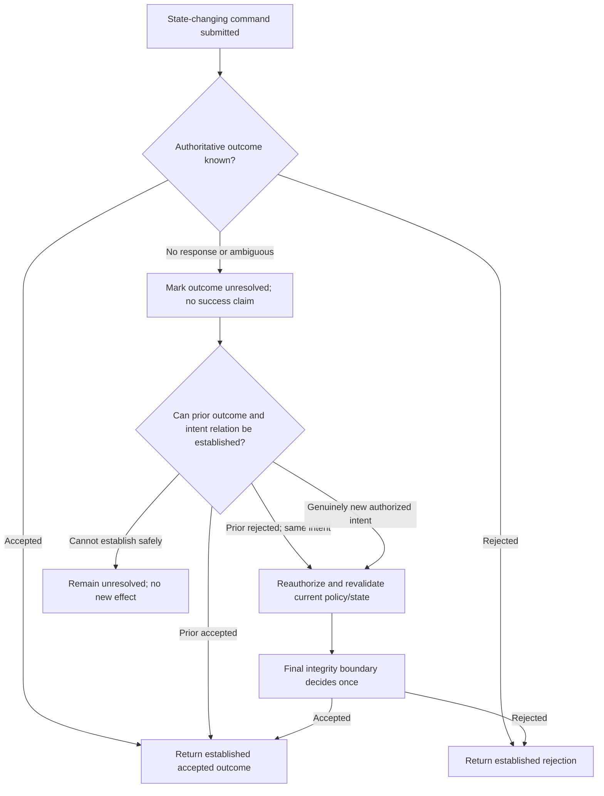
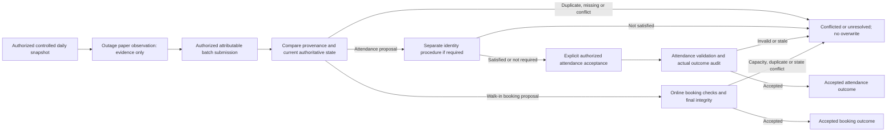
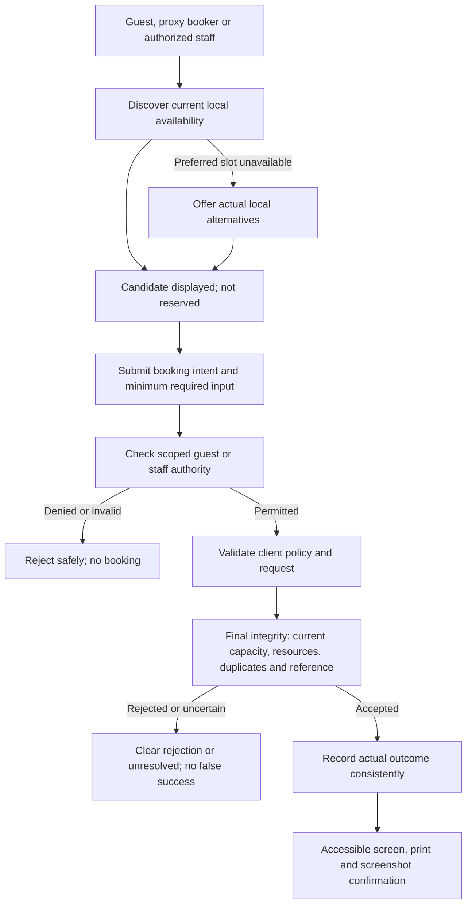
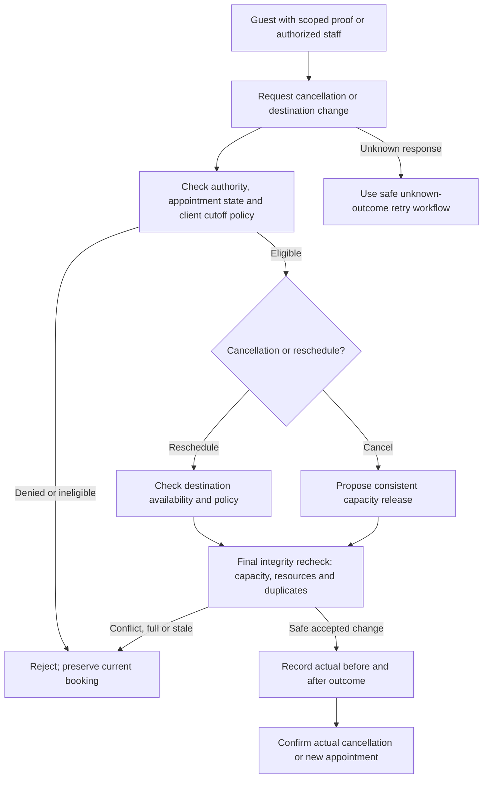
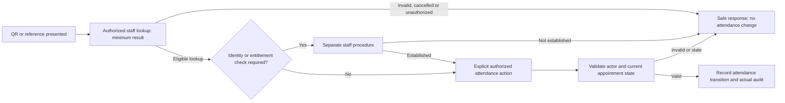
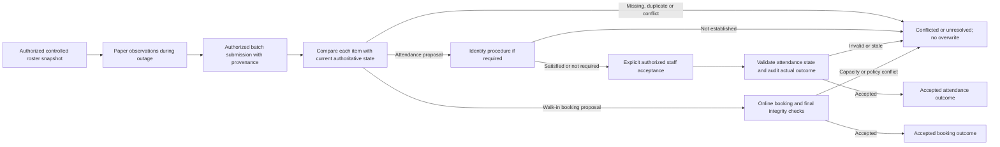
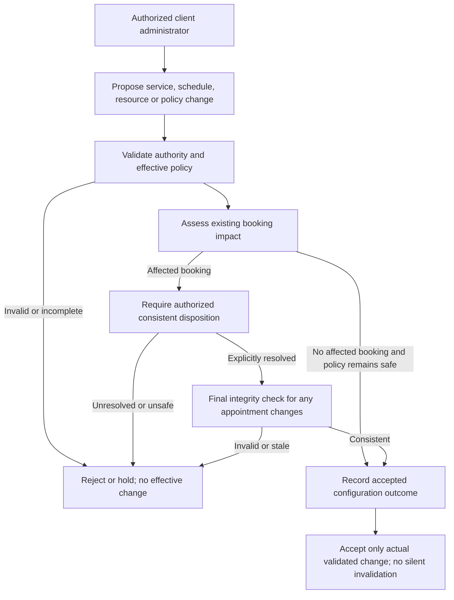

# Detailed System Workflow Design — Appointment Management System

| Field | Value |
|---|---|
| Version | 0.1 |
| Status | **DRAFT — AWAITING PRODUCT OWNER REVIEW** |
| Gate | Gate 2 — Architecture & Design (**IN PROGRESS**) |
| Authority | D-081 development-stage assumption baseline; D-083–D-086 within their recorded scopes |
| Owner / approval authority | Product Owner |

> This is a workflow design proposal for continued Gate 2 work. It is not final architecture, policy approval, independent verification, Gate 2 exit, Gate 3 authorization, implementation authorization, or release approval.

## 1. Purpose and scope

This document describes end-to-end workflow behavior and decision boundaries for the independently installed commercial Appointment Management System. It refines the approved development-stage requirements into actor actions, logical responsibility, observable outcomes and safe exceptions. It uses the logical responsibilities and provisional directions in the provisionally accepted Component & Module Design v0.1; it does not define interfaces, schemas, data models, API contracts, algorithms or deployment technology.

The scope covers public guest, proxy and staff-assisted appointment journeys; staff and administrative duties; concurrency, failure and paper fallback; and operational responsibilities under both hosting ownership arrangements. FR-009 (generic eligibility/masterlist capability) and FR-011 (advanced reporting/analytics) remain deferred. Their identifiers are preserved; essential operational monitoring under FR-008/NFR-011 and the controlled daily roster under FR-016 are not those deferred capabilities.

## 2. Source baselines and governance

- Requirements Specification v0.7 and Requirements Traceability revision 1.0 are the exact D-081 baseline, approved for **development-stage assumptions**, not representative stakeholder validation. Present traceability revision 1.1 is an administrative status reconciliation and does not change the approved links.
- Component & Module Design v0.1 is provisionally accepted under D-086 solely as a Gate 2 working design. Its accepted SHA-256 is `3D25E1DA93775804765F571CF876AE9383027D5280F195A50626631456D61001`.
- D-085 directions, including the modular-monolith-per-independent-installation direction, remain provisional. D-083 requires both client-managed and provider-managed hosting to be accommodated; D-084 sets one standardized supported deployment profile as a principle but selects no profile or technology.
- D-020/D-035 require independent client installations and independent data boundaries. The product must never connect to or affect production CEAP. No CEAP behavior is used as a requirement.
- D-034/D-075 deny default operator access to client records. D-045 establishes that QR/reference possession is not identity, change authority or attendance evidence. D-070's concurrency obligation is a design/test obligation, not a result.
- D-079 deadlines remain binding: resolve cancellation/rescheduling cutoff and remaining measurable quality targets before final Gate 2 architecture approval; retention/deletion, exceptional operator-access duration and break-glass policy before Gate 3 security/privacy review approval; printed-roster handling/disposal before Gate 6 release approval.
- No fixed policy values, numeric response-time or availability targets, hosting technology, database mechanism, API contract or implementation choice is selected here. All protected state changes require approved authentication, server-side authorization and validation. Audit obligations must report actual outcomes.

Gate status remains Gate 2 **IN PROGRESS**; Gates 3–7 remain **BLOCKED**. The requirements are not reclassified as validated by this design.

## 3. Actors, logical responsibilities and shared rules

### 3.1 Actors and boundaries

| Actor | Workflow authority boundary |
|---|---|
| Public guest | May discover availability, make account-free booking requests, access an eligible confirmation/reference and request eligible changes through an approved scoped guest path. A reference alone does not authorize a change. |
| Proxy booker | Acts as booker/contact for an attendee where permitted. Booker and attendee remain distinct; the booker is not identity proof for the attendee. |
| Front-desk staff | Individually authenticated and authorized for assigned routine lookup, appointment, attendance, roster, reconciliation and staff-assisted booking duties. Staff assistance does not grant supervisor authority. |
| Supervisor | Individually authorized to decide only configured exceptions, with reason and required attributable before/after record. Does not bypass final validation. |
| Client administrator | Owns installation configuration, services and internal role administration within approved authority. Configuration cannot silently invalidate existing bookings. |
| Client/provider infrastructure custodian | Performs only allocated technical/hosting responsibilities. Infrastructure and backup custody can confer effective access; this does not by itself grant application authority or permission to view client records. |
| Product operator | Performs authorized technical support without default client-record access or client-administrator privilege. Exceptional record access requires explicit client authorization, least privilege, defined scope/duration, attribution, review and closure. |

Each client installation is an independent application, configuration, credential and data boundary. No workflow crosses client installations or touches CEAP. Paper is a controlled physical snapshot, not another writable appointment database.

### 3.2 Logical responsibilities

Names below match the Component & Module Design v0.1 responsibility boundaries: **Public experience**, **Internal staff experience**, **Identity, authorization and scoped guest recovery**, **Client policy and configuration**, **Availability and alternatives**, **Appointment command coordination**, **Final booking integrity**, **QR presentation and authorized lookup**, **Attendance/service-state validation**, **Supervisor exception decisions**, **Roster and reconciliation**, **Audit and essential operational visibility**, and **Installation operations boundary**. A “final boundary” is a logical responsibility, not a selected database or transaction technology.

### 3.3 Shared rules

1. A displayed availability candidate is advisory. Every booking-affecting request is revalidated against authoritative current policy and state at the Final booking integrity boundary.
2. One accepted command has one authoritative outcome: accepted, rejected, or unresolved. No success confirmation is issued for rejected or unresolved work.
3. Retries first establish the prior authoritative outcome and whether the repeated request is the same intent. Similar current data alone does not prove that a previous command succeeded or failed. If safe determination is impossible, unresolved means no new effect until resolution.
4. Booking, cancellation, rescheduling and any multi-record reallocation are atomic in outcome: failed work leaves no partial or orphaned appointment. No lock, queue, transaction, schema or idempotency mechanism is prescribed.
5. Ordinary capacity and configured prohibited-duplicate rules cannot be bypassed under contention. D-070's 50 valid requests for one remaining capacity unit must eventually produce exactly one accepted booking and safe outcomes for the others, with no integrity violation.
6. Cancellation/rescheduling rechecks authority, cutoff/eligibility, destination availability, duplicate and capacity policy. No unapproved cutoff or fee is assumed.
7. QR presentation, QR lookup, separate identity/entitlement procedure, attendance, and service completion are distinct. Only explicit, authorized and validated attendance action changes attendance.
8. Paper observations are proposals. They do not automatically change authoritative booking or attendance. Every accepted, conflicted or unresolved reconciliation result remains attributable and reviewable under approved access and retention policy.
9. Required audit evidence must reflect the actual authoritative outcome. Attempted, requested, displayed or assumed success is not recorded as success. Exact audit fields, retention and tamper-resistance mechanisms remain open.
10. An unresolved or unsafe configuration change cannot silently invalidate existing appointments. The approved disposition for affected bookings remains open.

## 4. Workflow catalog

The catalog is an index; workflow identifiers (WF) are local to this document.

| ID | Workflow | Primary traceability |
|---|---|---|
| WF-P01 | Discover availability and alternatives | FR-001, FR-018; UJ-001; BR-001/005; AC-001/013 |
| WF-P02 | Guest, proxy or assisted booking and confirmation | FR-002/003/010/013; UJ-001/005; BR-002/006; AC-001/002/005/010 |
| WF-P03 | Guest reference recovery and scoped management | FR-005/007/010; UJ-001/003; AC-002/009; D-085(1) |
| WF-P04 | Cancellation and rescheduling | FR-004/007/010; UJ-003; BR-005/008; AC-009 |
| WF-P05 | Duplicate, stale, invalid and unavailable requests | FR-002/007/018; NFR-006/008; AC-001/005/009/013 |
| WF-S01 | Authorized lookup, QR lookup and identity procedure | FR-005/006/008; UJ-002; BR-003/008; AC-003/004 |
| WF-S02 | Explicit attendance, correction and exception | FR-004/008/014/015; UJ-002/005; AC-004/011 |
| WF-S03 | Staff appointment changes and role separation | FR-004/008/013/015; NFR-003; BR-007; AC-010/011 |
| WF-A01 | Client configuration and schedule change impact | FR-001/004/008; NFR-004/006; BR-005/007; AC-001 |
| WF-X01 | Capacity contention and concurrent changes | FR-002/007/015/017; NFR-006/008; AC-005/009/011; D-070 |
| WF-X02 | Unknown outcome and safe retry | FR-002/007/008/010; NFR-006/011; AC-005/009 |
| WF-X03 | Paper roster, outage use and batch reconciliation | FR-008/016/017; NFR-009/011; BR-009; UJ-005; AC-012 |
| WF-O01 | Exceptional operator support access | FR-012; NFR-005/011; UJ-004; AC-007 |
| WF-O02 | Hosting, installation, backup and restoration operations | NFR-001/002/005/011; FR-012; D-020/034/035/075/083/084 |

## 5. Public appointment workflows

### WF-P01 — Discover availability and alternatives

**Purpose / initiator.** A guest or staff member seeks a suitable appointment candidate.

**Preconditions / authorization.** The selected independent installation has effective client configuration sufficient to evaluate the requested service, schedule, duration/buffers, staff/resources, ordinary capacity, and applicable policy. This is not a universal field list or a finalized “ready” policy contract. Public discovery is limited to what can be disclosed without unnecessary personal data; staff discovery requires an individually authorized role.

**Trigger and success path.** The actor selects an installation-local service/date or other supported search inputs. Public experience or Internal staff experience asks Availability and alternatives to compute actual candidates from current configured availability. The result is a list of candidates, not reservations. If the preferred date/slot is unavailable, offer actual alternatives only within the same installation. On selection, proceed to WF-P02, which repeats final checks.

**Alternatives / failure.** Missing, ambiguous or unsafe configuration must not be guessed into a universal default; report unavailable/needs-administration state without accepting a booking. No candidate yields a clear unavailable outcome. Invalid inputs are rejected safely. Do not disclose other appointments or cross-installation availability. A stale candidate remains advisory and is rechecked at final acceptance.

**State / owners / boundary.** No appointment state changes during discovery. Public experience or Internal staff experience → Client policy and configuration + Availability and alternatives. Final Booking integrity is mandatory only when a selected candidate becomes a state-changing request.

**Audit / observability.** No successful appointment event is recorded for a search. Any required security/operational event follows approved policy; essential failures may inform privacy-conscious operational visibility. Logging detail/retention is open.

**Trace / open dependencies.** FR-001/018, UJ-001, BR-001/005, AC-001/013; D-043/060/066/085(3); Q-019 and client configuration values remain open.

### WF-P02 — Guest, proxy or assisted booking and confirmation

**Purpose / initiating actor.** A guest, proxy booker or authorized staff member requests a booking, including an approved staff-assisted or streamlined walk-in path.

**Preconditions / authorization.** Guest request uses an approved scoped guest-authentication/authority path without public account creation. Internal request requires individual staff authentication and role authorization. A proxy booker and attendee are distinct where applicable. Required identity, service and walk-in fields, proxy evidence, attendee-presence rules and duplicate policy are client-specific and unresolved; collect only necessary information.

**Trigger / main path.** Submit an explicit booking intent and selected candidate. Identity, authorization and scoped guest recovery validates actor and scope. Appointment command coordination validates inputs and applicable client policy; Final booking integrity rechecks current service eligibility, schedule, buffers, staff/resource availability, ordinary capacity, configured prohibited duplicates and uniqueness of the new reference. If accepted, required audit outcome is consistent with the accepted command. Public/internal experience returns an accessible, printable, screenshot-friendly confirmation: reference, status, service, date/time, location/arrival instructions, QR/reference presentation guidance, and booking-management instructions. External delivery is not implied.

Where a client/service rule requires identity or entitlement verification, use only a separately approved applicable procedure. Generic eligibility/masterlist import and organization-specific document validation remain deferred under FR-009.

**Alternatives / exceptions.** Missing/invalid authority, required fields or policy rejects without a partial booking. Configured duplicate warning may be presented as policy allows; it does not silently authorize a prohibited booking. Staff assistance, proxy, walk-in and supervisor exception paths use the same final booking boundary. Capacity/full or stale slot returns safe rejection and may offer WF-P01 alternatives. If final outcome cannot be established, use WF-X02; do not confirm success.

**State / owners / final boundary.** `candidate → accepted booking` or `candidate → rejected/unresolved` (conceptual states). Owners: Public/Internal experience, Identity/authorization, Client policy, Appointment command coordination, Final booking integrity, Audit/visibility. Final acceptance is exclusively at Final booking integrity with current authoritative state.

**Audit / observability.** Accepted booking records actual actor/booker/attendee distinction as applicable, outcome and necessary context; avoid unnecessary personal data. Rejections and security attempts follow policy. Required audit failure cannot be represented as successful booking.

**Concurrency/retry.** Competing requests are rechecked at the same final boundary; exactly one of D-070's 50 valid requests for one remaining capacity unit succeeds. An uncertain response enters WF-X02.

**Trace / open dependencies.** FR-002/003/010/013, NFR-003/006/008, UJ-001/005, BR-001/002/006, AC-001/002/005/010; D-044/046/047/049/059/064/065/070/085(1,3); duplicate identity/window, capacity unit, guest proof, minimum fields and policy values remain open.

### WF-P03 — Guest reference recovery and scoped management

**Purpose / initiator.** A guest cannot access a confirmation/reference, or seeks to manage an existing booking.

**Preconditions / authorization.** Reference/QR possession identifies a candidate appointment only. It is not identity proof, cancellation/rescheduling authority or sufficient recovery evidence. A separately approved scoped guest proof and recovery procedure is required. No credential, verification channel, expiry, recovery duration, SMS/OTP or public account is selected.

**Trigger / main path.** Guest requests reference help or an eligible change. Identity/authorization and scoped guest recovery evaluates approved proof and requested appointment scope without revealing whether unrelated records exist. On established authority, show only permitted booking details or route change to WF-P04. Successful change confirmation reflects the actual resulting status; only an eligible appointment may be offered for QR presentation per future-approved lifecycle policy.

**Alternative / failure.** Missing, invalid, expired-if-approved, or insufficient proof fails closed with a privacy-minimized response and no state change. Staff-mediated recovery requires staff role authorization and the separately approved recovery procedure; staff cannot invent proof or bypass final change checks. Ambiguous recovery remains unresolved and is escalated through an approved path.

**State / owners / audit.** No appointment transition for mere lookup/recovery. Owners: Public experience, Identity/authorization and scoped guest recovery, Appointment command coordination for changes, QR presentation/lookup as applicable, Audit/visibility. Any authorized access or change is recorded according to approved policy; no success is inferred from a presented reference.

**Trace / open dependencies.** FR-005/007/010, NFR-003/009, UJ-001/003, AC-002/009; D-045/049/050/061/085(1); guest proof, recovery, disclosure and QR lifecycle are unresolved (Q-015; QR-L01–L09).

### WF-P04 — Cancellation and rescheduling

**Purpose / initiator.** An authorized guest via scoped management or authorized staff requests cancellation or a destination appointment.

**Preconditions / authorization.** Establish scoped guest authority or individually permitted staff role; appointment is in a state eligible for the requested change under client policy. The cutoff, fees, grace period and exception values remain unresolved; the one-hour proposal is not approved.

**Trigger / main success path.** Appointment command coordination reads current authoritative appointment and policy, validates eligibility/cutoff, then for cancellation submits a release proposal; for rescheduling it evaluates destination and required alternative, duplicate, resource and capacity checks. Final booking integrity accepts a consistent release/reallocation or rejects it atomically. Audit records actual before/after outcome. Confirmation accurately identifies cancellation or the new accepted time/status and does not imply an active QR for a cancelled appointment.

**Alternative / exception.** Unauthorized, ineligible, stale, cutoff-blocked or conflicting requests are safely rejected without partial release or destination reservation. An approved exception requires supervisor authority, configured exception scope and reason, but still receives final validation. If destination is full, offer actual local alternatives where applicable; selecting one is a fresh candidate. Unknown result goes to WF-X02.

**State / owners / final boundary.** `active → cancelled`, `active → rescheduled`, or unchanged rejected/unresolved. Owners: Identity/authorization; Client policy; Appointment command coordination; Availability and alternatives; Final booking integrity; Audit/visibility. All capacity release/reallocation is adjudicated at the final boundary.

**Concurrency / trace.** A concurrent cancellation/reschedule or booking can change the current state; recheck and reject or resolve consistently, never double-release or overbook. FR-004/007/010; UJ-003; BR-005/008; AC-009; D-044/049/061/070/079/085(1,3); Q-020/Q-021 and cutoff remain open.

### WF-P05 — Duplicate, stale, invalid and unavailable requests

**Purpose / initiator.** Any actor submits a malformed, stale, prohibited-duplicate, invalid or no-longer-available request, intentionally or by replay.

**Preconditions / authorization.** Every state-changing attempt still passes approved authentication, server-side authorization and validation; public response must not expose unrelated personal data.

**Trigger / outcome.** At command evaluation, determine the authoritative current state and applicable configured rules. Invalid syntax/input or denied authority produces safe rejection; stale/unavailable candidate produces current availability outcome; a duplicate follows configured warning/blocking policy while preserving legitimate proxy/multiple-attendee cases. A prohibited duplicate never completes, including concurrent cases. No failed path creates partial/orphaned appointment state.

**Retry / concurrency.** Distinguish repeated same intent from a genuinely new command through WF-X02; do not treat client-side double-submit suppression or a similar existing appointment as proof of prior result. Recheck all final invariants under competition. If outcome cannot safely be determined, return unresolved/no-new-effect.

**Owners / audit / trace.** Appointment command coordination and Final booking integrity own outcome; Audit/visibility records actual outcome and policy-required attempts. FR-002/007/018, NFR-003/006/008, BR-001/002, AC-001/005/009/013; D-044/059/066/070; duplicate key/window, permitted exceptions and attempt logging policy remain open.

## 6. Staff and administrative workflows

### WF-S01 — Authorized appointment lookup, QR lookup and separate identity procedure

**Purpose / actor.** Individually authorized front-desk staff locate an appointment by approved search or QR/reference for front-desk verification.

**Preconditions / authorization.** Staff is authenticated and permitted the lookup scope. A presented QR/reference is untrusted input and not identity or authority. Lookup returns only the minimum appointment-verification result permitted by policy.

**Trigger / main path.** Scan or enter QR/reference, or use an approved staff search. QR presentation and authorized lookup validate input/current appointment status, return a minimal valid/invalid/cancelled or other approved result, and record the lookup as required. If client policy requires identity/entitlement checking, staff performs that as a separate procedure and outcome; otherwise lookup still does not imply arrival.

**Alternative / failure.** Invalid, cancelled, unavailable or unauthorized lookup yields safe minimal response; no personal data beyond the role's need is returned. Repeated scans follow the unresolved approved lifecycle/repeat policy; lookup does not consume, revoke or change appointment status by implication. Failure to verify identity means no attendance transition.

**State / owners / audit.** Lookup is a read; appointment and attendance states do not change. Owners: Internal staff experience, Identity/authorization, QR presentation and authorized lookup, Audit/visibility. Record QR lookup under FR-008 and policy; event visibility/retention remains open.

**Trace / open dependencies.** FR-005/006/008; UJ-002; BR-003/008; AC-003/004; D-045/050/085(2); QR-L01–L09 and L12 remain open as scoped.

### WF-S02 — Explicit attendance, correction and exception handling

**Purpose / actor.** Authorized staff explicitly records arrival, completion, no-show, or another configured attendance/service status; corrects an error only if a correction path is approved.

**Preconditions / authorization.** Individually authenticated role has permission for requested transition and appointment. Any required identity/entitlement procedure is separate and must be satisfied. Status set includes at minimum expected, arrived, completed and no-show; exact legal transition graph and correction authority remain open.

**Trigger / main path.** Staff explicitly selects a status action. Attendance/service-state validation checks actor, current appointment state and applicable policy. On valid transition, update attendance and required attributable audit together; show the resulting status. QR lookup, staff search, service start or paper evidence alone do not change attendance.

**Alternative / failure.** Unauthorized, stale, invalid transition or failed identity check makes no change. Correction or supervisor exception is allowed only if a separately configured, authorized path exists with reason, actor/time and before/after outcome; no general typing-correction behavior is inferred. Paper observations proceed through WF-X03 and require explicit staff acceptance and this same validation boundary.

**State / owners / concurrency.** Conceptual `expected → configured status` and other transitions are pending approved transition rules; rejected requests preserve current state. Owners: Internal staff experience, Identity/authorization, Attendance/service-state validation, Supervisor exception decisions as applicable, Audit/visibility. Concurrent cancellation/reschedule versus attendance is resolved against current state; no stale transition is accepted.

**Trace / open dependencies.** FR-004/008/014/015, NFR-003/011, UJ-002/005, BR-007/008/009, AC-004/011/012; D-045/047/048/076/085(2,4); transition graph, correction permission, exception categories and audit visibility remain open.

### WF-S03 — Staff appointment changes, proxy and role separation

**Purpose / actor.** Front-desk staff perform permitted routine appointment lookup/update, staff-assisted/proxy/walk-in booking, cancellation or rescheduling; supervisors and administrators perform distinct duties.

**Preconditions / authorization.** Staff member has individually accountable authentication and specific permission. Supervisor authority is separate; administrator owns internal roles and installation policy. A shared credential or hidden UI control is not authorization. Proxy identity and attendee remain distinct.

**Trigger / main path.** Internal staff experience presents permitted actions. Routine booking routes to WF-P02; cancellation/reschedule to WF-P04; attendance to WF-S02; booking-affecting update to Appointment command coordination and Final booking integrity; role change to authorized client-administration path with audit. Supervisor approves only configured reasoned exception through WF-S02 or WF-X01. Each request receives an accepted/rejected/unresolved result and applicable evidence.

**Alternative / failure.** Unauthorized role/action is denied without data change or disclosure. Staff assistance cannot bypass required attendee identity, duplicate/capacity checks, guest/staff authorization or audit. Role provisioning changes cannot create self-escalation unless specifically authorized by approved policy. Exact permission matrix, provisioning and separation details remain open.

**Owners / trace.** Internal staff experience, Identity/authorization, Client policy and configuration, Appointment command coordination, Final booking integrity, Attendance validation, Audit/visibility. FR-004/008/013/014/015; NFR-003/011; BR-006/007/008; UJ-002/005; AC-010/011; D-046–D-048/064/076; Q-009/Q-018.

### WF-A01 — Client configuration and schedule changes affecting existing bookings

**Purpose / actor.** An authorized client administrator changes service, availability, duration/buffer, staff/resource, capacity, duplicate or other approved scheduling configuration.

**Preconditions / authorization.** Individually authenticated client administrator. Proposed settings must be sufficient to evaluate applicable policy; no universal defaults are inferred. Changes are scoped to one installation and cannot alter another installation or CEAP.

**Trigger / main path.** Administrator proposes a change. Client policy and configuration validates authority and proposed policy, evaluates current/future affected appointments, and consults Final booking integrity for invariant effects. If no existing booking is affected and policy remains evaluable, record the actual accepted configuration outcome and required audit. If there are affected bookings, do not silently invalidate or mutate them; require a separately authorized and consistent disposition before accepting the change. Any resulting appointment mutation must use appointment command coordination and the final integrity boundary.

**Alternative / failure.** Invalid or incomplete policy, conflict, or unsafe/unresolved impact is rejected or held with no effective configuration change and no silent appointment invalidation. The exact resolution among reject, retain existing bookings, or explicitly approved exception is an open Product Owner/policy design question. Configuration action cannot itself bypass capacity, duplicate or eligibility rules.

**State / concurrency / audit.** `proposed → accepted` only after validation and impact disposition; otherwise `proposed → rejected/held`. Concurrent booking versus configuration change must be resolved against one coherent authoritative outcome; no silent window where old candidates become accepted under invalid policy. Audit records actual before/after configuration and impact disposition with least necessary data.

**Trace / dependencies.** FR-001/004/008; NFR-004/006; BR-005/007; AC-001; D-043/060/062/085(3); minimum safe configuration details, existing-booking resolution and client policy remain open.

## 7. Exceptional and recovery workflows

### WF-X01 — Full capacity, concurrent booking and concurrent changes

**Purpose / actors.** Any valid guest/staff booking, cancellation, reschedule, supervisor exception or eligible reconciliation competes for shared schedule/resource capacity.

**Preconditions / authorization.** Every request passes its ordinary actor authorization and policy checks. Capacity unit, resource model and duplicate parameters are configured for that installation but exact values/mechanism remain open.

**Trigger / main path.** Requests may discover the same apparent final availability. Each submitted command independently reaches Appointment command coordination and the same Final booking integrity boundary. That boundary evaluates authoritative current schedule, staff/physical resource, duration/buffer, capacity, duplicate, current appointment state and any approved exception. It produces one coherent accepted or rejected outcome per command. Release/reallocation from cancellation/rescheduling is included in the same integrity decision; contention may not create double release, partial transfer or overbooking.

**Required acceptance case.** For D-070's **50 valid requests competing for one remaining capacity unit**, exactly one booking succeeds and the other 49 fail safely without duplicate-rule/capacity violation, partial or orphaned state. This is a future design and verification obligation; this document claims no implementation or test result.

**Exceptions / recovery.** Supervisor exception requires authority, configured scope, reason and audit, and still reaches final validation. Invalid, stale or losing requests receive clear safe outcomes and may discover fresh alternatives. Failure midway yields no accepted partial state; unknown completion uses WF-X02. Do not choose locking, serialization, database constraints, queues or transaction implementation here.

**State / audit / trace.** Candidate/request → exactly one accepted/rejected/unresolved authoritative outcome. Audit reflects that actual outcome. FR-002/007/015/017; NFR-006/008; BR-001/002; AC-005/009/011; D-043/044/048/059/060/070/085(3); capacity unit, duplicate key/window, atomic mechanism and exception limits remain open.

### WF-X02 — Unknown outcome and safe retry

**Purpose / initiator.** A client/staff actor receives no response or an ambiguous response after a potentially state-changing command, then considers retrying.

**Preconditions / authorization.** The original operation may have been accepted even if its response was lost. A retry is not automatically a new operation or a proof that the first failed.

**Trigger / main path.** Mark the user-visible result unresolved rather than success or failure. Appointment command coordination consults authoritative outcome evidence and intent relationship to determine whether this retry is the same intended command or a genuinely new authorized request. If the prior result is established, return that same outcome without duplicating its effect. If the same intent is safely established as not accepted, permit a safe retry only after current authorization, policy and final integrity revalidation. A genuinely new operation is evaluated as a new authorized command.

**Alternative / failure.** If outcome or intent cannot safely be established, keep it unresolved, make no new effect, and provide a safe path for later reconciliation/support that does not reveal excess data. Never blindly replay a booking, cancellation or rescheduling. A duplicate warning or similar appointment is not proof of prior success. Do not falsely confirm or audit success.

**State / owners / audit / trace.** `submitted → unresolved → established accepted/rejected`, or remains unresolved; no invented technical token/state mechanism. Appointment command coordination + Identity/authorization + Final booking integrity + Audit/visibility. Audit/confirmation mirror the established outcome. FR-002/007/008/010; NFR-006/011; AC-005/009; D-044/070/079/085(3); idempotency mechanism and policy remain open.

The diagram expresses outcome logic only; it selects no idempotency key, transport, persistence, or recovery mechanism.

### WF-X03 — Paper roster, outage handling and batch reconciliation

**Purpose / actors.** Authorized staff obtain a controlled daily roster, rely on it as a read-only snapshot during outage, then submit paper-recorded attendance or walk-in proposals for batch reconciliation after service restoration.

**Preconditions / authorization.** Printing/handling is limited to authorized staff and minimum operational fields: reference, date/time, attendee name, service, assigned staff/resource where applicable, attendance status. Extra contact information requires justified need and controls. Snapshot custody/distribution is controlled; paper handling/disposal deadline is Gate 6. Offline creation/synchronization of new bookings is out of MVP scope.

**Trigger / main path.** Roster and reconciliation generates an authorized snapshot with identifiable provenance. During outage, staff consults/annotates controlled paper without asserting authoritative system changes. After recovery, authorized staff submits a batch of per-record proposals linked to source snapshot and observation. Roster and reconciliation compares each proposal with current authoritative state, checks attribution/authorization, and classifies each as accepted, conflicted or unresolved. Eligible walk-in proposal routes through WF-P02 and Final booking integrity as a new online booking proposal. Attendance proposal requires any applicable identity/entitlement procedure, explicit authorized staff acceptance and Attendance/service-state validation. Accepted results record actual resulting state and reconciliation provenance.

**Alternative / failure.** Duplicate paper entries, missing reference/snapshot, conflicting observations, changed/cancelled/current appointment, insufficient identity evidence or capacity conflict are surfaced, not silently resolved. A conflicting or non-reconcilable item remains conflicted/unresolved pending authorized review; no newer state is overwritten. Rejected items remain visibly rejected/not applied. Batch-wide versus per-item atomicity, review/rejection process and override authority remain open; no assumption of all-or-nothing batch acceptance.

**State / owners / final boundary.** Snapshot → paper proposals → per-item `accepted | conflicted | unresolved | rejected`. Owners: Internal staff experience, Identity/authorization, Roster and reconciliation, Appointment command coordination, Final booking integrity for booking proposals, Attendance validation for attendance, Audit/visibility. Paper itself never mutates authoritative attendance or creates a booking.

**Concurrency / audit / trace.** Reconciliation compares with current state at action time; concurrent changes can turn a formerly plausible observation into a conflict. Evidence ties actor, source snapshot, proposal and actual outcome without unnecessary personal data. FR-008/016/017; NFR-006/009/011; BR-009; UJ-005; AC-012; D-051/063/074/079/085(3–4); physical custody/disposal, batch atomicity, conflict review and final walk-in procedure remain open.

The paper path proposes work only. Neither paper presentation nor batch upload automatically changes attendance or creates an appointment.

### WF-X04 — Installation failure and recovery behavior

**Purpose / actor.** Client/provider operational custodian responds to an installation, availability, backup or restoration failure within approved responsibility allocation.

**Preconditions / authorization.** Affected installation is isolated from all other client installations and CEAP. Custodian follows approved technical authority; appointment-record access is not implied by host, diagnostic or backup control.

**Trigger / path.** Operational visibility identifies an important failure (booking failure, unexpected error, security event, capacity/integrity violation, reconciliation failure or other operational failure requiring attention). Authorized custodian follows allocated incident/recovery procedure; requests not safely processed remain rejected or unresolved per WF-X02. Restoration requires authorized backup custody and verification under a future-approved procedure before relying on recovered data. Compare post-restoration state through authorized reconciliation; do not infer success for in-flight commands.

**Alternative / failure.** Missing authorization or required audit/control blocks exceptional data access. Restore uncertainty stays unresolved and escalates to designated responsible client/provider role. Roster may support continuity only as WF-X03; no offline new-booking synchronization. Recovery targets, backup method, restore verification steps and monitoring implementation are not selected.

**Owners / audit / trace.** Installation operations boundary, Audit and essential operational visibility; workflow outcomes are scoped to one installation. Record operational event, responsible custodian, actual recovery disposition and appropriately minimized details under policy. NFR-001/002/005/011; FR-008/012/017; D-020/025/034/035/051/073/075/083/084; Q-008/Q-022 and recovery policy remain open.

## 8. Installation and operations workflows

### WF-O01 — Exceptional operator support access

**Purpose / actor.** Product operator performs authorized support that cannot be completed without limited client-data access.

**Preconditions / authorization.** Ordinary technical support should proceed without client-record access. Exceptional access is not a default role. Before access, obtain explicit client authorization, establish least privilege, defined scope and duration, named responsibility, attributable audit and review/closure path. Duration and emergency break-glass policy are unresolved and are due before Gate 3 review approval under D-079.

**Trigger / main path.** Operator explains the scoped need to the authorized client decision-maker; only after authorization is verified does the installation operations boundary permit the defined access. Operator performs only authorized actions, avoids unrelated records, records access/action and outcome, then closes/revokes access and obtains required review. No assumed tool or permission grant is described.

**Alternative / failure.** No authorization, unclear scope/duration, missing accountability or inability to audit means no client-data access. Escalate through a future-approved support procedure. Infrastructure custody, backup access or product-owner status alone grants no client application privilege.

**State / audit / trace.** `requested → authorized scoped access → reviewed/closed`, or denied. Owners: Installation operations boundary, Identity/authorization, Audit/visibility, client approver. Actual access and closure are recorded; no access is inferred from attempted support. FR-012; NFR-005/011; UJ-004; AC-007; D-034/047/050/075/079/083; duration, emergency access and review timing remain open.

### WF-O02 — Client-managed/provider-managed installation operations

**Purpose / actors.** Client and provider custodians plan and execute installation/configuration, update, monitoring, backup, restoration, incident and support duties for a specific client installation.

**Preconditions / constraints.** Both hosting arrangements must be supported (D-083). One standardized supported deployment profile is a design principle (D-084), not a selected technology or deployment. Each installation has separate application/data/configuration/credentials; client controls records, services, staff accounts and ordinary administration. Operator has no default client-data access. Assess effective infrastructure/diagnostic/backup visibility independently of app roles.

**Main path.** For each installation, identify authorized client and technical custodians and allocate responsibility for install/configuration, credential custody, updates, monitoring and incident response, backup custody, restore authorization/verification, and support. Maintain installation-specific configuration boundaries; do not share client policies or data. Operate and support within allocated authority. If support needs record access, route to WF-O01. Backups and a tested restoration procedure are required before relying on installation data; this design claims no test or mechanism.

**Alternative / failure.** Unallocated responsibility, uncertain effective access, missing client authorization, or recovery procedure gap is an open operational dependency, not license for default access. Configuration cannot leak or be copied across installations. No technology, operating system, vendor, paid hosting, support package, runtime, backup mechanism or final responsibility assignment is selected.

**Audit / observability / trace.** Record authorized configuration, access, update, restore and incident outcomes with privacy minimization and attribution; exact monitoring, audit visibility, retention and alerting remain open. NFR-001/002/004/005/011; FR-001/008/012; D-020/034/035/062/073/075/083/084; Q-007/Q-008/Q-015/Q-022 and D-079 remain dependencies.

## 9. Cross-workflow state and integrity rules

### 9.1 Conceptual lifecycle states

These labels organize discussion and are **not** a schema or complete state machine:

- Booking request: `candidate`, `submitted`, `accepted`, `rejected`, `unresolved`.
- Appointment: `active/eligible`, `cancelled`, `rescheduled` (new accepted destination), plus any other approved appointment states not defined here.
- Attendance/service: minimum statuses `expected`, `arrived`, `completed`, `no-show`; legal transitions and correction permissions remain open.
- Paper reconciliation item: `proposed`, `accepted`, `conflicted`, `unresolved`, `rejected`.
- Configuration proposal: `proposed`, `accepted`, `rejected`, `held/unresolved` for affected-booking impact.
- Operator access request: `requested`, `authorized scoped access`, `denied`, `reviewed/closed`.

No state label implies automatic transition. Actual state is changed only by an authorized, validated command at the applicable logical boundary.

### 9.2 Mandatory integrity checklist across workflows

| Invariant | Required treatment |
|---|---|
| One authoritative accepted outcome | One accepted effect per accepted command; rejected/unresolved commands cannot be presented as success. Required audit agrees with actual result. |
| Capacity and duplicate integrity | Final check uses current authoritative state and effective client policy; ordinary capacity cannot be exceeded and configured prohibited duplicates cannot complete. D-070: exactly one success among 50 valid requests competing for one remaining unit. |
| Unknown result | Uncertainty is not failure or success. Establish prior outcome and intent relation before repeat; otherwise unresolved and no new effect. |
| Cancellation/rescheduling | Revalidate authority, cutoff/eligibility, destination availability, capacity, resources and duplicate policy. Atomic release/reallocation; no silent policy bypass. |
| Schedule/configuration impact | Identify affected existing bookings; do not silently invalidate. Reject/hold or use a future-approved consistent disposition and final validation. |
| QR versus attendance | Presentation and lookup are distinct; neither proves identity nor updates attendance. Applicable identity procedure is separate; attendance requires explicit authorized action and current-state validation. |
| Paper evidence | Snapshot/observation is a proposal. Provenance and review required; paper alone never changes authoritative attendance or creates a booking. Conflicts remain visible; do not silently overwrite newer state. |
| Operator access | No default client-data access. Exceptional access only on explicit client authorization, least scope, defined duration, attribution, review and closure. |
| Installation separation | No shared tenant data path; no access across installations; no CEAP dependency, connection or effect. |

## 10. Mermaid workflow diagrams

The six required diagrams plus two supporting diagrams (WF-X02 unknown outcome and WF-X03 reconciliation) are conceptual illustrations of the workflows above; arrows show logical progression, not API calls, a prescribed runtime protocol or technology. Alternative branches preserve safe rejection and unresolved outcomes.

### 10.1 Public booking and confirmation

### 10.2 Cancellation/rescheduling and capacity handling

### 10.3 QR lookup and explicit attendance

### 10.4 Paper-roster reconciliation

### 10.5 Configuration changes affecting existing bookings

### 10.6 Unknown outcome and safe retry handling

## 11. Requirements and decision traceability

The table gives **workflow design coverage**, not validation, implementation or test evidence. Detailed source links and planned validation remain authoritative in Requirements Traceability revision 1.1 (administrative copy retaining the D-081 revision 1.0 links).

| Design coverage | Requirement / traceability coverage | Principal decisions / open dependencies |
|---|---|---|
| WF-P01 availability and alternatives | FR-001/018; NFR-004/006; UJ-001; BR-001/005; AC-001/013 | D-043/060/066; Q-019; client schedule/resource values open |
| WF-P02 booking, guest/proxy/assisted/walk-in, confirmation | FR-002/003/010/013; NFR-003/006/008; UJ-001/005; BR-001/002/006; AC-001/002/005/010 | D-044/046/047/049/059/064/065/070/085(1,3); minimum inputs, guest proof, capacity and duplicate policies open |
| WF-P03 scoped guest recovery and management | FR-005/007/010; NFR-003/009; UJ-001/003; AC-002/009 | D-045/050/061/085(1); QR-L01–L09, guest proof/recovery unresolved |
| WF-P04 cancel/reschedule | FR-004/007/010; NFR-003/006; UJ-003; BR-005/008; AC-009 | D-044/049/061/070/079/085(1,3); cutoff, eligibility, fees/policy open |
| WF-P05 invalid, duplicate, unavailable and safe retry cases | FR-002/007/018; NFR-003/006/008/011; BR-001/002; AC-001/005/009/013 | D-044/059/066/070/079/085(3); identity window, retry mechanism open |
| WF-S01 lookup and QR | FR-005/006/008; NFR-003/009; UJ-002; BR-003/008; AC-003/004 | D-045/050/085(2); QR-L01–L09, audit detail open |
| WF-S02 attendance and correction | FR-004/008/014/015; NFR-003/011; UJ-002/005; BR-007–009; AC-004/011/012 | D-045/047/048/076/085(2,4); transition graph and correction permissions open |
| WF-S03 staff/role separation | FR-004/008/013/015; NFR-003/011; BR-006/007; UJ-002/005; AC-010/011 | D-046–D-048/064/076; Q-009/Q-018 permission/provisioning details open |
| WF-A01 configuration impact | FR-001/004/008; NFR-004/006; BR-005/007; AC-001 | D-043/060/062/079/085(3); affected-booking disposition open |
| WF-X01 concurrency and capacity | FR-002/007/015/017; NFR-006/008; BR-001/002; AC-005/009/011 | D-043/044/048/059/060/070/085(3); 50-to-1 test obligation; no mechanism selected |
| WF-X02 unknown outcome | FR-002/007/008/010; NFR-006/011; AC-005/009 | D-044/070/079/085(3); idempotency/recovery mechanism open |
| WF-X03 roster and reconciliation | FR-008/016/017; NFR-006/009/011; UJ-005; BR-009; AC-012 | D-051/063/074/079/085(3–4); custody/disposal, conflict review and batch rules open |
| WF-X04 operational failure and recovery | FR-008/012/017; NFR-001/002/005/011 | D-020/025/034/035/051/073/075/083/084; Q-008/Q-022 recovery and operational ownership open |
| WF-O01 exceptional operator access | FR-012; NFR-005/011; UJ-004; BR-004; AC-007 | D-034/047/050/075/079/083; duration and break-glass before Gate 3 review approval |
| WF-O02 hosting and installation operations | FR-001/008/012; NFR-001/002/004/005/011 | D-020/034/035/062/073/075/083/084; Q-007/Q-008; profile and responsibility assignment open |

**Active record coverage:** the workflows collectively address every active D-081 functional requirement FR-001–FR-008, FR-010, FR-012–FR-018; all NFR-001–NFR-011; BR-001–BR-009; UJ-001–UJ-005; and AC-001–AC-013. FR-009 and FR-011 are intentionally excluded as deferred. AC-006 accessibility and NFR-007 apply across the public and staff-facing workflows; WCAG 2.2 AA and supported browser families are targets, not achieved conformance. D-068 core workflow inventory and NFR-010 test evidence remain later-gate obligations.

## 12. Open questions and downstream dependencies

### Before final Gate 2 architecture approval (D-079 / Gate Register)

- Product Owner disposition of cancellation/rescheduling cutoff; the one-hour proposal remains unapproved.
- Remaining measurable quality target dispositions, including Q-016 numeric response-time and Q-022 numeric availability values. Existing workload profiles and D-070 integrity result are not numeric response/availability commitments and are not results.
- Client policy details: capacity unit/resource model, duplicate identity/window/warning/blocking and exceptions, service/schedule/buffer values, guest proof/recovery, required booking inputs, cancellation/reschedule eligibility, attendance transitions, supervisor exception types, configuration-impact resolution and reconciliation outcomes.
- Q-007 provisional compatibility/dependency-management direction; exact runtime/dependency versions remain for Gate 4 under D-031.
- Q-008 responsibility boundaries and one supported profile details for client-managed and provider-managed hosting, including updates, credentials, monitoring, backups, restoration, incidents and support. No vendor, OS, topology, paid hosting or deployment arrangement is selected.
- QR lifecycle and race/recovery questions QR-L01–QR-L09; role provisioning and permission detail; audit event access/retention mechanics; safe retry/idempotency mechanism.
- Gate 2's separate data-model/schema, interface/API, configuration/per-installation and deployment strategy deliverables remain outside this workflow document and are not completed by it.

### Before Gate 3 security/privacy design-review approval (D-079)

- Retention/deletion policy and legal/privacy review; exceptional operator access duration; emergency break-glass policy. No fixed period, four-hour duration or break-glass procedure is adopted here.
- Security, privacy and data-integrity review, threat model, and any explicitly approved exception records remain required. No assessment is claimed.

### Before Gate 6 release approval (D-079)

- Printed-roster physical handling and disposal; genuine product-fit validation, qualified independent privacy/security assessment and required release evidence remain outstanding.
- Support package/pricing questions remain deferred as recorded under D-055; this document makes no commercial commitment.

## 13. Internal self-audit and validation record

**Review type:** internal self-audit by the document author; **not independent verification** and not Product Owner acceptance.

| Severity | Finding / disposition |
|---|---|
| BLOCKER | None identified within the bounded workflow-design scope. Unresolved owner policy decisions are explicitly retained as open dependencies and are not silently settled. |
| MAJOR | No unresolved internal inconsistency identified in the planned coverage: every active FR/NFR and each UJ/BR/AC family is linked; all six required diagrams are included; capacity, QR/attendance, paper, operator and installation boundaries are stated consistently. This is source-level self-review, not a correctness proof. |
| MINOR | Mermaid source is present in eight fenced diagrams and can be source-inspected in this environment, but no approved renderer is available under the no-dependency/no-file-creation boundary; visual rendering is not verified. |

**Corrections incorporated during drafting:** differentiated accepted/rejected/unresolved outcomes; kept QR lookup separate from identity and attendance; made paper entries proposals requiring provenance, review and explicit action; routed all booking-affecting paths through final integrity; retained D-070's exact 50-to-1 result as an obligation; made safe retry depend on prior authoritative outcome and intent; and kept hosting, audit, configuration-impact and policy decisions open where source records do not decide them.

**Validation limits:** no automated Markdown linter or Mermaid renderer is invoked because that could require an unapproved dependency or create files. No workflow execution, security assessment, test, accessibility review, data model, API, hosting topology or technical mechanism is verified or selected by this self-audit.

## 14. Product Owner review questions

1. Does this document correctly refine D-081 requirements without treating assumptions as representative validation or changing deferred scope?
2. Are the actor authority boundaries and the separation between QR lookup, identity/entitlement procedure, attendance, and paper reconciliation clear and acceptable as workflow design?
3. Does every booking-affecting path visibly converge on one final integrity boundary, including rescheduling, supervisor exceptions, configuration impact and reconciliation proposals?
4. Are accepted/rejected/unresolved handling and the safe retry rule sufficient as design direction while leaving the implementation mechanism open?
5. Are the client-managed/provider-managed responsibility questions and no-default-operator-access boundary represented accurately without implying a deployment choice?
6. Which open decisions must be resolved before final Gate 2 architecture approval, especially D-079 cutoff/quality milestones and the unresolved Q-007/Q-008 details?
7. Should the workflow catalog or traceability grouping be corrected before any provisional acceptance of this v0.1 draft?

**Recommendation:** Product Owner review and disposition as **provisional workflow-design working material** only if the questions above are acceptable. Revise if any workflow or traceability gap is found; defer acceptance if a material governance conflict or policy decision must first be resolved. This recommendation does not itself accept the document, approve final architecture, close Gate 2 or authorize implementation.
