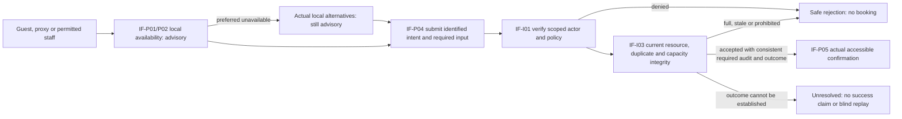
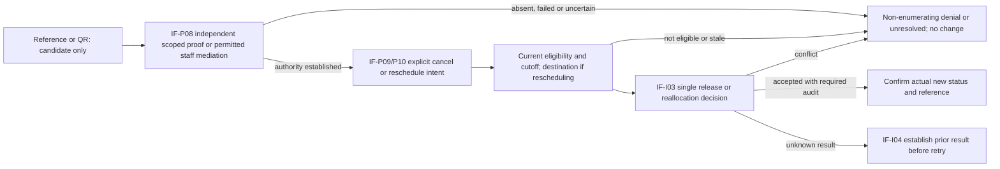
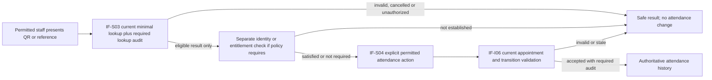
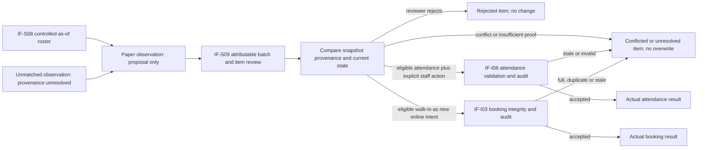
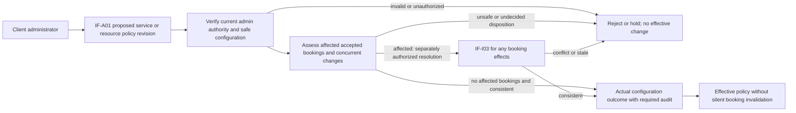

# Interface & API Design — Appointment Management System

| Field | Value |
|---|---|
| Version | 0.1 |
| Status | **DRAFT — AWAITING PRODUCT OWNER REVIEW** |
| Gate | **Gate 2 — Architecture & Design (IN PROGRESS)** |
| Checkpoint | **8 — Interface & API Design** |
| Owner | Product Owner |
| Scope | Provisional interface contracts and interaction design |

> This is a logical contract proposal, not an approved API specification, final architecture, implemented control, or authority to advance a gate. No route, endpoint URL, HTTP method/status code, message format, credential, persistence mechanism, or technology is selected. Gates 3–7 remain BLOCKED.

## 1. Authority, purpose, and interface boundaries

**Baseline.** Requirements Specification v0.7 and Requirements Traceability revision 1.0 are the D-081 **development-stage assumption** baseline, not representative stakeholder validation. The present traceability revision 1.1 only reconciles administrative gate-status wording. The current Project Charter revision is a draft; separately approved decisions govern their own scopes. D-082 authorizes Gate 2 documentation only. D-083/D-084 require design for client-managed and provider-managed hosting with one standardized supported profile *as a principle*, not a selected deployment. D-085's modular-monolith-per-independent-installation direction is provisional. The conceptual architecture and Checkpoints 5–7 are working designs, not final architecture; D-086/D-087/D-088 provisionally accept the latter three for continued design only. Checkpoint 7's accepted SHA-256 is `38C9DB532B988C150B3D80A1DA3C356EF66C6D3D26A82B356A3AD980183AC652` (Decision Register §9.6).

**Purpose.** An *interface contract* describes what an actor may ask for, what information crosses a boundary, which logical responsibility decides, and which outcomes can truthfully be shown. It is independent of a transport or page layout. The public experience presents availability and scoped guest actions; the internal experience serves individually authorized staff, supervisors and client administrators. Technical operator/installation duties remain distinct from client business administration. Interactions among the Checkpoint 5 responsibilities are conceptual within one installation, not network calls or separately deployed services. No external integration is approved for MVP: automated SMS/email/OTP, payments/deposits, broad integrations, public accounts, waitlists and offline booking synchronization are excluded/deferred (D-042/D-056–D-058). No public REST API, SPA, mobile app, event bus or microservices are assumed.

**Installation boundary.** Each client has its own independently deployed and operated application, configuration, credentials and database/schema (D-020/D-035; NFR-001/002), never shared SaaS tenancy or a CEAP connection. A client-provided installation label does not grant cross-client access. Clients control appointment records, staff accounts, services and ordinary administration; the product operator has no default client-data or client-admin access (D-034/D-075). All proposed contracts operate only within their authorized installation. No CEAP artifact informs this design.

**Notation.** Inventory status **R** means the underlying capability is required by the cited development-stage baseline (the *interface shape* remains proposed); **P** is a candidate way to express an existing obligation, not separately approved behavior; **U** cannot be finalized without the named policy decision. `read` means no *appointment/business-state* mutation; a read such as QR lookup can still require protected audit evidence. `write` means a protected state change. Candidate IDs `IF-*` are local to this draft, not requirement IDs, approved endpoints or physical modules. Data-model `#` references mean the **logical candidates** in Checkpoint 7 §3, never approved tables. Source `WF-*` identifiers are local to Detailed System Workflow Design §4.

## 2. Traceable interface inventory

Each row names **initiator → purpose; owning Checkpoint 5 logical responsibility**, then input → result, authorization/state boundary, source trace and status. All protected reads validate permitted scope; every write uses approved authentication (including scoped guest authentication), server-side authorization and validation (NFR-003). Inventory contracts do not prescribe how a UI invokes them.

| ID | Initiator → purpose; logical owner | Input → result; authorization / effect | Workflow; sources | Status |
|---|---|---|---|---|
| IF-P01 | Guest/staff → discover services; Public experience + Client policy and configuration | Local service/search scope → minimal eligible offerings; public-minimized or permitted staff scope; **read** | WF-P01; FR-001/018; BR-005; UJ-001; AC-013 | R |
| IF-P02 | Guest/staff → availability and local alternatives; Availability and alternatives | Service, preferred period → actual available candidates or unavailable/alternatives; candidates advisory; **read** | WF-P01/P05; FR-001/018; BR-001/005; AC-001/013 | R |
| IF-P03 | Guest/proxy/staff → begin booking; Public or Internal staff experience | Selected candidate + applicable policy context → minimum required-input guidance; no reservation or authority implied; **read** | WF-P02; FR-002/003/013; BR-006; AC-001/010 | P |
| IF-P04 | Guest/proxy/staff → submit booking intent; Appointment command coordination | Scoped actor, service/candidate, booker/attendee context, minimum policy fields, intent correlation → accepted/rejected/unresolved; **write via Final booking integrity** | WF-P02/P05/X01/X02; FR-002/003/013; NFR-003/006/008; BR-001/002/006; AC-001/005/010 | R |
| IF-P05 | Successful actor → confirmation; Public or Internal staff experience | Established accepted outcome → accessible screen/print/screenshot confirmation, or no success confirmation for rejected/unresolved; **read of scoped outcome** | WF-P02/P04; FR-010; UJ-001/003; AC-002/009 | R |
| IF-P06 | Intended user or permitted staff → eligible QR/reference presentation; QR presentation and authorized lookup | Appointment scope + approved access path → minimized presentation or denial; presentation **read**, lifecycle issuance/reissue **U write if approved** | WF-P02/P03/S01; FR-005; BR-003; AC-002; QR-L01–L09 | R/U |
| IF-P07 | Guest → scoped appointment view/lookup; Identity, authorization and scoped guest recovery | Reference as locator + separately established scoped proof → permitted minimal details or non-enumerating denial; **read** | WF-P03; FR-005/007; NFR-003/009; AC-002/009; D-085(1) | P/U |
| IF-P08 | Recovery claimant / permitted assisting staff → claim/recover scope; Identity, authorization and scoped guest recovery | Claimed appointment + approved independent proof/staff authority → scoped verified/denied/unresolved result without existence disclosure; **U evidence/write, not a booking mutation** | WF-P03; FR-007; NFR-003; D-061/085(1); QR-L05 | U |
| IF-P09 | Scoped guest / permitted staff → cancel; Appointment command coordination | Appointment + separately proven authority + requested intent → actual cancellation/rejection/unresolved and confirmation if accepted; **write via Final booking integrity** | WF-P04/X02; FR-004/007/010; BR-005/008; UJ-003; AC-009 | R |
| IF-P10 | Scoped guest / permitted staff → reschedule; Appointment command coordination | Appointment, destination candidate, proof/actor and intent → actual reallocation/rejection/unresolved and confirmation if accepted; **write via Final booking integrity** | WF-P04/X01/X02; FR-004/007/010/018; BR-001/002/005; AC-009/013 | R |
| IF-S01 | Internal worker → establish individual staff authority; Identity, authorization and scoped guest recovery | Approved staff authentication and installation context → role/scope decision; account/session mechanism unresolved; **U security-state effect** | WF-S03; FR-004/008; NFR-003/011; BR-007; Q-009/018 | R/U |
| IF-S02 | Permitted staff → search/view appointment; Internal staff experience | Scoped search terms → only permitted minimal appointment result; **read** | WF-S01/S03; FR-004; NFR-003/009; UJ-002; BR-007 | R |
| IF-S03 | Permitted staff → QR/reference verification lookup; QR presentation and authorized lookup | Presented untrusted QR/reference → minimal eligible/invalid/cancelled/other approved verification result; **read with required lookup audit**, not identity | WF-S01; FR-006/008; BR-003/008; AC-003/004; D-045 | R |
| IF-S04 | Permitted staff → record explicit attendance/service action; Attendance/service-state validation | Appointment, requested configured status, separate identity-procedure outcome if required, actor → accepted transition or safe rejection; **write** | WF-S02; FR-004/008/014; BR-008; UJ-002; AC-004 | R |
| IF-S05 | Permitted reviewer → propose attendance correction; Attendance/service-state validation + Supervisor exception decisions if applicable | Prior/current history, proposed correction, authority/reason → permitted correction or denial; **U write**, no general typing-edit feature | WF-S02; FR-004/008/014/015; BR-007/008; D-076 | U |
| IF-S06 | Permitted staff → assisted/proxy/walk-in or routine booking-affecting change; Appointment command coordination | Actor distinct from booker and attendee, minimum required fields/action → validated outcome through IF-P04/P09/P10 or equivalent final boundary; **write** | WF-P02/P04/S03; FR-004/013; BR-006/007; AC-009/010 | R |
| IF-S07 | Supervisor → configured exception decision; Supervisor exception decisions | Affected/proposed appointment, rule, proposed effect, reason, actor → approved-for-final-validation or denied; **write with required exception audit**, never direct booking override | WF-S02/S03/X01; FR-008/015; BR-001/007; AC-011 | R |
| IF-S08 | Permitted staff → generate/print controlled roster; Roster and reconciliation | Installation-local day/scope → D-074 minimum fields and identifiable as-of snapshot/custody context; **protected read with snapshot/print evidence** | WF-X03; FR-016/008; NFR-009; BR-009; AC-012 | R |
| IF-S09 | Permitted staff → submit paper batch and review items; Roster and reconciliation | Snapshot/observation provenance, proposals, actor → per-item accepted/conflicted/unresolved/rejected outcomes; **write only after explicit review and applicable validation** | WF-X03; FR-017/008; NFR-006/011; BR-009; AC-012 | R |
| IF-S10 | Permitted client reviewer → inspect audit/essential monitoring; Audit and essential operational visibility | Authorized scope/category → privacy-minimized events and actionable failures; **read**, not advanced analytics/export | WF-X04/O01; FR-008; NFR-009/011; D-073 | R |
| IF-A01 | Client administrator → change service/schedule/resource/capacity policy; Client policy and configuration | Proposed effective policy and revision context → impact assessment + accepted or rejected/held disposition; **write only if safe** | WF-A01; FR-001/008; NFR-004/006; BR-005/007; AC-001 | R |
| IF-A02 | Client administrator → provision/revoke internal role/access; Identity, authorization and scoped guest recovery | Target principal, authorized scope/change and actor → effective grant or denial with audit; **write** | WF-S03/O02; FR-004/008; NFR-003/011; BR-007; Q-009/018 | R |
| IF-O01 | Authorized client decision-maker / operator → request and review exceptional support; Installation operations boundary | Specific installation, reason, explicit client authorization, least scope and defined duration → denied or scoped access and review/closure evidence; **U write**, no default grant | WF-O01; FR-012/008; NFR-005/011; BR-004; AC-007; D-075/079 | R/U |
| IF-O02 | Allocated client/provider custodian → technical installation/incident/backup/restore work; Installation operations boundary | Authorized operational scope → attributable operation/result, privacy-minimized diagnostic; **U technical-state effect**, never client-admin permission | WF-X04/O02; FR-012/008; NFR-001/002/005/011; Q-008 | P/U |
| IF-I01 | Public/Internal experience or other owner → authorize scoped action; Identity, authorization and scoped guest recovery | Trusted actor/proof, operation, installation and appointment scope → permitted/denied decision; **read/decision**, not a grant from reference | WF-P02/P03/P04/S03/O01; FR-003/004/007/012; NFR-003/005; BR-004/007 | P |
| IF-I02 | Availability/command/configuration → evaluate effective policy; Client policy and configuration | Installation service, time, resource, policy context → effective revision or unsafe/incomplete; **read**, not policy editing | WF-P01/P02/A01; FR-001/018; BR-001/002/005; NFR-004/006 | P |
| IF-I03 | Appointment command coordinator → final capacity/duplicate/booking decision; Final booking integrity | Authorized proposed booking/change, current authoritative state, effective policy, exception context if permitted → accepted or rejected without partial/orphaned effect; **write boundary** | WF-P02/P04/X01; FR-002/007/015/017; NFR-006/008; BR-001/002; AC-005/009/011 | P |
| IF-I04 | Booking/change coordinator → command identity/outcome and required audit; Appointment command coordination + Audit and essential operational visibility | Intent, actor, operation, prior result, actual decision → known prior result/new safe decision/unresolved; **write/outcome consistency** | WF-P05/X02; FR-002/007/008/010; NFR-006/011; AC-005/009 | P/U |
| IF-I05 | QR presentation/lookup owner → resolve reference; QR presentation and authorized lookup | Untrusted reference/QR, permitted staff scope, current appointment → minimum eligible or safe invalid result and lookup audit; **read of appointment** | WF-S01; FR-005/006/008; BR-003/008; AC-003/004 | P |
| IF-I06 | Direct staff/reconciliation owner → apply attendance; Attendance/service-state validation | Explicit authorized action, current booking/attendance, required separate identity procedure → valid transition or no-change denial and required audit; **write boundary** | WF-S02/X03; FR-014/017/008; BR-008/009; AC-004/012 | P |
| IF-I07 | Roster/reconciliation owner → review proposals against current state; Roster and reconciliation | Snapshot provenance, observation, actor and current appointment/version → accepted/conflicted/unresolved/rejected per item; eligible writes only through IF-I03/IF-I06 | WF-X03; FR-016/017/008; NFR-006/011; BR-009; AC-012 | P/U |

**Inventory total: 31 candidate interfaces** (10 public `P`, 10 staff `S`, 2 client-admin `A`, 2 operator/operations `O`, 7 internal `I`). `R/U` expresses a required capability with unresolved authority or lifecycle mechanics, **not** permission to invoke it without an approved mechanism. Read-only interfaces may produce required audit/operational evidence; they do not thereby become booking or attendance mutation routes. The internal rows are obligation boundaries, not additional publicly callable APIs.

## 3. Public booking, management and confirmation contracts

**Discovery → intent.** IF-P01 lists only this installation's publishable services. IF-P02 computes available candidate periods and actual installation-local alternatives using effective policy and current apparent capacity; it cannot promise a reservation. IF-P03 presents the approved minimum input requirements for service, proxy or staff-assisted mode without creating an appointment. On IF-P04 submission, the actor/booker/contact and intended attendee are distinct where applicable; a scoped guest-authentication mechanism must be approved before a guest state change (NFR-003), with no mandatory public account. A staff request uses individual role authority. IF-I03 checks current service eligibility, applicable duration/buffers, resources, capacity, prohibited duplicate rule and reference uniqueness at the final decision. A duplicate *warning* is non-punitive and may accompany only a policy-permitted action (D-059/BR-002). An unavailable candidate yields clear rejection and fresh IF-P02 alternatives, never a waitlist or cross-installation result.

**Established outcome → accessible confirmation.** IF-P05 is produced only from an accepted booking, cancellation or rescheduling: unique reference, actual status, service, date/time, location and arrival instructions, QR/reference presentation guidance and booking-management instructions in screen-readable, printable, screenshot-friendly form (FR-010/D-065). For a cancelled appointment, do not portray its QR as currently eligible. An unresolved result must say the outcome cannot yet be established and offer a safe review/recovery path; it must not present an accepted confirmation. No automated outbound message is required. NFR-007/D-069's WCAG 2.2 AA and supported-browser policy apply to these interactions, but conformance is not claimed.

**Presentation/lookup ≠ management proof.** IF-P06 makes an eligible, privacy-minimized QR/reference available through an approved access path; issuance/reissue/expiry/revocation/consumption are unresolved QR-L01–L09, not assumed. IF-P07 is a *candidate* scoped appointment view after approved proof, not public lookup of anyone's details by reference alone. IF-P08 requires proof separate from QR/reference or a separately authorized staff-mediated recovery procedure. The claimant can differ from the booker and attendee; no identity is inferred from possession or from being a proxy. Unverified claims receive a non-enumerating response. Credential, recovery channel, expiry and disclosure policy remain for Product Owner and Gate 3 review (D-085(1); Q-015).

**Change.** IF-P09/IF-P10 require separately established appointment-scoped guest authority or permitted staff authority, current appointment state and applicable client cutoff/eligibility. Cancellation releases the applicable capacity **once**; rescheduling checks destination as a new candidate and consistently reallocates capacity under IF-I03. Neither an outdated availability view nor a stale appointment state can cause a partial release or booking. A failure returns rejection/conflict or an honestly unresolved outcome as appropriate. D-079 leaves the cutoff open; no one-hour or 24-hour default, cancellation fee or penalty is designed (D-089). Unrelated service fees are not decided by this contract.

## 4. Staff, client administration and operator contracts

IF-S01 establishes individual internal actor context; Q-009 authentication/provisioning mechanism and Q-018 permission matrix are open. Staff may search/view only within assigned scope (IF-S02), and staff QR lookup (IF-S03) returns minimal verification information with **required lookup audit** (FR-008) even though it changes neither booking nor attendance. Any separate identity/entitlement check is a staff procedure where policy requires it, not a QR scan side effect. IF-S04 is an explicit authorized attendance action; IF-S05 correction authority and transition legality remain unresolved, and D-076's deferred typing-correction feature is not introduced. Assisted proxy and walk-in operations (IF-S06) use the same booking/change integrity boundary as guests; no universal walk-in field set or staff bypass is created.

IF-S07 supplies only supervisor-approved, configured exception context, with actor, rule, affected appointment (or proposed appointment), reason, time and before/after outcome; it is not a direct write around IF-I03 or IF-I06 (D-048). IF-A01 changes services, schedules, duration/buffers, staff/resources, capacity and other approved policy only after validating minimum safe effective configuration and existing-booking impact. Reject/hold unsafe changes without mutating existing appointments; retain/grandfather/exception choices remain open and any resulting booking changes still use IF-I03. IF-A02 provisions or changes individually attributable client staff grants, never an operator-wide default role. Authorization/role changes need consistent audit and cannot rely on client-submitted privilege claims.

IF-S08 produces the controlled D-074 roster with reference, appointment date/time, attendee name, service, applicable assigned staff/resource and attendance status. Printing/access are authorized and copy custody is controlled; added contact fields require justified need. IF-S09 is **structured paper-observation submission and review**, not automatic data import or offline booking synchronization. IF-S10 shows authorized, privacy-conscious essential monitoring and audit for booking failures, unexpected errors, security events, integrity/capacity and reconciliation failures; it does not implement FR-011 advanced analytics or general exports. The installation/operations boundary (IF-O01/O02) coordinates technical support, backups/restores, updates and incidents under both hosting ownership arrangements, never ordinary client administration. An operator needing record access must obtain explicit client authorization, least scope, defined duration, attributable actual access, review and closure (D-034/D-075; AC-007). No emergency access mode is silently created.

## 5. Internal module interaction and authoritative ownership

These are logical *decision contracts* between Checkpoint 5 responsibilities, not mandated runtime call order. Candidate Checkpoint 7 entities below are data meanings, not tables or an event bus.

| Interaction and logical data | Authoritative decision / safe failure |
|---|---|
| Public/Internal experience → IF-I01 / IF-I02 | The authority owner evaluates actor, operation and appointment scope against effective policy (#01, #09–11, #23); configuration owns effective policy (#01–04), not permission inferred from UI or reference. Missing proof or unsafe configuration denies/holds action without disclosing another record. |
| Availability and alternatives → IF-I02, current appointment context | Reads service/schedule/resource and logical commitments (#02–06) to return candidates; no reservation. The user may reselect an actual local alternative but must submit a new candidate to final checks. |
| Appointment command coordination → IF-I03 + IF-I04 | The coordinator identifies command intent, actor, booker and attendee (#06–08, #12–14); IF-I03 owns current capacity/resource/duplicate and booking-state integrity (#05–06). IF-I04 establishes the authoritative outcome (#13) and required audit (#22); no accepted action may be reported without consistent mandatory evidence. The final integrity boundary is shared by guest/staff, changes, approved exceptions and reviewed walk-in reconciliation. |
| Duplicate evaluation within IF-I03 | Uses configured identity key/window/warning-vs-blocking (#01, #07–08), not a lifetime one-person-one-appointment rule. A prohibited duplicate cannot complete even under contention; legitimate proxy/multiple-attendee cases follow approved policy. Identity/window are unresolved (D-044/D-059). |
| Supervisor exception decisions → applicable IF-I03/IF-I06 | A permitted reasoned exception (#15) changes only the authorized rule context; unrelated validation and required audit (#22) still apply. Missing authority, configured type or reason rejects with no effect. |
| Appointment changes → IF-I03 and IF-I04 | Cancellation/reschedule updates (#06, #14) and capacity commitment (#05) form one consistent accepted effect. A repeated command uses prior intent/result, not merely a similar appointment. No partial release, second acceptance or false confirmation. |
| QR presentation/lookup → IF-I05 | Reference/QR (#16) resolves only an appointment candidate; staff lookup reads current eligibility and writes required lookup audit (#22), not attendance. Presentation lifecycle/guest proof are separate (#11). Denied or invalid results expose only minimum allowed information. |
| Staff/reconciliation action → IF-I06 | Attendance owner validates individual permission, current appointment and configured transition (#17); any required identity procedure precedes explicit action. Accepted transition and audit agree; lookup, no-show observation or paper alone is not a mutation. |
| Roster/reconciliation → IF-I07 then IF-I03/IF-I06 | Snapshot/entry and paper observation (#18–21, #25) are attributed proposals. Reviewer compares current state and provenance; eligible walk-ins become new online booking intents, eligible attendance needs explicit acceptance. Conflict/unresolved/rejected items remain reviewable and never silently overwrite newer state. |
| Client configuration → IF-I02 and IF-I03 impact review | Administrator proposal (#01–04) cannot change effective schedule/resources while leaving existing bookings silently inconsistent. Assess current/future affected appointments and record actual configuration outcome with audit (#22); hold/reject unsafe or undecided impact. Concurrent booking sees a coherent effective revision. |
| Installation operations ↔ protected audit/visibility | Authorized client/provider custodians see only operational evidence (#22–24) needed for allocated duties; technical credentials/backups can confer effective access independent of application permissions. Client-data support requires IF-O01, not an implicit operator account. |

**Alternative tradeoff:** keeping these decisions inside a provisionally modular monolith supports a single reviewable final integrity boundary; splitting them into network services would complicate atomic outcomes without an approved need. A monolith must still enforce distinct authority and audit ownership. Neither a service topology nor a transaction/locking technology is selected (D-085(6)/D-088).

## 6. Illustrative, non-binding request and response models

These contract sketches describe **logical information**, not JSON, fields/columns, endpoint paths or exact required-input policy. **Required** below means needed to make the named decision *when applicable*, not a universal identifier or mandatory personal-data item. **Conditional** depends on client/service policy; **open** requires Product Owner/security disposition. Read output is minimized for the authorized actor.

| Operation | Input categories and classification | Validation and successful/other result | Required evidence |
|---|---|---|---|
| Discover (IF-P01/P02) | **Required:** local service or discovery scope and preferred date/period when searched; **conditional:** permitted resource/preference. Public data must not expose staff/private roster entries. | Validate input/policy; show available candidates or actual installation-local alternatives. Missing/unsafe configuration or full period → unavailable, not a booking guarantee. | No successful booking audit for browsing; privacy-conscious operational/security signals where policy requires. |
| Begin and submit booking (IF-P03/P04) | **Required at submission:** service/candidate, actor's approved scoped authentication, distinguishable booker/attendee context, operation/intent correlation; **conditional:** policy-required identity/contact, proxy evidence, requested resource; **open:** exact fields/proof/intent mechanism. Personal/sensitive data. | Format/required-input, actor authority and effective policy; at IF-I03 recheck current capacity/resources/buffers, duplicate and unique reference. Accepted → one appointment/reference; full/duplicate/invalid → no partial booking and clear safe result; indeterminate → unresolved. | Accepted booking, actor/booker/attendee distinction, command outcome and required audit consistent; attempt/diagnostic evidence per policy. |
| Confirmation and QR presentation (IF-P05/P06) | **Required:** established accepted outcome for confirmation; **conditional/open:** eligible QR representation and approved scoped presentation authority. Public reference is a locator, not proof. | Actual reference/status, service, date/time, location/arrival and management/QR guidance rendered for screen, print and screenshot. Invalid/cancelled/ineligible QR → safe denial, no false active outcome; no external delivery. | Booking/change audit already consistent; issuance/reissue evidence if lifecycle later approved; no attendance mutation. |
| Scoped lookup/recovery (IF-P07/P08) | **Required:** requested operation/appointment claim and independent approved proof; **conditional:** staff mediation; **open:** claimant evidence, channel, expiry, renewal. High sensitivity. | Verify appointment-scoped authority *before* disclosure; permitted minimal view or scope. Missing/invalid/expired-if-approved proof → indistinguishable safe denial; uncertain claim → unresolved. | Protected minimum recovery/verification/access evidence, actor where identifiable; no booking change from lookup. |
| Cancel/reschedule (IF-P09/P10) | **Required:** target appointment locator, separately established scoped guest/staff authority, explicit operation/intent; **conditional:** destination candidate, applicable policy/reason and expected-current-state evidence. Locator is not authority. | Recheck current eligibility/cutoff and state; for reschedule check destination resources/capacity/duplicate at IF-I03; accepted → actual before/after and accurate FR-010 confirmation, or unchanged conflict/rejection/unresolved. No penalty computation. | Command/outcome, affected appointment/change, capacity release/reallocation and required audit agree (#05/#12–14/#22). |
| Staff QR lookup and explicit attendance (IF-S03/S04) | **Lookup:** untrusted QR/reference and individually authorized role. **Action:** appointment, explicitly requested configured status, actor, and separate identity/entitlement result **if required**. | Lookup returns minimal current verification; no identity claim/status change. Action rechecks current booking and transition; valid → explicit recorded status, otherwise no-change denial/stale conflict. `expected`, `arrived`, `completed`, `no-show` are conceptual minimum labels, **not approved database enums/transition graph**. | QR lookup audit even on authorized read; accepted attendance before/after/action audit (#17/#22); rejected attempt detail per policy. |
| Exception, configuration and role change (IF-S07/A01/A02) | **Exception:** supervisor, affected/proposed appointment, rule, reason. **Configuration:** admin, scope, proposed policy/effective revision. **Role:** permitted admin, target principal and grant change. Sensitive authority data. | Revalidate role and proposal; exception goes to final validator. Configuration assesses existing-booking impact before acceptance; unsafe change rejects/holds. Role update cannot self-escalate through client assertions. | Attributable reason/rule/time/before-after for exception; actual config/grant outcome and audit (#01/#09–10/#15/#22). |
| Roster and reconciliation (IF-S08/S09) | **Roster:** permitted actor/day/scope. **Batch:** submitting actor, snapshot/as-of provenance where available, per-item paper observations (claimed event vs recorded time), intended attendance/walk-in action and reviewer; no unapproved offline booking. Personal/paper data. | Roster prints D-074 minimum fields only. Each item compares with current state, returns accepted/conflicted/unresolved/rejected; accepted attendance requires explicit staff action and IF-I06, accepted walk-in passes IF-I03. Missing snapshot is unresolved pending review; batch atomicity is open. | Snapshot/print custody and actual per-item outcome, reviewer, links to resulting authoritative actions and protected audit (#18–22/#25). |
| Exceptional support (IF-O01) | **Required before any access:** installation, specific client authorization, operator identity, reason, least scope, defined duration, review/closure path; **open:** duration/mechanism. | Without complete authority deny client-data access. Authorized limited work → actual access/outcome/revocation and review; host/backup custody is not permission. | Client approval, actual access, actions and closure audit (#23/#22); privacy-minimized diagnostics. |

**Response envelope, proposal:** carry an *outcome class* (accepted, rejected/conflict, or unresolved), only the authorized task's display data, and a safe correlation reference where useful for follow-up. A correlation reference is neither an appointment reference nor authorization. An accepted booking/change includes actual reference and FR-010 confirmation; a known rejected retry returns its actual rejection; unresolved does not assert success or failure. Stable same-intent semantics and presentation of correlation remain open (WF-X02; Checkpoint 7 §§4/7). No numeric retry period, response-time target or universal error code is selected.

## 7. Validation, authority and exception order (logical obligations)

| Layer | May run early for usability? | Mandatory at authoritative boundary / owner |
|---|---|---|
| 1. Input shape | Yes: missing/malformed selections, dates and policy-required fields can be shown early. | Server-side validation of submitted values and allowed scope; ignore untrusted client claims about capacity, resource ownership, actor identity or status. |
| 2. Business rules | Yes: display advisory availability and policy-eligible actions. | Current effective service/schedule/duration/buffers, duplicate warning/blocking, cutoff and exception policy rechecked for each requested mutation (IF-I02/I03/I06). Missing policy cannot be guessed. |
| 3. Identity/appointment scope | Guidance may explain what proof is needed; a displayed reference/QR grants nothing. | Approved scoped guest authentication/recovery or individual internal actor authority is established server-side for **every** state-changing operation; staff-mediated recovery is separately authorized (IF-I01). |
| 4. Role/permission | UI may hide actions for convenience only. | Each staff/supervisor/admin/exception/operator action checks current permission and installation/record scope. Client-provided role or client ID cannot elevate access. |
| 5. Final integrity and outcome | Displayed candidate is **never** an acceptance. | IF-I03 adjudicates booking/reallocation and duplicate/capacity; IF-I06 adjudicates attendance; configuration/role/support have their own scoped validators. Multi-record accepted effect and mandatory audit/outcome evidence must be coherent/atomic; failed work leaves no partial/orphaned state. |
| 6. Supervisor exception | UI may request reason and show pending review. | Only permitted supervisor approves configured rule deviation with actor, reason, rule, affected appointment and before/after evidence; applicable unrelated checks remain mandatory (D-048). |

Authorization is not inferred from a valid input or an available slot. If authentication/permission cannot be established or required audit cannot be recorded consistently, the operation cannot be reported as accepted. Specific identity, rate-control, audit tamper-resistance, transaction and anti-forgery mechanisms await Gate 3/authorized implementation; this contract does not weaken the mandatory boundary (Engineering Governance §§11–12).

## 8. Error, conflict and safe-retry contract

These are **conceptual categories**, not HTTP codes or fixed customer text. The boundary owner distinguishes user-actionable outcomes from internal diagnostics; sensitive appointment existence, proof material, other customers' bookings and infrastructure details never appear in a public error.

| Category / example | Safe actor-facing outcome; authoritative effect | Internal evidence / routing |
|---|---|---|
| Invalid input | Request cannot be accepted; identify safe correctable fields, no mutation. | Format/validation category; minimize submitted personal values. |
| Service/schedule unavailable or unsafe policy | No reservation; show actual permitted local alternatives or ask authorized admin to resolve configuration. | Effective-policy revision/availability diagnosis, restricted. |
| Capacity exhausted | Candidate unavailable; clear rejection and fresh alternatives, no held capacity. | Final check and relevant capacity constraint for authorized review. |
| Prohibited duplicate / permitted warning | Prohibited booking rejected without disclosing another person's record; policy-permitted warning is *not* a punishment or automatic override. | Configured duplicate decision, no cross-customer disclosure. |
| Appointment-state/stale-write conflict | Action not applied; safe updated status if caller is authorized, otherwise generic denial. | Current state/version, command and applicable policy context restricted. |
| Unauthorized / verification failed / invalid or expired recovery authority | Non-enumerating denial; never expose whether an unrelated appointment exists. No protected mutation or personal view. | Security-relevant attempt/proof outcome per approved privacy/audit policy; no secrets in diagnostics. Expiry applies only if approved. |
| Known retry/replay | If same intent and prior accepted, return its authorized actual outcome without new effect; if prior rejected, return established rejection, or submit a *new* authorized attempt only after explicit intent/revalidation. | Correlate stable command identity, actor/scope, meaningful request and authoritative outcome. |
| Unresolved retry/replay or temporary system failure | Say result not established; no false confirmation or blind new effect. Provide authorized follow-up/review path; an earlier mutation may have succeeded. | Preserve minimal command/attempt correlation and failure signal; establish prior outcome before resubmission. |
| Paper reconciliation conflict | Keep item conflicted/unresolved/rejected and show permitted reviewer what needs resolution; never overwrite newer booking/attendance. | Snapshot, observation, current-state comparison, actor/review/outcome and restricted audit. |

An unresolved command is **not** a third successful booking state: it is lack of reliable result. Safe retry requires distinguishing *same* intent from a genuinely new one and learning the prior authoritative outcome, not finding a similar appointment. If either fact cannot be established safely, make no **new** effect and retain unresolved follow-up. A new authorized attempt still checks current policy, identity and final integrity. A known prior rejection may be returned without a new write; intentionally retrying after correcting inputs or changing intent is a new evaluated request. Exact idempotency identity, retention, transport and expiry are open under D-079/Checkpoint 7 §7. Error classifications may be privacy-collapsed in public responses while remaining distinguishable to authorized reviewers; essential failure signals under D-073 do not replace required audit records.

## 9. Capacity, concurrency and outcome consistency

IF-P02/IF-P03 stop at **advisory** discovery/input. IF-P04/IF-S06/IF-P10 and reviewed walk-ins converge on IF-I03 using current effective configuration and authoritative occupancy; cancellation/reallocation also uses it. Every accepted ordinary booking satisfies all configured capacity units, resource/staff overlap, duration/buffers and prohibited duplicate checks. One accepted creation has one unique reference; booking, capacity commitment (whether stored or derived), command outcome and required audit agree. An approved supervisor exception is explicit and audited, not a public or staff capacity bypass. Existing appointments cannot be silently invalidated by configuration changes (IF-A01). Attendance changes use IF-I06, not the booking-integrity write path, and remain separate from QR lookup.

**D-070 acceptance scenario:** with **50 simultaneous valid booking requests for one remaining capacity unit**, exactly **one** succeeds, the other **49** get safe clear unsuccessful outcomes, and there is no over-capacity, prohibited duplicate, partial or orphaned booking. Test preconditions must establish the resource/capacity unit and non-conflicting duplicate policy; an exception may not silently relax the ordinary test. A lost response must be reconciled through IF-I04 rather than counted as a second success or safe rejection without evidence. This is a later design/test obligation, **not a claim of implementation or measured performance**. D-067's 20–100 daily appointments is a planning profile, not a hard limit or concurrent-user count; Q-016 numeric response-time and Q-022 availability dispositions are still due under D-079 before final Gate 2 approval. No lock, isolation level or distributed transaction is chosen.

## 10. QR, attendance and paper provenance rules

**QR/reference:** public presentation IF-P06 is available only through an eligible approved access path; a QR/reference is a *locator*, not proof of attendee identity, guest change authority or attendance (D-045). Staff IF-S03 verifies current appointment eligibility with minimal data and logs the lookup; invalid/cancelled cannot silently appear active. Repeated scan, activation, expiry, revocation, reissue and cancellation-versus-lookup races remain QR-L01–L09. A separate identity/entitlement procedure is applied only where policy requires it; after that, **explicit** permitted IF-S04 action checks current booking and attendance state. Minimum conceptual status labels `expected`, `arrived`, `completed`, `no-show` are not final transition rules or database enums (FR-014/BR-008). Corrections/exception authority remains open; no-show does not trigger a penalty or automatic booking change.

**Paper:** IF-S08 freezes an authorized as-of roster snapshot, not an offline appointment database. IF-S09 accepts attributed paper observations/proposals and snapshot identity where known; an unmatched source stays unresolved until an approved procedure reviews sufficiency (Checkpoint 7 §9). Each item compares observed versus current booking/attendance and records actual accepted, conflicted, unresolved or rejected review outcome. A reviewer must explicitly accept an eligible attendance proposal, then IF-I06 validates it; a paper walk-in requires a *new online* IF-P04-equivalent booking submission via IF-I03. Missing/duplicated observation, changed/cancelled appointment, capacity conflict or insufficient proof is surfaced without silent overwrite. Batch-wide versus per-item atomicity, correction/override authority, conflict representation, custody and retention are open (D-051/063/074/085(4)). No file-import format or offline new-booking synchronization is selected.

## 11. Security, privacy and hosting trust boundaries

| Boundary | Required/proposed contract and open mechanism |
|---|---|
| Public and guest | Public discovery minimizes disclosed services/availability; appointment detail, recovery, cancellation and rescheduling require approved scoped proof distinct from reference/QR (D-045/D-061/NFR-003). Propose abuse/rate controls for public discovery, repeated booking, lookup and recovery **without choosing a threshold, identity key, CAPTCHA or external provider**. Prevent account/appointment enumeration with safe errors; specific controls await Gate 3. |
| Staff, supervisor and administrator | Individual accountability; least privilege per assigned permission/installation; client admin provisions internal access, supervisor supplies configured exception authority, staff perform permitted routine tasks only (D-047/048). No UI-only access control, shared credentials or self-declared role. Authentication, permission matrix and session security await Q-009/Q-018/Gate 3. |
| Exceptional operator and infrastructure | D-034/D-075 deny default record/admin access; exceptional access requires explicit client authorization, least scope, defined duration, individual attribution, review/closure and audit (IF-O01). Operator technical custody, diagnostics, backup and restore can confer *effective* access outside app roles; no host ownership is an implicit grant. Duration/break-glass remain unapproved under D-079. |
| Both hosting ownerships | For **client-managed** and **provider-managed** installations, identify who holds credentials, sees diagnostic and backup data, authorizes restores, reviews incidents and closes support grants. Interface permission does not control infrastructure reads. D-083 requires both; D-084 only approves one supported-profile principle. Final custody/responsibility matrices and isolation verification belong to Deployment Architecture/Q-008, not this contract. |
| Data handling, audit, recovery | Public confirmation/QR, printable roster (D-074), audit, reconciliation and essential monitoring show minimum necessary personal data (D-050/NFR-009/011); logs never carry proof secrets. Required booking/change/QR lookup/attendance/config/role/exception/operator/reconciliation evidence must agree with actual outcome and be reviewable only by authorized roles. Retention/deletion, backup propagation, tamper resistance, abuse-control mechanism and privacy/security review remain open (Q-015/D-079/Gate 3). |
| Installation/CEAP | No interface may read/write another client installation, pool tenant data or access production CEAP. A client-controlled installation identifier in a request cannot override the executing installation's authority boundary (D-019/020/025/035; NFR-001/002). |

Do not mistake *logical requirements* for controls already implemented, independently reviewed or compliant with any specific privacy regime. Accessibility target WCAG 2.2 AA and current/previous stable Chrome, Edge, Firefox and Safari coverage (NFR-007/D-069) apply to public and administrative user-facing contract outcomes; no conformance result exists. No secrets, personal examples or legal retention periods are specified here.

## 12. Compatibility and contract evolution (proposals)

Keep each installation's external user-facing and internal logical contract consistent as policy varies, without forking core booking integrity (D-062/NFR-004). When a proposed contract changes input requirements, permission, error semantics or eligibility, record the affected FR/BR/UJ/AC and the applicable client policy revision; review compatibility for existing bookings, old confirmations/QRs, paper rosters and in-flight commands before approval. An old displayed candidate never bypasses new final checks, but a policy update also cannot silently invalidate an accepted appointment. Deprecate an older presentation/interaction only with an approved migration and user-facing communication path appropriate to scope; do not erase historical outcome evidence.

**Open choices:** whether any public programmatic API exists, how contracts are versioned (if needed), which compatibility window applies, transport/error-code mapping, QR/reference rotation and the exact client-specific validation configuration. None is fixed by this draft. Propose stable *conceptual* outcome classes across public/staff views with role-specific disclosure; backend diagnostics may distinguish cases that the public must see as one generic denial. Later NFR-010/AC-008 regression checks must cover success, rejection, authorization, failure, stale policy, retries, concurrency and the D-068 core inventory, with actual evidence at later gates rather than assertions here. Requirements Governance §§6/8 govern any material approved-baseline change; this draft cannot amend v0.7 or revive deferred features.

## 13. Logical interface diagrams

All five Mermaid blocks are **conceptual proposals**. Arrows are obligations and outcomes, not a prescribed synchronous call order, public endpoints or approval of a mechanism. The diagram branches labeled “audit” require consistency **with** the authoritative result, not an unprotected post-success write. Mermaid source has not been independently rendered or parser-validated.

### 13.1 Public booking: advisory versus final acceptance

### 13.2 Guest recovery and authorized change

### 13.3 Staff QR lookup, separate procedure and explicit attendance

### 13.4 Controlled paper reconciliation and conflicts

Unmatched observation cannot take an eligible branch until a separately approved sufficiency/review procedure permits it; the diagram does not grant one. Batch/item atomicity is not selected.

### 13.5 Administration and existing-booking impact

The “separately authorized resolution” branch is **conditional**, not approval of grandfathering, exceptions or forced rebooking. A configuration change without affected appointments need not write an appointment.

## 14. Requirements, workflows, data and architecture traceability

The matrix maps **active** D-081 development-stage records to IF IDs, the Checkpoint 7 logical candidates, the existing workflow catalog and architecture sources. It claims design coverage only, not stakeholder validation, approval of these contracts, implementation, or executed tests. Conceptual Architecture is Checkpoint 4's working architecture; Component & Module Design is Checkpoint 5 (D-086), Detailed System Workflow Design Checkpoint 6 (D-087), Data Architecture & Model Design Checkpoint 7 (D-088). No physical schema is implied by data candidate numbers.

| Active baseline / rule / journey / criterion | Interface contracts and data candidates | Checkpoints 4–7 / decision links |
|---|---|---|
| FR-001/018; NFR-004/006; BR-001/005; UJ-001; AC-001/013 | IF-P01–IF-P03, IF-A01, IF-I02–IF-I03; #01–06 | Conceptual §§6/9; Component §§4–6/9; WF-P01/A01 (Workflow §§5–6); Data §§3/6; D-043/060/062/066/085(3) |
| FR-002/003/013; NFR-003/006/008/009; BR-001/002/006; UJ-001/005; AC-001/005/010 | IF-P04–IF-P05, IF-S06, IF-I01–IF-I04; #05–08/#11–13/#22 | Conceptual §§6–7/9; Component §§4/6/9; WF-P02/P05/X01/X02; Data §§5–8; D-044/046/059/064/070 |
| FR-004/007/010; NFR-003/006/007; BR-005/007/008; UJ-003; AC-009/006 | IF-P05, IF-P07–IF-P10, IF-S01, IF-S06, IF-I01, IF-I03–IF-I04; #06/#09–14/#22 | Conceptual §§7/12; Component §§6/9–10; WF-P03/P04/S03/X02; Data §§5/7–8; D-045/049/061/065/079/089 |
| FR-005/006/014; NFR-003/009; BR-003/008; UJ-002; AC-002/003/004 | IF-P06–IF-P07, IF-S02–IF-S05, IF-I05–IF-I06; #11/#16–17/#22 | Conceptual §8; Component §§7–8; WF-S01/S02; Data §§5/8–9; D-045/050/085(1–2) |
| FR-008; NFR-009/011; BR-004/007/009; UJ-004/005; AC-007/011/012 | IF-S03–IF-S05, IF-S07–IF-S10, IF-A01–IF-A02, IF-O01–IF-O02, IF-I04, IF-I07; #12–15/#17–25 | Conceptual §§10–12; Component §§9–11; WF-X02/X03/X04/O01/O02; Data §§7/9–10; D-048/050/073/074/075 |
| FR-012; NFR-001/002/005; BR-004/007; UJ-004; AC-007 | IF-O01–IF-O02, IF-I01, IF-A02; #01/#09–10/#22–24 | Conceptual §§3–4/11; Component §§3/11; WF-O01/O02; Data §§2/10; D-020/025/034/035/075/083/084 |
| FR-015; NFR-006/011; BR-001/007; UJ-005; AC-011 | IF-S07, IF-I01, IF-I03–IF-I04, IF-I06; #05/#12–15/#22 | Conceptual §9; Component §§8–9; WF-S02/S03/X01; Data §6; D-047/048/085(3) |
| FR-016/017; NFR-006/009/011; BR-009; UJ-005; AC-012 | IF-S08–IF-S09, IF-I03, IF-I06–IF-I07; #05–06/#18–22/#25 | Conceptual §10; Component §§8–9; WF-X03; Data §§4/9–10; D-051/063/074/085(4) |
| NFR-007/010/011; AC-006/008; D-068 core inventory | All relevant public/internal IFs; user-visible accessibility, restricted evidence and later success/rejection/authorization/failure checks | Conceptual §12; Component §10; Workflow §§4/11–12; Data §§10–11; D-052/068/069/072/073 |

**Coverage boundaries.** Together these rows cite FR-001–FR-008, FR-010, FR-012–FR-018; NFR-001–NFR-011; BR-001–BR-009; UJ-001–UJ-005; AC-001–AC-013. FR-009 (generic eligibility/masterlist) and FR-011 (advanced reporting/analytics) remain **DEFERRED** under D-042; IF-S08 roster and IF-S10 essential monitoring do not revive FR-011. D-076's walk-in queue number, optional staff notes and routine typing correction remain deferred. D-089 excludes penalty interfaces without removing operational cancellation/no-show data. The D-081 approved Specification v0.7 still mentions fees as open validation questions (AC-009 and §§6/9); the formal versioned reconciliation and traceability impact review under Requirements Governance §§6/8 are pending. This draft does not change that baseline or decide unrelated service fees.

## 15. Open decisions and downstream dependencies

No item below is settled by an illustrative contract or diagram. “Before” denotes a governance milestone, not a newly invented calendar date.

| Milestone / decision owner | Open design choice and interface consequence |
|---|---|
| **Before final Gate 2 architecture approval — Product Owner, D-079/Q-020** | Dispose of configurable cancellation/rescheduling cutoff and eligibility (no one-hour or 24-hour default); IF-P09/P10 cannot finalize policy-dependent rejection/exception paths until decided. D-089 already excludes cancellation/no-show penalties. |
| **Before final Gate 2 architecture approval — Product Owner, D-079/Q-016/Q-022** | Dispose of remaining numeric response-time and availability targets. D-067's daily profile and D-070's 50-to-1 integrity result do not approve those numbers or establish measured performance. |
| **Gate 2 design resolution before final architecture relies on it — Product Owner/client policy** | Capacity unit/period/resource sharing, duration/buffers, duplicate identity/window and warning/blocking, service-specific required inputs and exceptions (Q-019/Q-021); define an evaluable minimum-safe-policy contract for IF-I02/I03 and its configuration-impact treatment (reject/retain/authorized resolution). No chosen universal model. |
| **Gate 2 / Gate 3 design review before implementation — Product Owner and qualified reviewers** | Attendance transitions/corrections, cancellation-versus-attendance race, QR issuance/reissue/expiry/revocation/repeated scans (QR-L01–L12), staff Q-009/Q-018 permission/provisioning, guest scoped proof and recovery claimant/channel/expiry; decide authority/disclosure for IF-P06–P08, IF-S04/S05 without treating QR as proof. |
| **Gate 2 / Gate 3 design review before implementation — Product Owner and integrity reviewers** | Same-intent command identity, authoritative result retrieval, retention and unresolved follow-up; reconciliation conflict representation, reviewer/override authority and batch-versus-item atomicity; decide without invented retry token, fixed duration, offline sync or all-or-nothing batch promise (D-079 defers idempotency mechanics without setting a new Gate 2 deadline). |
| **Gate 2 Deployment Architecture/Q-007/Q-008 — Product Owner** | Responsibility/effective-access matrices for client-managed and provider-managed hosting, one supported deployment profile, credentials, diagnostics, backups/restores, incidents and support. Interface contracts cannot by themselves prevent host/backup-level access; exact runtime versions remain Gate 4 (D-031). |
| **Before Gate 3 security/privacy review approval — Product Owner, D-079/Q-015** | Retention/deletion, exceptional operator access duration and emergency break-glass policy; qualified review of proof, rate/abuse controls, least-privilege access, audit tamper resistance and minimized disclosures. No fixed period, four-hour duration or break-glass grant is assumed. |
| **Before Gate 6 release approval — Product Owner, D-079** | Printed-roster physical handling/disposal, genuine product-fit validation, qualified independent privacy/security assessment and required verification/release evidence. Q-010 detailed pricing/licensing/support-package pricing remains deferred by D-055. |
| **May remain provisional until separately authorized implementation planning** | Transport/UI bindings, public API existence/versioning, concrete error/field mappings, QR format, transaction/locking mechanism, rate thresholds and supported technology choices; none may weaken the invariant, privacy or gate-review obligations above. Formal Specification v0.7 fee-reference amendment requires separate exact-wording approval under Requirements Governance §§6/8. |

No external service or added dependency is selected. A material architecture/security/database/deployment choice or change to the approved requirement baseline requires Product Owner disposition; D-088 did not approve Checkpoint 7's logical candidates as final database structures, and this Checkpoint 8 draft does not do so either.

## 16. Single internal self-audit and limits

**Author self-audit only, not independent verification or Product Owner acceptance.** Checked source/governance scope and D-020/D-034/D-035/D-045/D-070/D-075/D-079/D-081–D-089; all 31 inventory rows and the active ID families against §14; alignment to Checkpoint 7 candidate numbers and Checkpoint 5 owner boundaries; WF-P/S/A/X/O paths; authorization and disclosure; D-070/retry/error consistency; Mermaid-to-prose boundaries; penalty/deferred scope; D-079 deadlines; and absence of physical implementation commitments.

| Classification | Finding and disposition |
|---|---|
| **BLOCKER** | None found within this draft's bounded logical-interface scope. Open policies block their affected *finalization*, not the creation of an explicitly provisional design for Product Owner review. |
| **MAJOR** | Guest proof/recovery, attendance correction, safe-retry identity and reconciliation batch/conflict rules remain underspecified by approved sources. Preserved IF-P08/IF-S05 and affected contracts as unresolved; no credential, transition graph, batch atomicity or replay protocol invented (§§2/8/15). Specification v0.7's fee-open wording still awaits a separately approved versioned amendment under D-089; no penalty contract or requirement edit made. |
| **MINOR** | Mermaid source is included in five fenced diagrams and was compared with the narrative; **visual rendering and parser validation were not performed**. The inventory describes obligation-level interfaces, so exact field and permission matrices remain downstream design decisions rather than false precision. |

**Corrections within this single drafting execution:** differentiated a protected QR *read* from its required lookup-audit write; made public lookup contingent on separate scoped authority; ensured known rejected retries do not return success; specified that unmatched paper observations cannot use an eligible branch without later approved review; distinguished outcome uncertainty from a failed request; expanded shorthand IF IDs in the traceability table so they cannot be mistaken for different interfaces; and kept no-show records separate from D-089-excluded punishment. No second improvement cycle, application or database test, security assessment, accessibility verification or independent diagram rendering occurred.

**Review request:** Product Owner to review proposed interface boundaries, safe error/command handling and the §15 decisions, then separately decide whether any part is acceptable as provisional Gate 2 working design. This document is not final architecture, Checkpoint 8 acceptance, Gate 2 exit, Gate 3 authorization or implementation approval.
