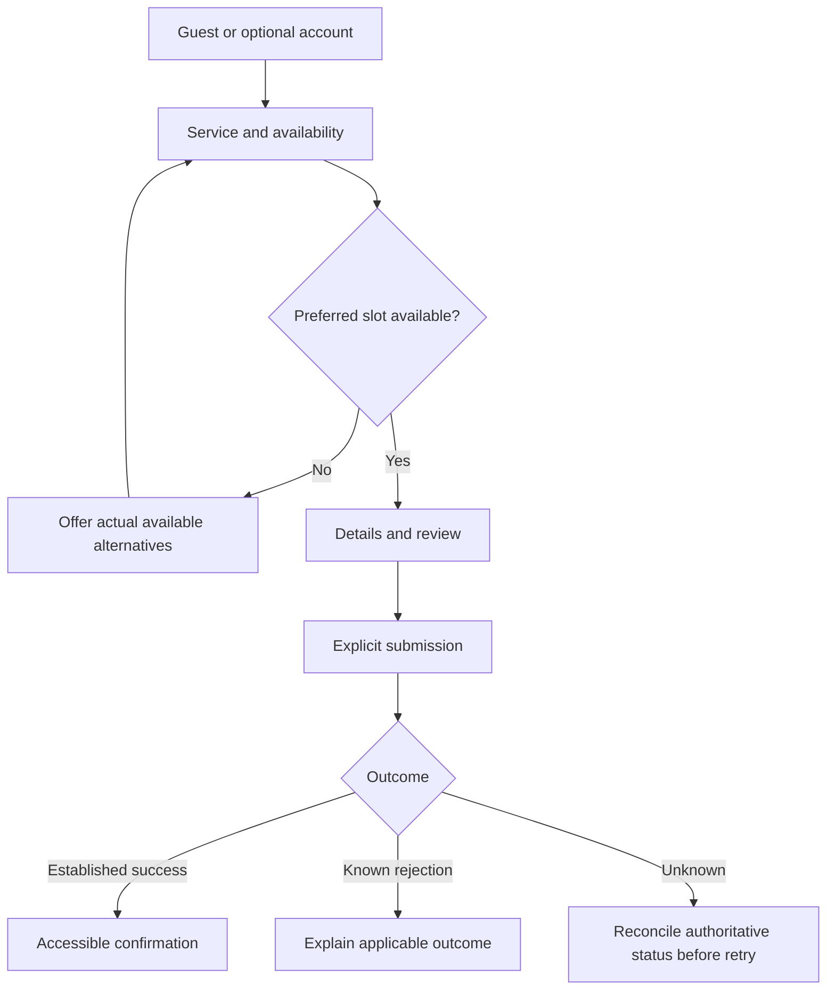
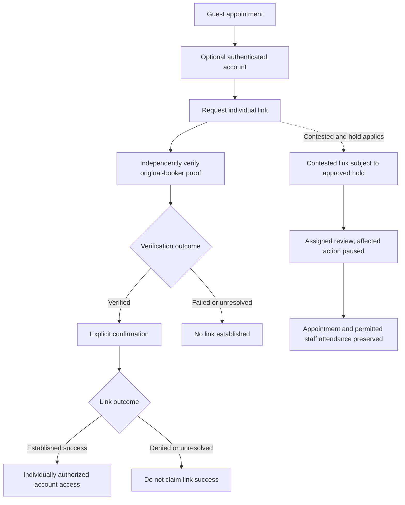

# iTakda Application Flow and UI/UX Reference

> **Status: ACCEPTED — provisional Application Flow & UI/UX reference guidance (Session 04).** Acceptance covers the documented logical journeys, approved boundaries, outcome distinctions, and provisional design guidance. It does not create requirements or permissions, approve final screens, layouts, routes, navigation or interaction implementations, accept Checkpoint 11 or its prototype as product design, establish accessibility or browser conformance, or authorize product implementation.

## Source authority and scope

- **Authoritative baseline:** [Engineering Governance](../ENGINEERING_GOVERNANCE.md), applicable approved [decisions](../decisions/DECISION_REGISTER.md), approved development-stage [requirements v0.8](../requirements/REQUIREMENTS-SPECIFICATION-v0.8.md) with unchanged [v0.7](../requirements/REQUIREMENTS_SPECIFICATION.md), and [traceability revision 1.2](../requirements/REQUIREMENTS-TRACEABILITY-v1.2.md) with carried-forward [revision 1.0](../requirements/REQUIREMENTS_TRACEABILITY.md). Preparation-era labels do not undo the recorded exact-version approval; these assumptions are not representative validation.
- **Accepted supporting references:** [PRD](../product/PRD.md), [TRD](../technical/TRD.md), and [Design System](DESIGN_SYSTEM.md), including its separately accepted provisional §8 amendment, do not supersede the baseline.
- **Provisional supporting material:** unfinished [Checkpoint 11 design/accessibility](../archive/legacy-sdlc/checkpoint-records/checkpoint-11/CHECKPOINT-11-DESIGN-SYSTEM-AND-ACCESSIBILITY.md), [screen inventory](../archive/legacy-sdlc/checkpoint-records/checkpoint-11/CHECKPOINT-11-SCREENS-AND-INTERACTIONS.md), fictional [prototype](../../prototype/checkpoint-11/index.html), and draft [Security reference](../security/SECURITY.md) inform later review; none independently establishes authority or product behavior. The inventory's earlier blanket exclusion of public accounts is historical; its §4.2 account addendum is provisional.

Routine product changes follow D-098 and applicable approvals in Governance §5. D-101 permits only qualifying fictional prototype refinements within its safeguards; neither decision accepts Checkpoint 11 or authorizes product implementation.

## Public booking and outcomes

This table summarizes logical responsibilities, not prescribed screens. Guest and account bookings use the same applicable availability, eligibility, capacity, duplicate, and integrity policies (BR-010; AC-014/016/018 in [v0.8 §§3–4](../requirements/REQUIREMENTS-SPECIFICATION-v0.8.md)).

| Journey or state | Approved boundary and flow implication | Source |
|---|---|---|
| Entry and discovery | Guest booking needs no account; optional account entry follows the installation's registration policy. Discover permitted services and availability; a displayed slot is not a reservation. | FR-002/003/019; AC-016/018; [v0.8](../requirements/REQUIREMENTS-SPECIFICATION-v0.8.md) |
| Unavailable selection | Offer actual available alternatives within the same installation; selecting one remains subject to availability and capacity checks. | FR-018; AC-013; [v0.7](../requirements/REQUIREMENTS_SPECIFICATION.md) |
| Details and review | Collect approved common and applicable service-specific information, distinguish booker, attendee and acting staff where relevant, explain profile prefill, and allow review before explicit submission. | FR-013/022; AC-018/023; [v0.8](../requirements/REQUIREMENTS-SPECIFICATION-v0.8.md) |
| Established success | Show only an established committed result. The authorized viewer receives the required accessible on-screen, printable and screenshot-friendly confirmation with approved information. | FR-010; AC-002/018; D-065; [v0.8](../requirements/REQUIREMENTS-SPECIFICATION-v0.8.md); [v0.7](../requirements/REQUIREMENTS_SPECIFICATION.md) |
| Known rejection | Distinguish an established unsuccessful result from success or uncertainty; provide applicable approved next steps without exposing unrelated information. A known rejected reschedule preserves the original appointment. | FR-007; BR-013; AC-018/026; [v0.8](../requirements/REQUIREMENTS-SPECIFICATION-v0.8.md) |
| Unknown submitted outcome | Do not claim success or rejection, issue a false confirmation, or invite blind duplicate submission. Reconcile authoritative state and same-intent relationship before retry; the interaction and mechanism remain open. | BR-013; AC-018/026; [v0.8](../requirements/REQUIREMENTS-SPECIFICATION-v0.8.md); D-090 in [decisions](../decisions/DECISION_REGISTER.md) |
| Contested action held | Only an action subject to an approved dispute hold is paused for assigned review; it is neither an established success nor rejection. The held action and its transaction confirmation/email do not execute while held. | FR-007/021; BR-011; AC-021/025; [v0.8 §§4–5](../requirements/REQUIREMENTS-SPECIFICATION-v0.8.md) |
| Limited email | D-095 permits only the six specified verification, recovery, scoped guest-access and established transaction purposes, subject to recipient/content boundaries. Delivery failure or delay neither reverses a committed change nor triggers a duplicate command; no transaction email is sent for a rejected, unknown, uncommitted or held transaction. The full confirmation remains available to its authorized viewer. | FR-010/020; AC-024; [v0.8 §5](../requirements/REQUIREMENTS-SPECIFICATION-v0.8.md); D-095 in [decisions](../decisions/DECISION_REGISTER.md) |

**Illustrative logical flow:** arrows describe relationships, not routes, screen counts, page order, or selected mechanisms. A hold is an applicable contested-action boundary, not a normal booking step.

Displayed availability is informational, not a reservation; selection does not guarantee capacity at final submission. The authoritative submission outcome may be established success, known rejection, or unknown. An unknown outcome requires reconciliation rather than a blind retry.

## Guest and optional-account journeys

| Journey | Approved actor and outcome boundary | Source |
|---|---|---|
| Guest and account entry | Guest booking and independently scoped guest management remain available whether registration is enabled or disabled. Disabling registration blocks new signup, including incomplete signup at activation; existing verified accounts retain sign-in and authorized actions. | FR-019; AC-016/020; [v0.8](../requirements/REQUIREMENTS-SPECIFICATION-v0.8.md) |
| Account and profile | A verified account can access only individually authorized upcoming and retained past appointments. Profile prefill is explained; a booking edit does not silently change the saved profile or other bookings, and profile editing is separate. | FR-019/022; AC-015/023/025; [v0.8](../requirements/REQUIREMENTS-SPECIFICATION-v0.8.md) |
| Link a guest appointment | An authenticated account requests an **individual** link only after independent verification of the original booker and explicit confirmation, with attributable audit. Matching personal details, account access, email token, reference, or QR alone is insufficient; registration does not automatically import prior appointments. | FR-021; BR-011; AC-017/021; [v0.8 §§3–5](../requirements/REQUIREMENTS-SPECIFICATION-v0.8.md) |
| Ordinary eligible change | An authorized, eligible cancellation or reschedule follows applicable normal policy; it is not automatically held merely because it changes an appointment. Known rejection preserves the original appointment; uncertainty requires reconciliation. | FR-007; BR-013; AC-026; [v0.8](../requirements/REQUIREMENTS-SPECIFICATION-v0.8.md) |
| Contested link or change | An action subject to an approved dispute hold is paused for assigned case review. The affected action and its confirmation/email do not execute while held; the existing appointment and permitted staff attendance work remain intact. A hold alone is neither success nor rejection. Assigned case-review authority and documented review govern hold/release or reversal; procedures and role mapping remain open. | BR-011; AC-021/025; [v0.8 §§4–5](../requirements/REQUIREMENTS-SPECIFICATION-v0.8.md) |
| Deactivation | Deactivation ends account access without automatically cancelling existing appointments or removing required records. Later management requires independently verified appointment-scoped guest access or authorized staff assistance. | FR-019; AC-025; [v0.8](../requirements/REQUIREMENTS-SPECIFICATION-v0.8.md) |

**Illustrative logical flow:** proof and dispute procedures are unresolved; arrows do not specify screens or implementation. A contested proposed change may also be held under the same approved boundaries.

## Staff, administrator, and operator journeys

| Actor | Approved task boundaries and provisional flow implications | Source |
|---|---|---|
| Authorized staff | Perform permitted appointment creation, view, update, cancellation, rescheduling and explicit attendance work; assisted, proxy and walk-in activity uses applicable authority and integrity checks. Authorized QR or manual-reference lookup retrieves the permitted result; QR lookup alone neither proves identity nor marks attendance. Required identity checking, arrival, and completion remain separate actions. | FR-004/006/013/014; D-045; [v0.7](../requirements/REQUIREMENTS_SPECIFICATION.md); [v0.8](../requirements/REQUIREMENTS-SPECIFICATION-v0.8.md); [decisions](../decisions/DECISION_REGISTER.md) |
| Staff and supervisor | Authorized staff generate the controlled daily roster and review paper attendance/walk-in reconciliation against current state, surfacing conflicts and unresolved items without silent overwrite. Configured exceptions require assigned supervisor authority, a reason and audit; final validation remains applicable. | FR-015–017; AC-011/012; [v0.7](../requirements/REQUIREMENTS_SPECIFICATION.md) |
| Client administrator | Manage permitted services, availability, resources and internal access under assigned authority and client policy; manage appointments or operational oversight only where authorized. The MVP daily roster is in scope; advanced reporting/analytics and other exports remain deferred. No specific permission matrix or dashboard is established here. | FR-001/004/011/016; BR-007; [v0.7](../requirements/REQUIREMENTS_SPECIFICATION.md) |
| System operator | Installation, maintenance, backups and authorized technical support remain within the installation boundary. There is no default access to client appointment records or personal data; exceptional access requires explicit client authorization, least privilege, defined scope and duration, attribution, review and closure. The procedure and operating allocation remain open. | FR-012; NFR-005; AC-007; [v0.7](../requirements/REQUIREMENTS_SPECIFICATION.md) |

## Flow-specific accessibility and interaction guidance

NFR-007 and AC-006 require applicable core public and administrative workflows to meet the WCAG 2.2 AA target across applicable desktop/mobile experiences using current and previous stable major releases of Chrome, Edge, Firefox and Safari (D-068/D-069; [v0.7](../requirements/REQUIREMENTS_SPECIFICATION.md); [decisions](../decisions/DECISION_REGISTER.md)). No browser compatibility or accessibility conformance is claimed.

Use the accepted provisional [Design System](DESIGN_SYSTEM.md), including §8, for component guidance rather than treating it as a final standard. Consider loading, empty, input error, permission denial, stale/conflict, recoverable failure, established success and unknown submitted-outcome states; preserve safe input and avoid exposing unrelated information. Preserve readable, accessible confirmation and persistent task information for critical errors, warnings and unknown outcomes; toasts are supplementary. Icon-first utility controls need accessible names, visible focus, keyboard operation and appropriate tooltip/touch behavior; consequential or ambiguous actions generally retain visible text. Balanced motion must not delay or be necessary to complete critical tasks; support reduced motion and responsive reflow. Dialogs are presentation choices and do not replace authorization or server-side validation.

## Journey-to-source coverage

| Journey / actor | Approved source anchors | Summary here | Provisional choices |
|---|---|---|---|
| Guest/account booking | FR-002/003/010/018/019; AC-013/016/018/024 | Selection, submission, outcomes and confirmation | Screen composition, navigation and outcome presentation |
| Account, change and disputes | FR-007/019/021/022; AC-020/021/023/025/026 | Scoped access, individual linking, holds, profile and deactivation | Proof, dispute presentation and reconciliation interaction |
| Staff and supervisors | FR-004/006/013–017; AC-003/004/011/012; D-045 | Lookup versus attendance, roster, exceptions and reconciliation | Role-specific interfaces and manual-reference interaction |
| Administrator and operator | FR-001/011/012; NFR-005; AC-007 | Configuration, deferred reporting and support access boundary | Interface composition and exceptional-access procedure |
| Accessible core workflows | NFR-007; AC-006; D-068/D-069 | Target and browser policy; supporting design guidance | Rendered interaction, environments and evidence |

Source anchors above refer to the linked approved baseline; they do not adopt screen-level proposals or create new requirements.

## Open design and policy details

- Final screen inventory, navigation structure, and role-specific composition.
- Guest proof, account recovery and individual-link interaction; dispute intake, review presentation and role assignment.
- Unknown-outcome reconciliation UX and safe retrieval mechanism; no blind retry is approved.
- Service-specific eligibility and visibility presentation, QR lifecycle and manual-reference interaction.
- Notification presentation/timing, responsive layouts, test environments and rendered accessibility evidence.

These open choices do not make approved authority, outcome, confirmation or accessibility obligations optional. Do not infer new policy values, hold triggers, permissions, mechanisms, or product features from a proposed flow.

## UX completeness amendment — accepted provisional guidance

> **ACCEPTED — provisional UX guidance, separately approved by the Product Owner.** This UX Completeness Amendment is a separate approval and does not retroactively alter the Session 04 acceptance record below. Approval date: not separately recorded. Recording date: 2026-11-11. It creates no product requirement or implementation authorization.

This amendment describes logical recovery journeys, not selected screens, routes, status mappings, proof methods, retry protocols, providers or implementation mechanisms. The [Design System](DESIGN_SYSTEM.md) owns reusable presentation guidance; approved requirements and decisions govern outcomes and authority.

### Error and interruption journeys

The following are approved **design-review scenarios**, not a requirement for six separate application-rendered pages. Presentation depends on context, application availability, authentication/authorization state, available installation branding and deployment/server fallback capabilities. Prefer available installation branding, with a safe neutral fallback when it cannot be loaded; no branding configuration interface or new fields are approved. Actual mapping, page coverage, fallback ownership and mechanisms remain for later authorized design.

| Situation | Provisional user-facing direction and approved boundary |
|---|---|
| 404 — page not found | Explain that the requested page is unavailable and offer a safe applicable route without revealing whether an inaccessible appointment exists. |
| 403 — access refused | Explain the access limitation without exposing protected records or implying a new permission; offer only a permitted route or authorized assistance where available. |
| 419 — invalid or expired request token, where applicable | Explain that the page or request can no longer be used. A 419 does not itself prove authenticated-session expiration or that a submitted operation failed. Re-establish applicable authority and determine the prior outcome before a repeat that could duplicate a change. |
| 429 — requests limited | Explain the limitation and offer an appropriate next step only when supported; do not invent a wait time, rate threshold or automatic retry. |
| 500 — internal error | Give a safe explanation without technical details. If the submitted booking/change outcome is not established, treat it as unknown and reconcile rather than offer blind resubmission. |
| 503 — service unavailable | Explain unavailability when a response can be delivered; do not promise recovery time or offline booking, or imply an established rejection. |
| Network interruption | A missing response after submission does not prove failure. Reconcile authoritative state and the same-intent relationship before retry; if reconciliation is unavailable, keep the outcome unresolved. A network failure may prevent a server-delivered page from appearing. |
| Authenticated session expiration | Re-establish applicable authentication or independently established guest authority before protected actions. Preserve safe input where feasible; reauthentication does not establish the result of an earlier submission. |

Error experiences must preserve response semantics, confidentiality and the existing authorization and booking outcome boundaries. A generic error cannot justify a blind retry.

### Loading, correction and recovery

| Situation | Provisional logical handling |
|---|---|
| Loading or long-running work | Identify processing as pending. A pending indicator is not a reservation, rejection or confirmation. Avoid accidental repeated submission; do not invent a completion time. |
| Empty dataset or no search/filter matches | Distinguish an established empty result from loading failure, partial/stale data or access denial. Offer an applicable next step without exposing unrelated records. |
| No appointment slot or stale availability | Offer actual alternatives within the current installation only if they exist and the approved workflow permits them (FR-018/AC-013). Recheck current availability and capacity; never invent availability, promise a future slot or represent a selection as reserved. |
| Validation rejection | Identify the correction without disclosing protected information. Preserve safe input where feasible, maintain accessible error association and focus, and permit resubmission only under applicable authority and current-state checks. |
| Known business-rule rejection | Present the established rejection and approved next step where applicable. A known rejected reschedule preserves the original appointment. |
| Unknown submitted outcome | Do not claim success or known failure or invite blind duplicate submission. Reconcile authoritative state and the same-intent relationship before retry; the method remains open. Do not trigger a new transaction email solely because an outcome is unknown. Any notification must follow the authoritative committed state and approved email rules. An authoritatively unknown, uncommitted, rejected or held transaction sends no transaction email. A lost browser response alone does not suppress a legitimate notification for an independently established committed transaction; unsafe retries must not trigger duplicate commands or notifications. |
| Contested action under an approved hold | Keep the affected action and its confirmation/email paused for assigned review; preserve the appointment and permitted staff attendance. Ordinary eligible changes are not automatically disputed. |
| QR or camera unavailable | Keep QR lookup, identity checking and attendance action distinct. Consider an authorized manual-reference path where applicable; a reference alone grants no appointment or attendee authority. Interface and proof methods remain open. |
| Email delivery failure | Do not undo a committed booking/change or trigger a duplicate command. The authorized viewer retains the required confirmation independently of email; purpose, recipient and content follow D-095 and v0.8 §5. |

For an applicable authorized destructive or irreversible action, consider clear consequences and proportionate confirmation. A dialog establishes no authorization, deletion right, validation or reversal capability. After submission distinguish established success, known rejection and unknown outcome; show recovery or reversal options only where supported by the approved workflow.

Paper fallback and later reconciliation remain limited to authorized workflows; no offline booking or automatic synchronization is implied. Privacy-minimized feedback and required audit obligations continue to apply.

## Session 04 review and acceptance

| Field | Record |
|---|---|
| Scope and disposition | The Product Owner explicitly accepted `docs/design/APP_FLOW_UI_UX.md` in this conversation as provisional Application Flow & UI/UX reference guidance. This documentation review is complete; acceptance covers its logical journeys, approved boundaries, outcome distinctions and provisional design guidance. |
| Approver and date | Product Owner; approval date not separately supplied. Record prepared 2026-11-11; the recording date is not represented as an approval date. |
| Reviewer and verification | Codex compared the document with the reviewed revision and final clarifications, checked relevant source and authority boundaries, and reviewed the acceptance change, Markdown links and Git state as reported in the Session 04 closure chat. The Mermaid source was inspected; rendering was not verified. No browser, product or accessibility testing is claimed. |
| Session decisions | FLOW-Q01 = B: compact source-linked journey and state tables. FLOW-Q02 = B: a few illustrative logical diagrams, not prescribed screens. FLOW-Q03 = A: link to the accepted provisional Design System. FLOW-Q04 = A: retain approved boundaries and identify unresolved mechanisms. |
| Findings and clarifications | FLOW-F01 through FLOW-F06 addressed at the documentation level. Final clarifications distinguish original-booker proof verification, explicit confirmation and established linking outcome, with failed or unresolved verification and conditional dispute holds separate; displayed availability is informational and unknown submitted outcomes require reconciliation rather than blind retry. |
| Limitations and open matters | Acceptance applies to this reference only. It does not amend requirements, decisions or governance; approve final screens, layouts, routes, navigation or interactions; select guest-proof, dispute-review, reconciliation or notification mechanisms, a permission matrix or operator-access procedure; accept Checkpoint 11 or its prototype; establish accessibility conformance or browser compatibility; or authorize code, database changes, deployment or implementation. Screen and role composition, proof and dispute procedures, reconciliation UX, service-specific presentation, notification details, responsive implementation and rendered accessibility evidence remain open. Review was documentation-based and assisted by Codex; no independent human technical review is claimed. |

This record follows [Engineering Governance §5](../ENGINEERING_GOVERNANCE.md#5-spec-driven-development-lifecycle) for the change, reviewer, verification, outcome and limitations, and §18 for explicit Product Owner approval and an unsupplied approval date. No new decision-register entry or historical gate transition is implied.
