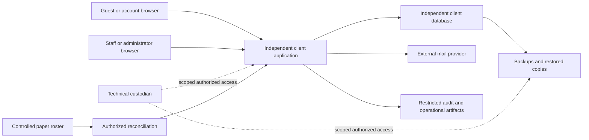

# iTakda Security and Privacy Reference

> **Status: PROVISIONALLY ACCEPTED — Security and privacy design reference (Gate 2 — Session 07).** Acceptance is subject to the documented unresolved decisions and qualified privacy/security review; see the acceptance record below. This is a documentation-based design reference, not a completed application security assessment or conformance claim. Proposed mechanisms, technologies and operational assignments remain unapproved.

## Authority and scope

Binding obligations come from applicable [Engineering Governance](../ENGINEERING_GOVERNANCE.md), approved [decisions](../decisions/DECISION_REGISTER.md), effective [requirements v0.9](../requirements/REQUIREMENTS-SPECIFICATION-v0.9.md) read with preserved [v0.8](../requirements/REQUIREMENTS-SPECIFICATION-v0.8.md) and unchanged [v0.7](../requirements/REQUIREMENTS_SPECIFICATION.md), and effective [traceability revision 1.3](../requirements/REQUIREMENTS-TRACEABILITY-v1.3.md) with preserved revisions [1.2](../requirements/REQUIREMENTS-TRACEABILITY-v1.2.md) and [1.0](../requirements/REQUIREMENTS_TRACEABILITY.md). Preparation-era labels do not undo exact-version approvals. These are development-stage assumptions, not representative validation.

The accepted [PRD](../product/PRD.md), [TRD](../technical/TRD.md), [Architecture](../architecture/ARCHITECTURE.md), [conceptual Backend Schema](../architecture/BACKEND_SCHEMA.md), [Design System](../design/DESIGN_SYSTEM.md) and [Application Flow](../design/APP_FLOW_UI_UX.md), including their accepted amendments, are supporting references. They do not supersede requirements. Historical working designs retain their individual limitations, including D-088's non-physical-schema disposition. D-098 governs routine SDD work; D-101 remains a bounded fictional-prototype exception. This draft does not accept Gate 2; Checkpoint 11 was accepted on 2026-11-13 within its documented design/prototype scope (D-112); see the [transition ledger](../SDD_TRANSITION.md).

The approved obligations below summarize existing controls. Safeguards, verification techniques, threat ownership and review-queue options explicitly described as proposed require applicable later review and authorization. Under D-102 / Governance §15, significant technology selections need proportional failure, mitigation, verification and residual-risk analysis before implementation approval. This reference selects no package, proof method, permission matrix, numerical limit, vendor or deployment topology. CEAP assets and production access are outside scope; payments remain outside MVP, and advanced exports/reporting are not introduced.

## Assets, actors and logical trust boundaries

| Asset or actor | Boundary to preserve / design to review |
|---|---|
| Guests and optional registered customers | Public inputs are untrusted; guest booking is account-free. Account control is distinct from appointment-specific authority and attendee/proxy authority (FR-019–022; AC-015–025). |
| Staff, supervisors and administrators | Individual attribution and approved action/service/resource scope; a role name or visible UI control grants no permission. Case-review permission is specifically bounded by AC-021/025. |
| Technical operator and client/provider custodians | Independent installation context; technical host/database/backup access is not business-record authorization. No default operator client-record access (D-083; FR-012; AC-007). |
| Appointment, participation, capacity and attendance | Final authority/state/integrity checks, atomic changes and required consistent audit; QR lookup and attendance remain separate (NFR-006; BR-013; D-045). |
| Credentials, sessions and purpose-limited tokens | Protect secrets and scoped identity/recovery paths. Exact proof assurance, expiry, replay/session handling and recovery remain open (FR-020/021; ACCT-L02/03/08). |
| Audit, diagnostics, paper and recovery copies | Minimized, restricted, attributable artifacts with approved retention/custody; paper is a snapshot, and restoration must not silently bypass newer restrictions (FR-008/016/017; NFR-009/011; D-091). |
| Mail provider and other authorized third parties | Only approved purpose/recipient/content crosses the boundary; review credentials, processing terms, feedback and availability. No provider or new integration is approved (D-095). |

**Illustrative logical boundary model:** connections express information/access paths for review, not physical networks, selected modules or final deployment. Repeat the independent client boundary for each installation; never pool client appointment databases.

Browser requests, QR/manual references, recovery links, configuration changes, reconciliation input and any later approved provider callbacks are entry points requiring their applicable checks. Each client requires an independent application installation and independent database, not schemas in one shared client database. Physical hosting remains open in both client-managed and provider-managed arrangements (D-020/D-035/D-083).

## Approved control obligations

- Authenticate, authorize and validate every state-changing action server-side. Guest booking remains account-free, with an approved scoped mechanism; guest appointment management requires independent appointment-scoped proof (NFR-003).
- Limit access by actor, appointment, service, action and applicable policy. Account login, matching personal information, email, a reference or QR alone does not establish unrelated appointment, attendee or guardian authority. Linking is individual, independently verified and explicitly confirmed (FR-021).
- Keep booker, attendee and staff distinct; apply service-specific proxy restrictions and the approved dispute/hold boundary. Denials must not mutate state or disclose unnecessary data (v0.8 §5).
- Separate QR lookup from identity checking and explicit authorized attendance (D-045). Protect client administration from unapproved privilege escalation; staff authentication and permission design remain open (Q-009/Q-018).
- No default operator access to client records. Exceptional access needs explicit client authorization, least privilege, defined scope and duration, attribution, audit, review and closure (FR-012/D-075). Infrastructure, logs and backup custody may give effective access even without an application role.
- Minimize collection, display and diagnostic data; protect secrets outside source and client-side code, separate environments, and apply only approved retention/deletion rules. Record required attributable events and review access (FR-008/NFR-009/011).
- Limit the six D-095 email purposes to the recipient/content matrix in [v0.8 §5](../requirements/REQUIREMENTS-SPECIFICATION-v0.8.md); failed delivery cannot undo a committed operation or trigger duplicate commands. Do not treat delivery as identity proof.
- Protect atomic booking and rescheduling under concurrency; reconcile unknown outcomes without blind replay. Isolated security, authorization and integrity tests and applicable specialist review are required; see [testing](../engineering/TESTING.md).

## Proposed safeguards and preserved workflow boundaries

The following are design candidates implementing existing obligations, not newly approved controls. No candidate automatically satisfies a requirement.

| Area | Approved boundary | Proposed design consideration |
|---|---|---|
| Authentication and sessions | Server-side protection of state changes; optional verified accounts and independent guest authority (NFR-003; FR-019/020). | Review credential storage, session rotation/invalidation, reauthentication, replay and recovery. Evaluate stronger MFA for privileged accounts, including accessible recovery; no method/vendor mandated. |
| Authorization, proof and holds | Individual original-booker proof plus authenticated account control and explicit confirmation before linking; no personal-data matching or automatic import. Ordinary eligible changes are not automatically held. Only assigned staff/supervisor with approved case-review permission controls hold/reversal; held action and its confirmation/email pause, while appointment and permitted staff attendance remain (FR-007/021; AC-021/025). | Model actor/action/appointment/service checks and denial paths; map actual case-review assignments and proof procedures before affected work. |
| Integrity and outcomes | Shared applicable final checks; atomic reschedule; known rejection preserves original; unknown requires authoritative reconciliation, not blind retry (BR-010/013; AC-018/026; D-090). | Evaluate transaction/concurrency and same-intent mechanisms with failure injection; no locks, keys, isolation level or retry protocol selected. |
| QR and administrative actions | QR/reference is a locator, not identity or attendance/change authority. Exceptions/configuration require applicable authority and audit (D-045; FR-001/006/014/015). | Validate payload and current state, separate lookup from explicit attendance, review repeated scans/corrections and permission escalation. |
| Tokens and abuse | Purpose-scoped access, privacy and authority boundaries remain binding; abuse design is open (FR-020; NFR-003/009; ACCT-L07/08). | Evaluate non-enumerating responses, bounded expensive work and purpose/replay controls. Rates, lockouts, expiries and MFA remain proposals. |
| Audit, secrets and supply chain | Attributable consistent evidence, minimum diagnostic data, protected secrets and isolated environments (FR-008; NFR-011; Governance §§11–14). | Review tamper resistance, restricted access, redaction, credential rotation, dependency provenance and minimal CI privileges. No logging store, scanner or pipeline selected. |
| Operations and recovery | Backups plus tested restore procedure before data reliance; separately approved privacy-safe verification of a particular real backup under D-091. Exceptional support requires client authority and closure (FR-012; AC-007; Governance §17). | Allocate incident/escalation, patching, restoration and credential custody; evaluate independently protected recovery copies and recovery exercises. No RPO/RTO, frequency or responsibility assignment approved. |
| Mail and notification recovery | Only six D-095 purposes: account verification, password recovery, appointment-scoped guest access, established booking, cancellation and rescheduling; recipient/content matrix and accessible confirmation remain binding (AC-024). | Evaluate recoverable notification intent, after-commit processing, bounded retries and delivery observability. A queue/outbox/provider is not selected. Provider acceptance is not guaranteed inbox delivery. |

Deactivation ends account access without cancelling appointments; later management needs independent scoped guest authority or authorized staff assistance. Booking/profile edits remain separate (FR-019/022; AC-023/025). Email failure never reverses a committed transaction or repeats a booking command. A lost browser response does not suppress legitimate notification of an independently established commit; an authoritatively unknown, uncommitted, rejected or held transaction does not independently authorize transaction email. Notification follows committed state and approved rules; unsafe retry must not duplicate commands or notifications ([Application Flow](../design/APP_FLOW_UI_UX.md), accepted UX amendment).

## STRIDE threat model — proposed scenarios

STRIDE considers spoofing, tampering, repudiation, information disclosure, denial of service and elevation of privilege. The scenarios below are source-grounded design risks, **not confirmed application vulnerabilities**. No attack was executed. Priority means dependency urgency, not a measured probability or exploit severity. **First** means resolve the relevant design before affected high-risk implementation; **Before use** means before reliance on that integration/artifact/operation. These dependencies do not reopen accepted provisional references.

For every T01–T15 item, implementation safeguards and owner allocations beyond existing approved obligations and D-103/D-104 directions are **proposed/unapproved**; implementation and evidence are **unverified**. Applicable Product Owner authorization and specialist review remain required. Engineering roles named below describe work to allocate, not approved permissions.

### T01 — Spoofing: account takeover (First)

- **Asset/boundary/precondition and impact:** public login/recovery to account authority; attacker has reused credentials or a stolen session, enabling access or changes under that account's permitted scope. Sources: NFR-003; FR-019/020.
- **Proposed mitigation and verification:** proportionate abuse controls, secure credential/session lifecycle and recovery; evaluate privileged MFA. Test credential abuse, revoked sessions, recovery and reauthentication with synthetic identities.
- **Residual risk / proposed owner:** phishing, endpoint/session compromise and recovery abuse remain; identity/security design owner.

### T02 — Spoofing and information disclosure: guest enumeration/linking (First)

- **Asset/boundary/precondition and impact:** public reference/proof/link entry to individual appointments; attacker knows a reference, personal details or email token and attempts unrelated access/linking. Sources: FR-020/021; AC-015/017/021.
- **Proposed mitigation and verification:** independent original-booker proof, scoped responses and explicit individual confirmation; test unrelated/attendee-only claims, matching details, enumeration and token replay without disclosure or mutation.
- **Residual risk / proposed owner:** compromised contact channel is not attendee proof; product proof-policy owner and security reviewer.

### T03 — Tampering: manipulated requests (First)

- **Asset/boundary/precondition and impact:** browser-to-application request; attacker alters appointment, service, resource, status or actor identifiers, seeking unauthorized state or access. Sources: NFR-003/006; FR-007; BR-010.
- **Proposed mitigation and verification:** server-side authority/current-state validation and controlled writable fields; test direct object-reference changes and unauthorized fields across all affected paths.
- **Residual risk / proposed owner:** missed entry points and inconsistent checks; application/security design owner.

### T04 — Tampering: concurrent or replayed booking changes (First)

- **Asset/boundary/precondition and impact:** final booking/database boundary under racing requests or lost responses; overbooking, duplicate/partial changes or loss of the original reservation. Sources: NFR-006; BR-013; D-070/D-090; AC-005/026.
- **Proposed mitigation and verification:** atomic final checks, consistent audit and same-intent reconciliation. Test contention, deadlock/timeout, reschedule races and crash/response loss before and after commit.
- **Residual risk / proposed owner:** outcome stays unknown until authoritative reconciliation succeeds; data-integrity reviewer and application designer.

### T05 — Elevation of privilege: staff or case-review misuse (First)

- **Asset/boundary/precondition and impact:** internal action-to-permission boundary; broad or bypassed grants allow unauthorized exceptions, data access or hold/link reversal. Sources: FR-012/015/021; AC-007/021/025.
- **Proposed mitigation and verification:** deny unassigned actor/action/service/appointment combinations; test direct calls, cross-role scope and claimant self-release, not only UI visibility.
- **Residual risk / proposed owner:** authorized insider misuse remains; Product Owner permission mapping with security review.

### T06 — Spoofing and tampering: QR reuse or crafted payload (First)

- **Asset/boundary/precondition and impact:** scanner/reference input to lookup/attendance; copied or malformed QR is treated as identity or automatic attendance. Sources: D-045; FR-006/014.
- **Proposed mitigation and verification:** untrusted locator validation, restricted current-state lookup and separate authorized attendance action; test repeated/stale/cancelled presentations, camera denial and competing changes.
- **Residual risk / proposed owner:** identity procedure, QR lifecycle and correction policy remain open; staff-workflow and security designers.

### T07 — Repudiation: missing or altered audit (First)

- **Asset/boundary/precondition and impact:** business effect to restricted evidence; actor/service can change state without consistent attribution or can alter evidence, undermining review. Sources: FR-008; NFR-011; Governance §11.
- **Proposed mitigation and verification:** attributable outcome-consistent evidence and protected review access; test audit failure, denial/reversal attribution and unauthorized alteration/read attempts.
- **Residual risk / proposed owner:** infrastructure custodians may control both data and evidence; security/operations design owners.

### T08 — Tampering, disclosure and elevation: XSS/CSRF/injection (First)

- **Asset/boundary/precondition and impact:** untrusted browser/request content reaches trusted rendering or database operations; script/request/query manipulation causes disclosure or unauthorized action. Sources: NFR-003/009; Governance §12.
- **Proposed mitigation and verification:** safe output/DOM handling, appropriate request-origin protection, parameterized access and least privilege; test malicious content in relevant input/render paths and unauthorized cross-origin mutations.
- **Residual risk / proposed owner:** dependency defects and unsafe exceptions remain; application/security reviewer. Any later approved upload capability needs separate file/storage/access review; none is introduced here.

### T09 — Denial of service: booking or recovery abuse (First)

- **Asset/boundary/precondition and impact:** public requests to capacity, database, recovery or provider resources; automated attempts exhaust slots or technical/email capacity and block legitimate users. Sources: NFR-003/006/011; ACCT-L07.
- **Proposed mitigation and verification:** distinguish business capacity from abuse limits, bound expensive work and examine fair recovery. Test controlled synthetic bursts and backlog/limit responses without live-service load.
- **Residual risk / proposed owner:** distributed abuse and legitimate surges; product abuse-policy and operations designers; no threshold selected.

### T10 — Disclosure and elevation: infrastructure/support access (First)

- **Asset/boundary/precondition and impact:** host/deployment/support credentials reach client data or another installation through configuration crossover or excessive custody. Sources: D-083; FR-012; AC-007; NFR-001/002/005.
- **Proposed mitigation and verification:** installation-scoped credentials/artifacts and exceptional access authorization, scope, duration, attribution, review and closure; test synthetic crossover and access revocation under both hosting models.
- **Residual risk / proposed owner:** provider compromise or privileged misuse; client/provider operational allocation requires Product Owner disposition.

### T11 — Information disclosure: logs, roster and recovery copies (Before use)

- **Asset/boundary/precondition and impact:** protected data enters diagnostics, paper, downloads or backups accessible to an unauthorized reader. Sources: NFR-009/011; FR-016/017.
- **Proposed mitigation and verification:** minimum fields, restricted access and custody/disposal; inspect synthetic artifacts and denied access paths, including restored copies. Advanced reporting/export capability remains deferred.
- **Residual risk / proposed owner:** copies/screenshots and paper cannot reliably be recalled; privacy and operations designers.

### T12 — Tampering and disclosure: email provider/token compromise (Before use)

- **Asset/boundary/precondition and impact:** provider credentials, links or any later adopted feedback endpoint are compromised/replayed; forged messages or restricted content/authority leaks result. Sources: D-095; FR-020; AC-024.
- **Proposed mitigation and verification:** scoped protected credentials, purpose-bound token lifecycle and authentic provider feedback if adopted; test rotation, delayed/replayed links, recipient restrictions and forged feedback.
- **Residual risk / proposed owner:** provider/inbox compromise and ambiguous delivery remain; email/security designer and privacy reviewer.

### T13 — Denial of service and tampering: destructive loss/failed recovery (Before reliance)

- **Asset/boundary/precondition and impact:** ransomware, destructive credentials or corrupt recovery copies cross operational boundaries, causing prolonged loss or unsafe restore. Sources: Governance §17; D-091; NFR-011.
- **Proposed mitigation and verification:** independently protected recoverable copies, authorized incident/restore handling and completeness checks; isolated synthetic rehearsal plus separately approved privacy-safe real-backup verification before reliance.
- **Residual risk / proposed owner:** recovery objectives, completeness and staffing remain unresolved; operations/client allocation.

### T14 — Tampering and elevation: compromised delivery pipeline (Before use)

- **Asset/boundary/precondition and impact:** repository, dependency, CI or deployment credential compromise allows malicious artifacts or changed configuration. Sources: Governance §§12/15/17; D-022/D-102.
- **Proposed mitigation and verification:** minimal privileges, dependency provenance, secret isolation, reviewed artifacts and credential recovery; verify revoked credentials and artifact/configuration consistency in an authorized environment.
- **Residual risk / proposed owner:** trusted maintainer/upstream compromise remains; maintainer/security/operations allocation; no CI/deployment provider selected.

### T15 — Tampering and repudiation: paper reconciliation conflict (Before use)

- **Asset/boundary/precondition and impact:** stale, duplicated or unattributed paper observation is treated as current authoritative state, overwriting newer changes or creating unverified attendance. Sources: FR-017; BR-009; AC-012.
- **Proposed mitigation and verification:** snapshot provenance, authorized per-item review and explicit conflict/unresolved outcomes; test duplicates, missing references, altered appointments and walk-in proposals through final booking checks.
- **Residual risk / proposed owner:** incomplete human evidence stays unresolved; staff-workflow and data-integrity reviewers. No offline booking synchronization is introduced.

## Privacy architecture — review required

| Data/lifecycle concern | Existing boundary and proposed review |
|---|---|
| Appointment, booker and attendee information | FR-022/NFR-009 require minimum justified common/service fields. Review purposes, collection, visibility and recipients by service; an account/booker scheduling view does not expose restricted attendee data (AC-015/023). |
| Account, proof, token and recovery information | Preserve individual authority and purpose limitation (FR-019–021). Review minimum proof evidence, recovery access, lifecycle and safe correction. Email possession does not establish attendee/guardian authority. |
| Audit and diagnostic information | FR-008/NFR-011 require accountable, protected, reviewable evidence under approved retention; diagnose with minimum personal data. Proposed classification should distinguish secrets, personal/service-sensitive data and permitted operational signals. Exact field catalog remains open. |
| Retention, deletion and deactivation | Deactivation preserves appointments. Review appointments, account/proof, command outcomes, audit, paper, backups and restored copies as dependencies; deletion must not create orphaned required evidence or silently restore unsafe access. No period, legal basis or anonymization method selected (ACCT-L06; Q-015). |
| Provider processing and recipients | D-095 purpose/content matrix governs email. Review client-specific sender/custody, processor terms, data location/transfers where relevant, support visibility, feedback and subprocessors before selection; no provider contract or responsibility allocation is approved. |
| Paper, downloads and backup retention | FR-016/017 and D-091 require custody, controlled review and recoverability. Review physical disposal, restore access and treatment of deleted/restricted information across copies. No general export feature is authorized. |
| Operator/support access | Technical custody does not grant business authority. Map client/provider responsibilities and actual host/log/backup capabilities in both hosting models; retain FR-012/AC-007 access approval and closure boundaries. |
| Privacy requests and incidents | Propose verified, scoped intake, escalation, evidence preservation and authorized response. Determine applicable jurisdiction, legal obligations, notices and consent where relevant through qualified review; no universal consent checkbox, legal deadline or contractual duty is invented. |

This draft establishes no legal compliance, certification, representative product validation or completed independent privacy/security assessment. D-104 now identifies the Philippines as the initial intended jurisdiction; actual legal applicability and qualified review responsibility remain unresolved.

## Recorded SEC-Q03 and PRIV-Q01 directions

The Product Owner explicitly authorized bounded SEC-Q03-A–E and PRIV-Q01-A–E recording in the current Session 07 instruction. [D-103/D-104](../decisions/DECISION_REGISTER.md) record these directions; approval date was not separately supplied. Recording date: 2026-11-12. Existing requirements remain authoritative; this is not a requirements amendment or approval of all proposed safeguards in this draft.

| Direction | Recorded disposition and remaining boundary |
|---|---|
| SEC-Q03-A — guest management | Design online appointment-scoped management with independently established original-booker authority and authorized assisted recovery if safe online proof cannot be established. Guest booking remains account-free. Reference, QR, matching details, account/email possession alone are insufficient; no OTP, password, token, document or biometric proof method selected. |
| SEC-Q03-B — linking | Prefer customer-initiated individual linking, with authenticated account control, independent original-booker proof, explicit per-appointment confirmation and audit. No automatic contact/personal-data matching or import. Authorized assisted handling remains subject to the same authority requirements. |
| SEC-Q03-C — representative authority | Preserve distinct booker/attendee/proxy/guardian contexts. Define service-specific actions/visibility before affected workflows; use minimal common information and authorized assistance for uncertain/disputed/sensitive claims. No universal guardian rule or default identity-document collection. |
| SEC-Q03-D — case review | Explicitly assigned trained staff/supervisors need the existing approved case-review permission. Ordinary eligible changes remain distinct; only the affected contested action/link is held under approved conditions, preserving appointment and permitted attendance. No claimant self-release, automatic cancellation or broad staff reversal. Exact assignments, training provision, procedure and escalation remain open. |
| SEC-Q03-E — support | Default to non-data technical support. Exceptional client-data access requires explicit client authorization, least privilege, scope/duration, attribution, review and closure in both hosting models. No managed-support entitlement or new operational role is granted. |
| PRIV-Q01-A — initial context | Philippines; general-purpose appointment management for small-to-medium appointment-driven businesses, preserving D-041's staffed-front-desk segment. Independent installations/databases remain binding. No permanent jurisdiction restriction or assertion that only Philippine law applies; other-jurisdiction/sensitive-context expansion needs applicable review and existing government/future-market status remains. |
| PRIV-Q01-B — minimization | Prefer minimal common booking data; justified service extensions need purpose, necessity, visibility, validation and qualified privacy review. Booker, attendee, staff and operator contexts stay distinct; no new fields or physical schema approved. |
| PRIV-Q01-C — retention assessment | Use category-and-purpose assessment across appointments, accounts, proof, audit, diagnostics, email, paper, backups/restored copies. Deactivation preserves appointments. Periods, legal basis, deletion guarantees and mechanisms stay open; restoration of restricted/deleted data is a verification concern. |
| PRIV-Q01-D — hosting/providers | Both hosting models remain; actual installations/providers need explicit responsibility allocation and independent application/database/credential boundaries. Review mail providers, subprocessors, locations, support visibility and contracts before adoption. No provider or legal role assigned. |
| PRIV-Q01-E — requests/incidents | Client-led privacy requests are an initial operational planning assumption with separately authorized technical assistance. Managed privacy support requires a future decision. Verified intake, escalation, incident ownership, evidence preservation and applicable reporting review need design; no deadline, consent, notification conclusion or contractual duty invented. |

### Proportionate D-102 assessment of the recorded directions

All verification below is future work. Recorded direction does not prove that a safe mechanism or operational arrangement exists. T01–T15 remain the detailed threat source; this table supplies decision rationale without duplicating their scenarios. Proposed reviewer/owner roles describe work still to allocate, not granted permissions or accepted risk.

| Direction | Benefit, alternative and trade-off | Credible failure; mitigation/recovery | Future verification; residual risk and dependency |
|---|---|---|---|
| SEC-Q03-A | Online convenience with assisted recovery; assisted-only alternative reduces online complexity but adds workload/delay. | Leaked contact/reference becomes authority; enforce independent scoped proof and safe denial/recovery (T01/02). | Test leaked details, unrelated claimant and lost proof. Compromised evidence and unsafe assistance remain risks; proof/service-policy owner plus security review before affected implementation. |
| SEC-Q03-B | Individual self-initiated linking scales; assisted-only alternative adds review capacity/cost. | Account takeover links unrelated records; separate account control, original-booker proof, confirmation and audit (T02/05). | Test no auto-import, attendee-only claim, reversal/dispute and cross-booking denial. Human/evidence error remains; Product Owner policy and security design. |
| SEC-Q03-C | Service-specific least disclosure supports varied businesses; assisted handling until profiles exist limits self-service but reduces premature rules. | Proxy obtains restricted attendee data; minimum booker view and independently reviewed representative evidence (T02/11). | Test role/service/field combinations and insufficient authority. Coercion/service ambiguity remains; service-policy owner and qualified privacy review before affected use. |
| SEC-Q03-D | Limited trained reviewers reduce privilege exposure; broader assigned trained group improves coverage but raises misuse risk. | Dispute harassment or unauthorized release; conditional scoped hold, attribution and assigned review preserve appointment/attendance (T05/07). | Test routine change, claimant/unassigned denial and permitted review. Misjudgment/delay remain; staffing, training, escalation and procedure owner before implementation. No review-time commitment. |
| SEC-Q03-E | Non-data default minimizes exposure; a future controlled data-support offering could aid diagnosis but needs explicit authority/custody. | Technical credentials treated as business permission; scoped client approval, review and closure (T10/13/14). | Verify denied routine access, revocation and cross-installation controls. Powerful custodian compromise remains; client/provider support allocation before affected support. |
| PRIV-Q01-A | Initial Philippines context bounds review; multi-jurisdiction launch broadens reach but raises review/maintenance complexity. | Applicability assumptions miss service or cross-border duties; qualified actual-use/provider review before expansion (T10/11/12). | Validate applicability inventory against actual geography/services/providers. Client-use drift remains; Product Owner and qualified reviewer before operational reliance. |
| PRIV-Q01-B | Minimal catalog reduces collection/exposure; broader configurable catalog supports more services but increases review burden. | Sensitive free text leaks into messages/logs; justified fields, visibility and qualified review (T03/11/12). | Inspect synthetic forms/views/messages/artifacts by approved catalog. Unexpected user input remains; service-data/privacy owner before processing design. |
| PRIV-Q01-C | Category/purpose assessment avoids blanket retention; common baseline with reviewed exceptions is simpler but can over/under-retain. | Deletion destroys required evidence or restore revives restricted access; dependency-aware retention/restore review (T07/11/13/15). | Synthetic lifecycle and restore checks once rules are approved. Copies/paper/provider retention remain difficult; qualified legal/privacy and operations review before reliance. |
| PRIV-Q01-D | Explicit allocation supports both hosting models; client-led or provider-managed custody have different setup/support costs. | Shared credentials expose installations or provider misuse goes unnoticed; isolated custody and reviewed actual provider arrangements (T10/12/14). | Test credential/sender crossover and revocation; review processing terms/locations. Insider/provider compromise remains; actual client/provider allocation and qualified review before adoption. |
| PRIV-Q01-E | Client-led handling retains business context; managed assistance may be more consistent but expands authority/contracts. | Fraudulent request or unclear incident ownership causes disclosure/loss/delay; verified intake, scoped assistance and escalation/evidence preservation (T02/07/11/13). | Tabletop unrelated/representative request and suspected breach scenarios. Disputed identity/incomplete facts remain; client/provider allocation and qualified reporting review before reliance. |

## Qualified Philippine privacy and security review register

**All entries below are PENDING qualified review**, not legal findings or compliance claims. D-104 supplies initial intended jurisdiction, not final applicability or legal-role analysis. The Product Owner must arrange appropriate qualified review; specific reviewer appointments, legal/contractual roles and operating duties remain unassigned. This is separate from the later required independent privacy/security assessment and release approval under Governance §19.

| Review item | Subject and evidence/disposition required |
|---|---|
| PH-01 — applicability | Assess Republic Act No. 10173, applicable IRR and current NPC issuances against actual installations, services, individuals, processing and locations; consider any other applicable laws without assuming Philippines-only coverage. |
| PH-02 — responsibility | Determine actual controller/processor or equivalent responsibilities from purposes, decisions and custody; reconcile client/provider/support roles and necessary arrangements. No legal role follows automatically from hosting model. |
| PH-03 — impact assessment | Determine applicable privacy impact assessment requirements, scope, reviewer and update triggers; review inventory, flows, risks and required disposition. No completed PIA asserted. |
| PH-04 — processing/notices | Review purpose/necessity, processing justification, notices and consent where applicable by data category/service; no legal basis or universal checkbox selected. |
| PH-05 — rights/requests | Review data-subject rights, proportionate request/representative verification, permitted response content and actual handling responsibilities. |
| PH-06 — lifecycle | Determine category/purpose retention/deletion and required evidence dependencies across audit, diagnostics, email, paper, backups/restores; verify restoration safeguards. |
| PH-07 — sensitive/representative data | Review sensitive information, guardian/proxy authority, field visibility and necessary evidence; no default identity-document collection. |
| PH-08 — incidents | Determine incident ownership, evidence preservation and qualifying breach-notification/reporting obligations for actual facts; no deadline or reportability conclusion selected. |
| PH-09 — third parties | Review hosting, mail/subprocessors, cross-border processing, locations, support visibility, security and contractual arrangements before actual adoption. |
| PH-10 — independent assessment | Arrange qualified independent privacy/security assessment and disposition of findings before release as required; specialist design review and operational/recovery evidence remain separately necessary. |

Official starting references: [RA 10173](https://privacy.gov.ph/data-privacy-act/), [NPC IRR](https://privacy.gov.ph/implementing-rules-regulations-data-privacy-act-2012/), [NPC advisories/circulars](https://privacy.gov.ph/pips-and-pics/advisories-circulars/) and [NPC PIA toolkit](https://privacy.gov.ph/wp-content/uploads/2022/01/NPC_PIA_0618.pdf). These are navigation aids, not an exhaustive or frozen list of applicable law; qualified review must identify current applicable issuances and interpretations.

## Future security verification and evidence

All rows below are planned criteria/techniques, not executed evidence. Use separately authorized isolated environments and fictional/synthetic data under [Testing](../engineering/TESTING.md) and Governance §14. NFR-010/AC-008 require automated success, rejection, authorization and failure coverage of approved core workflows before release. Evidence records should identify source, policy preconditions, environment, actual result, reviewer and limitations; proposed preparer/owner allocations still require assignment.

| Area / threat links | Future verification criterion |
|---|---|
| Authorization/privilege (T02/03/05/10) | Deny unrelated appointment/service/action access without mutation/disclosure; test public, guest, account, staff, case-review, admin and operator paths, including direct requests. |
| Guest linking/lifecycle (T01/02/05) | Require individual original-booker proof and confirmation; no auto-import, attendee-only link or matching-data grant. Test disabled signup with existing verified access, deactivation preserving appointments, and hold/reversal denials. |
| Sessions/tokens (T01/02/12) | Verify purpose, scope, replay/expiry/revocation and recovery behavior once designed; reauthentication does not establish a prior submitted outcome. No numerical lifetime or proof mechanism is fixed. |
| Booking/idempotency (T03/04/09) | D-070/AC-005: 50 valid simultaneous requests for one remaining unit produce exactly one reservation and safe others, no prohibited duplicate/partial/orphaned state. Define policy preconditions. Test same-intent repeats, deadlock/timeout, response loss and reschedule/hold/configuration races; known rejected reschedule preserves original (BR-013; AC-026). No idempotency mechanism selected. |
| QR/attendance (T06) | Lookup alone never proves identity, authorizes change or records attendance. Test invalid/repeated/stale QR, camera failure, permitted manual-reference path and current-state correction/race handling where approved. |
| Abuse/input (T03/08/09) | Controlled tests of malicious input, request-origin and enumeration attempts; proposed rate/lockout behavior must not bypass business capacity or authorize unsafe retries. Thresholds and mitigations await review. |
| Audit/logs (T07/11/15) | Required evidence agrees with outcomes and identifies authorized actors as applicable; test evidence failure, restricted access, privacy-minimized logs, reversals and paper conflicts. |
| Isolation/custody (T10/11/13/14) | Independent application/database/artifact/sender context with synthetic cross-installation denial checks; examine host/backup privileges and exceptional access closure, not only application roles. |
| Email/recovery (T01/02/12) | Verify six-event recipient/content matrix, delayed/failed/duplicate/out-of-order delivery, worker/provider outage and commit-to-dispatch crashes where mechanisms are proposed. No undo or duplicate business action; lost browser response must not suppress a legitimate committed-state notification. |
| Backup/restore (T10/13) | Demonstrate procedure under isolated conditions, then separately approved privacy-safe real-backup recoverability before operational reliance (D-091). Verify completeness and restricted/deleted-data treatment; no result or RPO/RTO claimed. |
| Dependencies/configuration (T08/10/14) | Review supported lifecycles, provenance, secret handling, minimal privileges, environment separation and upgrade/recovery criteria under D-102 before selection/execution. No dependency audit or compatibility pass claimed. |
| Accessible secure interaction | Review authentication/recovery, token/QR fallback, denial, holds, pending and unknown states for keyboard, focus, labels, responsive and reduced-motion usability under NFR-007/AC-006/D-069. Security feedback must remain understandable without exposing protected records; a tool pass alone is not WCAG conformance. |

Applicable specialist review, the required qualified independent privacy/security assessment, genuine product-fit review and separate Product Owner release/deployment approval remain independent controls (Governance §§5/14/19). Propose risk-based penetration testing of exposed high-risk workflows at the appropriate authorized stage; it does not replace those obligations or this source trace.

## Unresolved risks and decisions

**Unresolved:** independent identity/proxy proof, credentials and sessions, token and delivery safeguards, abuse controls, staff provisioning/permission matrix, QR lifecycle, audit protection and retention, legal basis/notices, data deletion, operator access duration and emergency access, hosting and backup custody. No universal cutoff, retention period, proof procedure, provider or recovery objective is selected. ACCT-L01–L08 and Q-009/Q-015/Q-018/Q-020/Q-021 contain detailed dependencies.

Risk scenarios for review include cross-appointment disclosure or linking, unauthorized support via host or backup access, duplicate bookings during contention, unsafe retries, leaked secrets, and paper-roster exposure. Applicable security/data-integrity review is required before acceptance of affected high-risk work; qualified independent privacy/security assessment and separate Product Owner release approval remain required before release. Security exceptions require the record and approval in Governance §13. No completed application assessment, conformance or test result is claimed.

The following queue carries forward the combined assessment's question IDs; SEC-Q01 authorized drafting only. **D-103/D-104 now settle bounded SEC-Q03/PRIV-Q01 directions, not their detailed mechanisms or qualified-review results.** Other options remain unanswered. Resolve material identity/privacy dependencies first, then operational/reliability choices before affected use. Exact technology selections can wait until bounded design. These are dependencies under D-098, not reinstated sequential gates.

| Queue item | Options and proposed next step | Dependency / proposed decision responsibility |
|---|---|---|
| SEC-Q03 — proof and permission allocation | Bounded A–E directions recorded by D-103. Proof/recovery mechanism, service profiles, actual trained reviewer assignments, procedure/escalation and support controls remain open. | Resolve before affected identity/link/hold/support work; Product Owner with applicable specialist input. |
| PRIV-Q01 — jurisdiction and privacy review | Initial Philippines/general-purpose context and bounded A–E planning directions recorded by D-104. PH-01–PH-10, exact data catalog/periods and actual allocations remain pending. | Resolve applicable dependencies before affected processing/operational reliance; Product Owner and qualified privacy/security/legal review. |
| SEC-Q02 — privileged MFA | Evaluate representative privileged workflows now or defer to their design. Recommend evaluation including recovery/accessibility; no factor/vendor mandated. | Before privileged-access implementation; Product Owner with security review. |
| TECH-Q02 — notification recovery expectations | Define observable failure/recovery handling, refine needs, or defer mail implementation. Recommend realistic recovery/disposition criteria, not guaranteed inbox delivery. | Before mail/provider mechanism selection; Product Owner and engineering/operations review. |
| OPS-Q01 — operational ownership | Review both client/provider hosting models, narrow supported responsibilities, or defer operational reliance. Recommend explicit custody, monitoring, incidents, restore and exceptional-access allocation. | Before dependent deployment/operational reliance; Product Owner with client/provider review. |
| TECH-Q03 — technologies and providers | Compare bounded candidates, retain preferred directions pending evidence, or defer additions. Recommend D-102 evaluations tied to an actual feature; no selection by this reference. | Before corresponding implementation approval; Product Owner with technical evidence. |

Residual risks include compromised endpoints/contacts, privileged insider/provider access, ambiguous external delivery, distributed abuse, incomplete human proof and failed recovery. They require visible review/disposition; this list is not risk acceptance. Material unresolved questions block affected work, not every unrelated feature.

### SEC-Q02 disposition: MFA coverage policy

**Coverage policy recorded:** Decision [D-105](../decisions/DECISION_REGISTER.md#924-internal-mfa-coverage-policy-sec-q02) records the Product Owner's explicit policy direction. MFA is required before protected internal application access for every authenticated internal user, including staff, supervisors, administrators and installation-local super-admins. Technical operators are covered only when separately authorized for protected internal application access. Public guests and customer-facing accounts are outside this policy. Secure, accessible and individually attributable MFA pathways are required for internal users without personal devices. Shared factors, shared credentials and undocumented bypasses are prohibited; failed or uncertain verification does not grant protected access. Sensitive actions require reviewed risk-based fresh verification, while routine interactions do not automatically repeat MFA. Enrollment, replacement, revocation, recovery and deactivation require controlled, attributable processes. Recovery must support an installation with one super-admin without standing developer/operator access.

The original SEC-Q02 question wording above is retained as historical context. Its coverage direction is recorded in D-105, and Requirements Specification v0.9 with Traceability revision 1.3 is now approved and effective for the stated amendment. Factor, accessible-method evaluation, session and implementation design remain open. This disposition does not amend the accepted Session 07 record, approve additional Security design, approve an SDD, or authorize implementation or deployment.

**Acceptance boundary:** the Session 07 acceptance record below remains historical and identifies the previously reviewed Security reference. This later SEC-Q02 addendum records D-105's policy boundary; it does not inherit or record a new Security-reference acceptance and does not approve the remaining security design.

| Remaining SEC-Q02 design question | Required before |
|---|---|
| Which secure MFA factors and accessible alternatives meet assurance, usability, compatibility, maintenance and operating needs? | Affected specification approval and implementation design. |
| What risk classification, session lifetime, reauthentication trigger and invalidation behavior apply? | Affected implementation and verification. |
| How are enrollment, replacement, revocation, deactivation and recovery authorized and evidenced, including single-super-admin recovery without a standing operator backdoor? | Affected specification approval, implementation and operational acceptance. |
| What specialist security, accessibility and operational review and rendered verification are needed for selected methods? | Before affected feature acceptance; no verification is claimed here. |

#### D-102 assessment for the coverage policy

| Assessment area | Proportionate assessment |
|---|---|
| Benefit and rationale | Consistent MFA coverage reduces reliance on passwords for protected internal access while preserving individual accountability and separate customer/guest journeys. |
| Material alternatives | Limit MFA to privileged roles, or require MFA for all authenticated internal users as recorded in D-105. A narrower policy is simpler to support but leaves ordinary internal accounts with weaker access assurance; broader coverage raises accessibility, enrollment and recovery demands. |
| Credible failure scenarios | Users without usable personal devices may be excluded; factor loss or provider/service failure may lock out the only super-admin; weak recovery may become an authentication bypass; overly frequent prompts may disrupt routine work. |
| Mitigation and recovery direction | Evaluate accessible, attributable alternatives; separately review high-risk fresh verification; define independently authorized recovery that does not depend on an inaccessible account or standing operator access. Exact mechanisms remain open. |
| Future verification criteria | Verify every covered role is denied protected access after failed, uncertain or absent MFA; verify guest/customer journeys remain outside this policy; review enrollment/recovery authorization, accessible rendered use, audit evidence and single-super-admin recovery under an authorized test plan. No tests have been executed. |
| Residual risk and owner | Lockout, factor compromise and support burden remain until factor and recovery designs are reviewed. Product Owner retains policy authority; engineering/security, accessibility and operations reviewers assess mechanisms before affected implementation. No residual risk is accepted by this entry. |

## Session 07 review and provisional acceptance

| Field | Record |
|---|---|
| Session, subject and disposition | **Gate 2 — Session 07: Security design reference — PROVISIONALLY ACCEPTED.** Acceptance covers the current security/privacy design reference, its recorded bounded directions and accurately identified unresolved matters. |
| Authority and provenance | Product Owner: “As Product Owner, I provisionally accept iTakda Gate 2 Session 07 as a Security design reference, subject to the documented unresolved decisions and qualified privacy/security review.” Supplied explicitly in the current acceptance-recording instruction. |
| Dates | Approval date: not separately supplied. Recording date: 2026-11-12; this is not represented as the approval date. |
| Accepted reference | D-103/D-104 revised Session 07 reference prepared/updated 2026-11-12 under SEC-Q01 and bounded SEC-Q03/PRIV-Q01 authorization; 277 lines before acceptance recording. Reviewed baseline SHA-256: `FEAA8E654C4F943FCEEA3B2579CB2A68F01E44921AB89C7140519B1D7903B057`. The baseline fingerprint identifies the pre-recording artifact, not the subsequently modified file. |
| Reviewer and verification | Product Owner acceptance; Codex documentation verification confirmed an exact match with the readiness-reviewed reference and checked the bounded status/record diff, source/status consistency, local links/anchors, Markdown structure and Git/unrelated-file preservation as reported in the recording chat. No independent human technical assessment, runtime, penetration, restore, database, browser, accessibility or Mermaid-rendering verification is claimed. |
| Open dependencies | D-103/D-104 approve only their recorded bounded directions. SEC-Q03/PRIV-Q01 mechanisms and operational details remain open; PH-01–PH-10 remain pending qualified review. STRIDE T01–T15 are documented scenarios, not completed security verification. Proposed safeguards beyond approved obligations/directions remain proposals. |
| Limitations | No legal compliance, security certification or residual-risk acceptance is implied. No implementation, database work, deployment, production access, release or Gate 2 closure is authorized. No outstanding proof protocol, MFA, retention period, provider or operational assignment is approved. |
| Preserved history | TECH-Q01's separate TRD amendment acceptance and historical Session 01–06 acceptance scopes remain intact. Gate 2 remains historically IN PROGRESS and unfinished under D-098; Checkpoint 11 was accepted on 2026-11-13 within its documented design/prototype scope (D-112). This record accepts Session 07 alone and grants no next-session authorization. |

This reference-document acceptance follows Engineering Governance §§5 and 18. The Gate Register preserves historical gate/checkpoint status, not a mandatory sequential document-session register; this acceptance makes no gate transition or new Decision Register policy decision.
